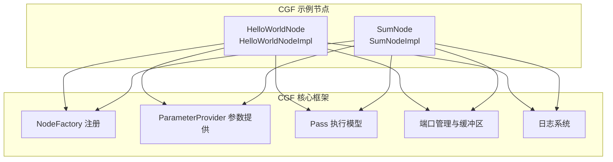
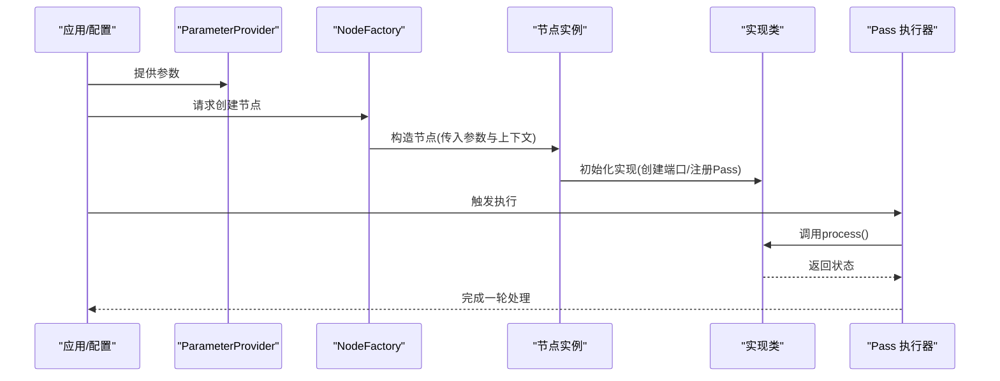
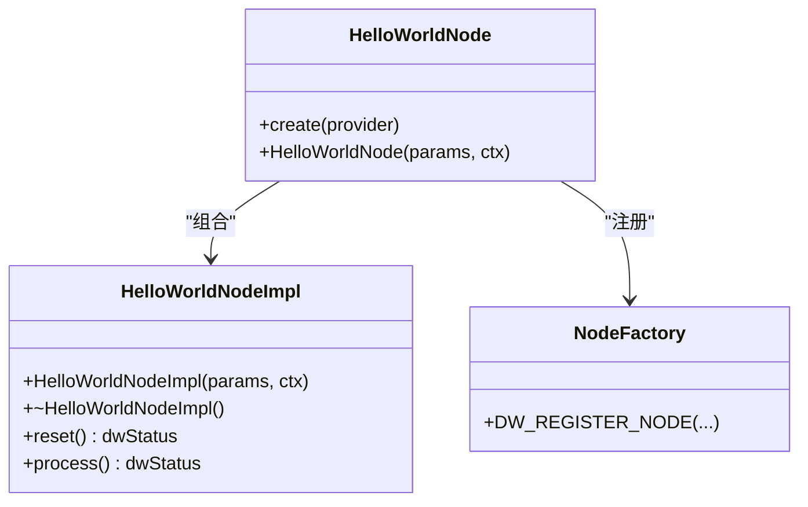
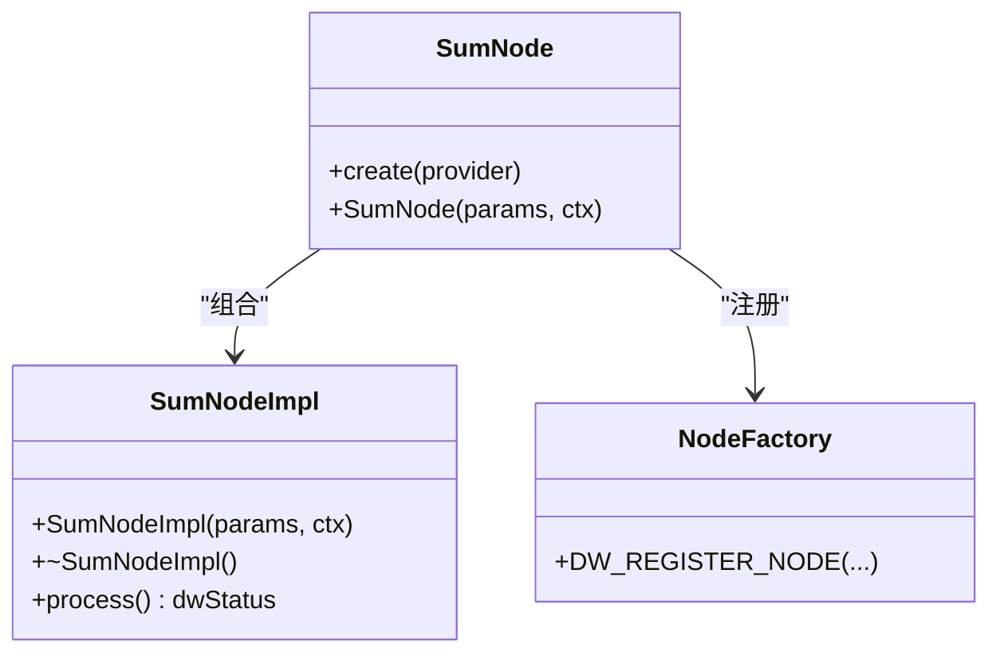
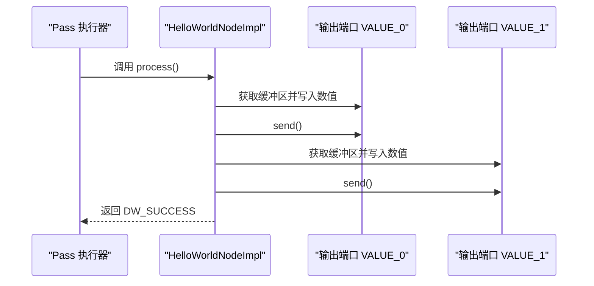
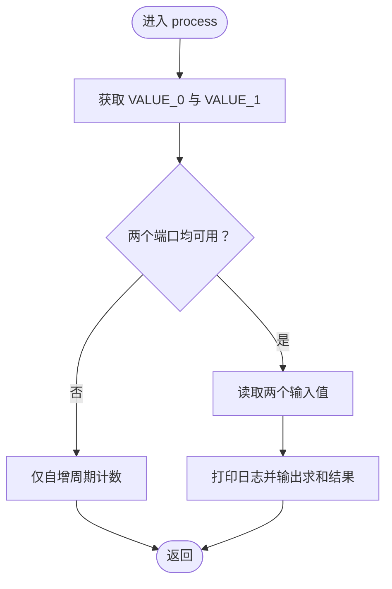
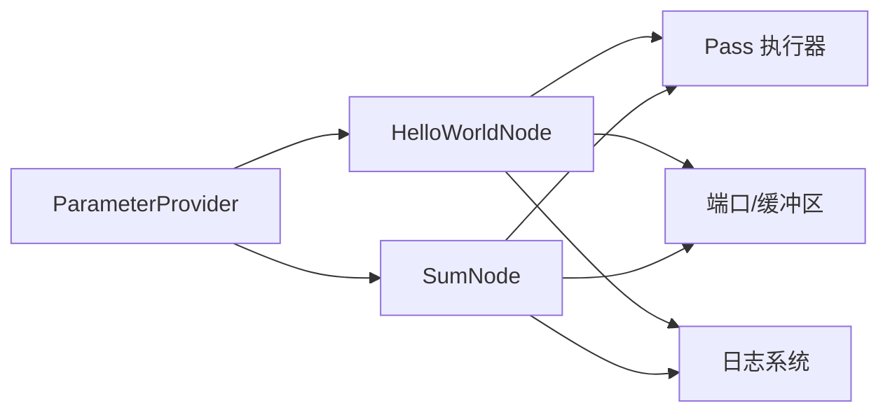

# 基础示例

<cite>
**本文引用的文件**
- [HelloWorldNode.cpp](file://driverorks-5.10/samples/src/cgf_nodes/HelloWorldNode.cpp)
- [HelloWorldNodeImpl.cpp](file://driverorks-5.10/samples/src/cgf_nodes/HelloWorldNodeImpl.cpp)
- [SumNode.cpp](file://driverorks-5.10/samples/src/cgf_nodes/SumNode.cpp)
- [SumNodeImpl.cpp](file://driverorks-5.10/samples/src/cgf_nodes/SumNodeImpl.cpp)
</cite>

## 目录
1. [简介](#简介)
2. [项目结构](#项目结构)
3. [核心组件](#核心组件)
4. [架构总览](#架构总览)
5. [详细组件分析](#详细组件分析)
6. [依赖关系分析](#依赖关系分析)
7. [性能考虑](#性能考虑)
8. [故障排查指南](#故障排查指南)
9. [结论](#结论)
10. [附录](#附录)

## 简介
本章节面向初学者，系统讲解 DriveWorks CGF（Computer Graphics Framework）中的两个基础示例：HelloWorldNode 和 SumNode。我们将从节点声明、实现类设计、参数配置、通道连接与数据处理流程入手，逐步拆解这两个示例的完整实现思路，并给出编译与运行步骤指引，帮助开发者快速掌握 CGF 节点开发的基本模式。

## 项目结构
本次文档聚焦于 samples/src/cgf_nodes 目录下的示例节点实现，包含以下关键文件：
- HelloWorldNode.cpp / HelloWorldNodeImpl.cpp：输出数值并打印问候信息的示例节点
- SumNode.cpp / SumNodeImpl.cpp：接收两个输入并进行求和计算的示例节点

图表来源
- [HelloWorldNode.cpp:41-57](file://driverorks-5.10/samples/src/cgf_nodes/HelloWorldNode.cpp#L41-L57)
- [HelloWorldNodeImpl.cpp:41-55](file://driverorks-5.10/samples/src/cgf_nodes/HelloWorldNodeImpl.cpp#L41-L55)
- [SumNode.cpp:41-57](file://driverorks-5.10/samples/src/cgf_nodes/SumNode.cpp#L41-L57)
- [SumNodeImpl.cpp:41-55](file://driverorks-5.10/samples/src/cgf_nodes/SumNodeImpl.cpp#L41-L55)

章节来源
- [HelloWorldNode.cpp:1-58](file://driverorks-5.10/samples/src/cgf_nodes/HelloWorldNode.cpp#L1-L58)
- [HelloWorldNodeImpl.cpp:1-91](file://driverorks-5.10/samples/src/cgf_nodes/HelloWorldNodeImpl.cpp#L1-L91)
- [SumNode.cpp:1-58](file://driverorks-5.10/samples/src/cgf_nodes/SumNode.cpp#L1-L58)
- [SumNodeImpl.cpp:1-84](file://driverorks-5.10/samples/src/cgf_nodes/SumNodeImpl.cpp#L1-L84)

## 核心组件
- HelloWorldNode：对外暴露的节点类，负责通过工厂创建内部实现对象，并完成节点注册。
- HelloWorldNodeImpl：实际处理逻辑的实现类，定义输出端口、Pass 流程与数据发送。
- SumNode：对外暴露的节点类，负责通过工厂创建内部实现对象，并完成节点注册。
- SumNodeImpl：实际处理逻辑的实现类，定义输入端口、Pass 流程与数据读取。

章节来源
- [HelloWorldNode.cpp:41-57](file://driverorks-5.10/samples/src/cgf_nodes/HelloWorldNode.cpp#L41-L57)
- [HelloWorldNodeImpl.cpp:41-87](file://driverorks-5.10/samples/src/cgf_nodes/HelloWorldNodeImpl.cpp#L41-L87)
- [SumNode.cpp:41-57](file://driverorks-5.10/samples/src/cgf_nodes/SumNode.cpp#L41-L57)
- [SumNodeImpl.cpp:41-80](file://driverorks-5.10/samples/src/cgf_nodes/SumNodeImpl.cpp#L41-L80)

## 架构总览
下图展示了两个示例节点在 CGF 中的典型调用链：参数提供者 -> 节点工厂 -> 节点构造 -> Pass 注册 -> 运行时执行。

图表来源
- [HelloWorldNode.cpp:41-57](file://driverorks-5.10/samples/src/cgf_nodes/HelloWorldNode.cpp#L41-L57)
- [HelloWorldNodeImpl.cpp:41-55](file://driverorks-5.10/samples/src/cgf_nodes/HelloWorldNodeImpl.cpp#L41-L55)
- [SumNode.cpp:41-57](file://driverorks-5.10/samples/src/cgf_nodes/SumNode.cpp#L41-L57)
- [SumNodeImpl.cpp:41-55](file://driverorks-5.10/samples/src/cgf_nodes/SumNodeImpl.cpp#L41-L55)

## 详细组件分析

### HelloWorldNode 组件分析
- 节点声明与工厂创建
  - 通过 create 静态方法由参数提供者驱动创建节点实例。
  - 在构造函数中将实现类以异常安全的方式委托给基类管理生命周期。
  - 使用节点工厂注册宏完成节点注册，便于运行时发现与加载。
- 实现类设计
  - 输出端口初始化：声明两个输出端口 VALUE_0 与 VALUE_1。
  - Pass 注册：注册名为 PROCESS 的 Pass，回调指向实现类的 process 方法。
  - 处理逻辑：在每次执行周期内，向两个输出端口写入递增/递减的数值并发送；同时记录日志。
  - 重置行为：在 reset 中初始化两个端口的初始值。
- 日志与调试
  - 使用统一的日志标签与日志流输出运行信息，便于定位问题。

图表来源
- [HelloWorldNode.cpp:41-57](file://driverorks-5.10/samples/src/cgf_nodes/HelloWorldNode.cpp#L41-L57)
- [HelloWorldNodeImpl.cpp:41-87](file://driverorks-5.10/samples/src/cgf_nodes/HelloWorldNodeImpl.cpp#L41-L87)

章节来源
- [HelloWorldNode.cpp:41-57](file://driverorks-5.10/samples/src/cgf_nodes/HelloWorldNode.cpp#L41-L57)
- [HelloWorldNodeImpl.cpp:41-87](file://driverorks-5.10/samples/src/cgf_nodes/HelloWorldNodeImpl.cpp#L41-L87)

### SumNode 组件分析
- 节点声明与工厂创建
  - 同样通过 create 方法由参数提供者驱动创建节点实例。
  - 构造函数委托实现类，并完成节点注册。
- 实现类设计
  - 输入端口初始化：声明两个输入端口 VALUE_0 与 VALUE_1。
  - Pass 注册：注册 PROCESS Pass，回调指向实现类的 process 方法。
  - 处理逻辑：在每次执行周期内，检查两个输入端口是否有可用缓冲区，若有则读取数值并打印求和结果；随后自增周期计数。
- 日志与调试
  - 使用统一的日志标签与日志流输出运行信息，便于定位问题。

图表来源
- [SumNode.cpp:41-57](file://driverorks-5.10/samples/src/cgf_nodes/SumNode.cpp#L41-L57)
- [SumNodeImpl.cpp:41-80](file://driverorks-5.10/samples/src/cgf_nodes/SumNodeImpl.cpp#L41-L80)

章节来源
- [SumNode.cpp:41-57](file://driverorks-5.10/samples/src/cgf_nodes/SumNode.cpp#L41-L57)
- [SumNodeImpl.cpp:41-80](file://driverorks-5.10/samples/src/cgf_nodes/SumNodeImpl.cpp#L41-L80)

### 数据处理流程（序列图）
下面以 HelloWorldNode 为例，展示一次典型的处理流程：端口可用性检查、写入缓冲区、发送数据与日志输出。

图表来源
- [HelloWorldNodeImpl.cpp:71-87](file://driverorks-5.10/samples/src/cgf_nodes/HelloWorldNodeImpl.cpp#L71-L87)

章节来源
- [HelloWorldNodeImpl.cpp:71-87](file://driverorks-5.10/samples/src/cgf_nodes/HelloWorldNodeImpl.cpp#L71-L87)

### 端口可用性判断（流程图）
SumNode 的处理逻辑包含对输入端口可用性的判断，避免在无数据时进行无效操作。

图表来源
- [SumNodeImpl.cpp:64-80](file://driverorks-5.10/samples/src/cgf_nodes/SumNodeImpl.cpp#L64-L80)

章节来源
- [SumNodeImpl.cpp:64-80](file://driverorks-5.10/samples/src/cgf_nodes/SumNodeImpl.cpp#L64-L80)

## 依赖关系分析
- HelloWorldNode 与 SumNode 共同依赖：
  - 参数提供者：用于从配置中解析节点参数。
  - 节点工厂：用于节点注册与实例化。
  - Pass 执行模型：用于调度节点的处理流程。
  - 端口管理与缓冲区：用于数据的输入/输出。
  - 日志系统：用于运行时输出调试信息。

图表来源
- [HelloWorldNode.cpp:34](file://driverorks-5.10/samples/src/cgf_nodes/HelloWorldNode.cpp#L34)
- [SumNode.cpp:34](file://driverorks-5.10/samples/src/cgf_nodes/SumNode.cpp#L34)
- [HelloWorldNodeImpl.cpp:41-55](file://driverorks-5.10/samples/src/cgf_nodes/HelloWorldNodeImpl.cpp#L41-L55)
- [SumNodeImpl.cpp:41-55](file://driverorks-5.10/samples/src/cgf_nodes/SumNodeImpl.cpp#L41-L55)

章节来源
- [HelloWorldNode.cpp:34](file://driverorks-5.10/samples/src/cgf_nodes/HelloWorldNode.cpp#L34)
- [SumNode.cpp:34](file://driverorks-5.10/samples/src/cgf_nodes/SumNode.cpp#L34)
- [HelloWorldNodeImpl.cpp:41-55](file://driverorks-5.10/samples/src/cgf_nodes/HelloWorldNodeImpl.cpp#L41-L55)
- [SumNodeImpl.cpp:41-55](file://driverorks-5.10/samples/src/cgf_nodes/SumNodeImpl.cpp#L41-L55)

## 性能考虑
- 端口可用性检查：在处理前先检查端口是否可用，可避免不必要的内存访问与空操作。
- 缓冲区复用：尽量在节点生命周期内复用已分配的缓冲区，减少频繁分配/释放带来的开销。
- 日志级别控制：在生产环境中建议降低日志频率或切换到更低级别，以减少 I/O 对路径的影响。
- Pass 设计：将耗时逻辑放在独立的 Pass 中，便于与框架的调度机制配合，提升整体吞吐。

## 故障排查指南
- 端口未就绪
  - 现象：端口不可用导致处理逻辑跳过。
  - 排查：确认上游节点是否正确创建并发送数据；检查端口名称与类型是否一致。
- 节点未注册
  - 现象：运行时无法发现节点。
  - 排查：确认节点实现中使用了节点注册宏；检查构建产物是否包含该节点。
- 参数解析失败
  - 现象：节点构造失败或行为异常。
  - 排查：核对参数提供者的配置项与节点参数结构体字段是否匹配。
- 日志无输出
  - 现象：无法看到预期的日志。
  - 排查：确认日志级别设置与节点使用的日志标签；检查运行环境的日志输出配置。

## 结论
通过 HelloWorldNode 与 SumNode 两个示例，我们系统地学习了 CGF 节点的声明、实现、参数注入、端口管理与 Pass 执行等关键环节。这两个示例为后续更复杂的节点开发提供了清晰的模板与最佳实践，建议开发者在理解其工作原理后，结合自身业务场景进行扩展与优化。

## 附录
- 编译与运行步骤（通用说明）
  - 准备环境：确保已安装对应版本的 DriveWorks SDK 与构建工具链。
  - 配置工程：在工程中包含 samples/src/cgf_nodes 下的示例源文件，并链接 CGF 框架库。
  - 构建：使用 CMake 或 IDE 构建工程，生成可执行程序或动态库。
  - 运行：启动应用后，确保配置文件中已声明相应节点与通道连接关系，然后观察日志输出验证功能。
- 常见问题
  - 端口名称不一致：请严格匹配大小写与拼写。
  - 上游未发送数据：检查上游节点的端口创建与发送逻辑。
  - 节点未被发现：确认节点注册宏已生效且构建产物包含该节点。