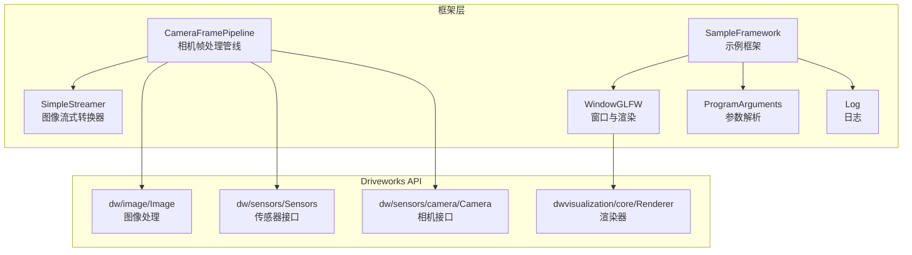
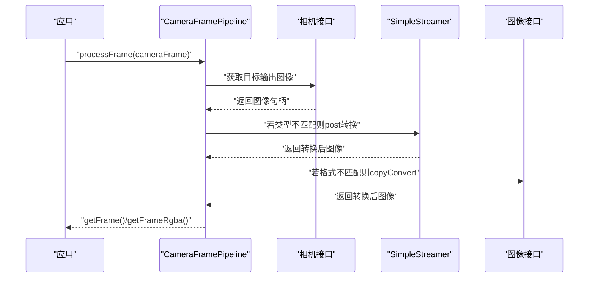
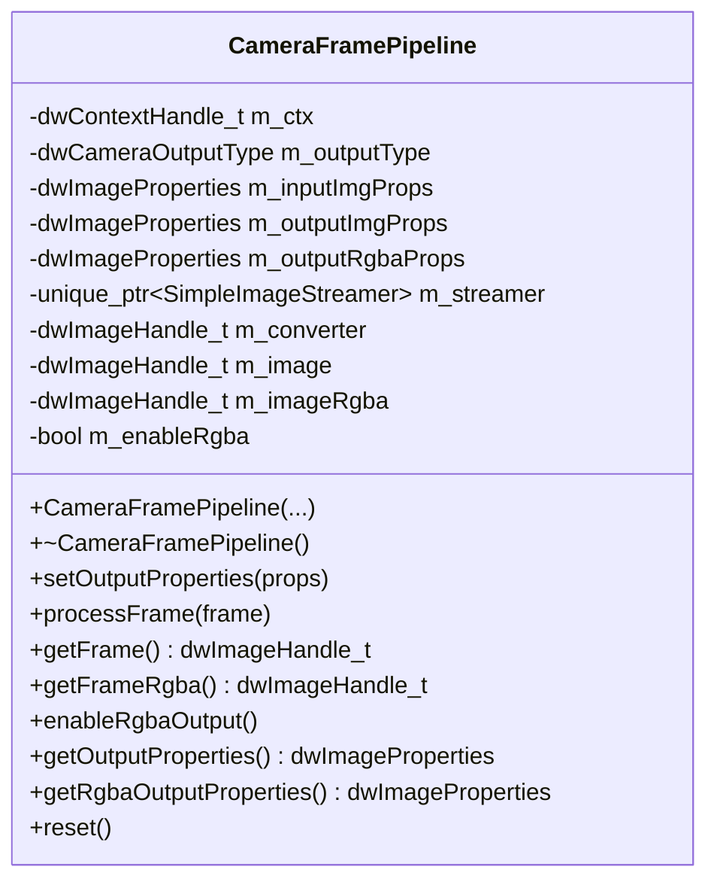
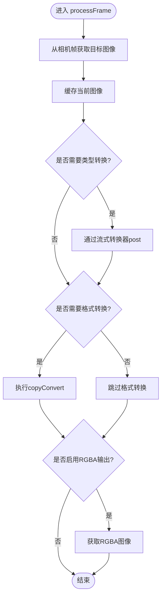
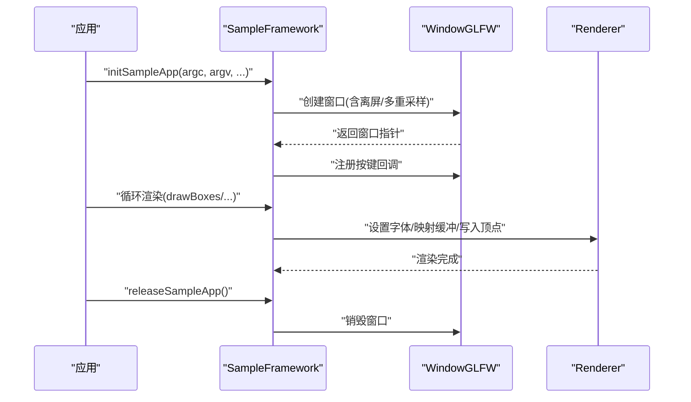
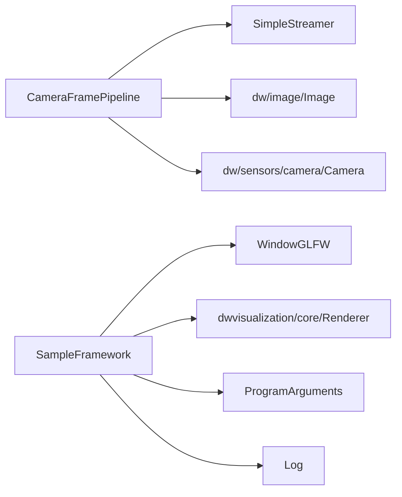

# 框架示例

<cite>
**本文引用的文件**
- [CameraFramePipeline.hpp](file://driverorks-5.10/samples/src/framework/CameraFramePipeline.hpp)
- [CameraFramePipeline.cpp](file://driverorks-5.10/samples/src/framework/CameraFramePipeline.cpp)
- [SampleFramework.hpp](file://driverorks-5.10/samples/src/framework/SampleFramework.hpp)
- [SampleFramework.cpp](file://driverorks-5.10/samples/src/framework/SampleFramework.cpp)
- [SimpleStreamer.hpp](file://driverorks-5.10/samples/src/framework/SimpleStreamer.hpp)
- [WindowGLFW.hpp](file://driverorks-5.10/samples/src/framework/WindowGLFW.hpp)
- [WindowGLFW.cpp](file://driverorks-5.10/samples/src/framework/WindowGLFW.cpp)
- [ProgramArguments.hpp](file://driverorks-5.10/samples/src/framework/ProgramArguments.hpp)
- [ProgramArguments.cpp](file://driverorks-5.10/samples/src/framework/ProgramArguments.cpp)
- [Log.hpp](file://driverorks-5.10/samples/src/framework/Log.hpp)
- [Log.cpp](file://driverorks-5.10/samples/src/framework/Log.cpp)
- [README.md](file://README.md)
</cite>

## 目录
1. [简介](#简介)
2. [项目结构](#项目结构)
3. [核心组件](#核心组件)
4. [架构总览](#架构总览)
5. [详细组件分析](#详细组件分析)
6. [依赖分析](#依赖分析)
7. [性能考虑](#性能考虑)
8. [故障排查指南](#故障排查指南)
9. [结论](#结论)
10. [附录](#附录)

## 简介
本文件围绕 Driveworks 5.x 示例框架中的 CameraFramePipeline 复杂数据流处理与 SampleFramework 基础框架组件展开，系统性讲解多相机数据同步、图像预处理、特征提取与结果输出的完整流程；同时阐述窗口管理、渲染引擎、输入处理与性能统计等核心功能。文档以代码级分析为主，辅以可视化图示，帮助读者快速掌握如何构建复杂的多节点数据处理管道，包括节点间的依赖关系、同步机制与资源管理，并提供性能优化建议与最佳实践。

## 项目结构
本仓库聚焦于 Driveworks 5.x 版本（5.8/5.10/5.14/520）samples 中的 framework 子模块，核心文件组织如下：
- framework 层：CameraFramePipeline、SampleFramework、WindowGLFW、ProgramArguments、Log、SimpleStreamer 等
- 核心依赖：Driveworks 图像、传感器、渲染与日志等 API
- 文档与说明：README 对 Driveworks 5.x 的背景、CGF/STM 架构与版本演进有概述

图表来源
- [CameraFramePipeline.hpp:62-111](file://driverorks-5.10/samples/src/framework/CameraFramePipeline.hpp#L62-L111)
- [SampleFramework.hpp:49-99](file://driverorks-5.10/samples/src/framework/SampleFramework.hpp#L49-L99)
- [WindowGLFW.hpp](file://driverorks-5.10/samples/src/framework/WindowGLFW.hpp)
- [ProgramArguments.hpp](file://driverorks-5.10/samples/src/framework/ProgramArguments.hpp)
- [Log.hpp](file://driverorks-5.10/samples/src/framework/Log.hpp)

章节来源
- [README.md:1-115](file://README.md#L1-L115)

## 核心组件
- CameraFramePipeline：封装相机帧采集、格式转换、OpenGL 输出与 RGBA 后处理的完整流程，支持按需启用流式转换与 CUDA/RGBA 输出。
- SampleFramework：提供窗口初始化、事件回调、渲染辅助函数与资源释放，统一示例应用的生命周期管理。
- WindowGLFW：抽象窗口与上下文管理，支持离屏渲染与多重采样。
- ProgramArguments：命令行参数解析与打印。
- Log：统一的日志记录接口。
- SimpleStreamer：图像类型/格式的流式转换器，用于在输入与输出属性不匹配时进行桥接。

章节来源
- [CameraFramePipeline.hpp:62-111](file://driverorks-5.10/samples/src/framework/CameraFramePipeline.hpp#L62-L111)
- [SampleFramework.hpp:49-99](file://driverorks-5.10/samples/src/framework/SampleFramework.hpp#L49-L99)
- [WindowGLFW.hpp](file://driverorks-5.10/samples/src/framework/WindowGLFW.hpp)
- [ProgramArguments.hpp](file://driverorks-5.10/samples/src/framework/ProgramArguments.hpp)
- [Log.hpp](file://driverorks-5.10/samples/src/framework/Log.hpp)
- [SimpleStreamer.hpp](file://driverorks-5.10/samples/src/framework/SimpleStreamer.hpp)

## 架构总览
下图展示了 CameraFramePipeline 在一次帧处理中的数据流与调用序列，以及与 Driveworks API 的交互关系。

图表来源
- [CameraFramePipeline.cpp:106-137](file://driverorks-5.10/samples/src/framework/CameraFramePipeline.cpp#L106-L137)
- [CameraFramePipeline.hpp:75-81](file://driverorks-5.10/samples/src/framework/CameraFramePipeline.hpp#L75-L81)

## 详细组件分析

### CameraFramePipeline 组件分析
- 设计要点
  - 以输入图像属性为基准，动态决定是否启用流式转换器与格式转换器。
  - 支持 RGBA 输出开关，便于后续 OpenGL 渲染或显示。
  - 提供重置接口，释放内部资源。
- 关键接口
  - 构造与析构：保存上下文、输出类型与输入属性。
  - setOutputProperties：根据期望输出属性配置转换器与流式转换器。
  - processFrame：从相机帧提取目标图像，按需进行类型/格式转换，并可选生成 RGBA 输出。
  - getFrame/getFrameRgba：获取处理后的图像句柄。
  - enableRgbaOutput：设置 RGBA 输出属性与类型。
  - reset：释放流式转换器资源。
- 错误处理
  - 使用 CHECK_DW_ERROR 与 dwGetStatusName 记录转换失败原因。
  - RGBA 未启用时访问 getFrameRgba 将触发告警日志。

图表来源
- [CameraFramePipeline.hpp:62-111](file://driverorks-5.10/samples/src/framework/CameraFramePipeline.hpp#L62-L111)

图表来源
- [CameraFramePipeline.cpp:106-137](file://driverorks-5.10/samples/src/framework/CameraFramePipeline.cpp#L106-L137)

章节来源
- [CameraFramePipeline.hpp:62-111](file://driverorks-5.10/samples/src/framework/CameraFramePipeline.hpp#L62-L111)
- [CameraFramePipeline.cpp:44-145](file://driverorks-5.10/samples/src/framework/CameraFramePipeline.cpp#L44-L145)

### SampleFramework 组件分析
- 功能职责
  - 初始化与退出：注册信号处理器、解析参数、创建窗口并设置键盘回调。
  - 渲染辅助：提供绘制框与带标签框的工具函数，支持文本渲染与顶点映射。
  - 生命周期：提供 initSampleApp/releaseSampleApp，统一示例应用的启动与释放。
- 输入处理
  - ESC 停止运行，空格键切换暂停状态。
  - 用户按键回调可转发至上层应用。
- 渲染辅助
  - drawBoxes：将二维边界框映射到屏幕坐标并写入渲染缓冲，随后提交渲染。
  - drawBoxesWithLabels：在 drawBoxes 基础上增加类别标签渲染。

图表来源
- [SampleFramework.cpp:236-291](file://driverorks-5.10/samples/src/framework/SampleFramework.cpp#L236-L291)
- [WindowGLFW.cpp](file://driverorks-5.10/samples/src/framework/WindowGLFW.cpp)
- [SampleFramework.hpp:71-97](file://driverorks-5.10/samples/src/framework/SampleFramework.hpp#L71-L97)

章节来源
- [SampleFramework.hpp:49-99](file://driverorks-5.10/samples/src/framework/SampleFramework.hpp#L49-L99)
- [SampleFramework.cpp:47-291](file://driverorks-5.10/samples/src/framework/SampleFramework.cpp#L47-L291)

### 辅助组件与接口
- SimpleStreamer：当输入图像类型与输出类型不一致时，用于桥接转换，避免重复拷贝与状态丢失。
- WindowGLFW：封装 GLFW 初始化、上下文管理、事件回调与离屏渲染能力。
- ProgramArguments：命令行参数解析与打印，便于调试与配置。
- Log：统一日志接口，配合 CHECK_DW_ERROR 与 dwGetStatusName 输出错误信息。

章节来源
- [SimpleStreamer.hpp](file://driverorks-5.10/samples/src/framework/SimpleStreamer.hpp)
- [WindowGLFW.hpp](file://driverorks-5.10/samples/src/framework/WindowGLFW.hpp)
- [WindowGLFW.cpp](file://driverorks-5.10/samples/src/framework/WindowGLFW.cpp)
- [ProgramArguments.hpp](file://driverorks-5.10/samples/src/framework/ProgramArguments.hpp)
- [ProgramArguments.cpp](file://driverorks-5.10/samples/src/framework/ProgramArguments.cpp)
- [Log.hpp](file://driverorks-5.10/samples/src/framework/Log.hpp)
- [Log.cpp](file://driverorks-5.10/samples/src/framework/Log.cpp)

## 依赖分析
- 组件耦合
  - CameraFramePipeline 依赖 SimpleStreamer 与 Driveworks 图像/传感器 API；对 RGBA 输出路径做了条件分支，避免不必要的计算。
  - SampleFramework 依赖 WindowGLFW 与渲染器，提供统一的输入与渲染辅助。
- 外部依赖
  - Driveworks 图像与传感器接口用于帧采集与格式转换。
  - 渲染器用于绘制标注框与文本。
- 可能的循环依赖
  - 当前各组件以单向依赖为主，未发现明显循环依赖。

图表来源
- [CameraFramePipeline.hpp:35-49](file://driverorks-5.10/samples/src/framework/CameraFramePipeline.hpp#L35-L49)
- [SampleFramework.hpp:49-49](file://driverorks-5.10/samples/src/framework/SampleFramework.hpp#L49-L49)

章节来源
- [CameraFramePipeline.hpp:35-49](file://driverorks-5.10/samples/src/framework/CameraFramePipeline.hpp#L35-L49)
- [SampleFramework.hpp:49-49](file://driverorks-5.10/samples/src/framework/SampleFramework.hpp#L49-L49)

## 性能考虑
- 流式转换最小化拷贝
  - 当输入类型与输出类型不一致时，优先使用 SimpleStreamer 进行类型转换，减少显存与内存之间的重复拷贝。
- 条件格式转换
  - 仅在输入格式与输出格式不一致时创建转换器，避免无谓的 GPU/CPU 转换开销。
- RGBA 输出按需启用
  - RGBA 输出通常带来额外的 GPU 内存与带宽消耗，应在需要渲染或显示时才启用。
- 渲染缓冲复用
  - drawBoxes/WithLabels 通过映射渲染缓冲写入顶点，尽量复用缓冲并限制绘制数量，避免频繁分配。
- 参数解析与日志
  - 使用 ProgramArguments 打印参数，有助于快速定位配置问题；日志接口用于及时暴露错误与警告。

## 故障排查指南
- 图像转换失败
  - 现象：processFrame 中 copyConvert 返回非成功状态。
  - 排查：检查 setOutputProperties 是否正确设置输出属性；确认输入图像属性与目标格式兼容。
- RGBA 输出为空
  - 现象：调用 getFrameRgba 返回空句柄或告警日志。
  - 排查：确认已调用 enableRgbaOutput；检查相机输出是否支持 RGBA 类型。
- 渲染异常
  - 现象：drawBoxes/WithLabels 未显示或显示异常。
  - 排查：确认渲染缓冲初始化参数（顶点格式、语义）与函数约定一致；检查屏幕尺寸与归一化参数。
- 应用退出与暂停
  - 现象：无法通过 ESC 停止或空格键暂停。
  - 排查：确认 initSampleApp 已注册按键回调；检查信号处理与事件循环逻辑。

章节来源
- [CameraFramePipeline.cpp:117-125](file://driverorks-5.10/samples/src/framework/CameraFramePipeline.cpp#L117-L125)
- [SampleFramework.cpp:54-69](file://driverorks-5.10/samples/src/framework/SampleFramework.cpp#L54-L69)
- [SampleFramework.cpp:71-155](file://driverorks-5.10/samples/src/framework/SampleFramework.cpp#L71-L155)

## 结论
CameraFramePipeline 与 SampleFramework 共同构成了 Driveworks 5.x 示例框架中的核心数据流与基础设施。前者专注于相机帧的采集、转换与输出，后者提供窗口、输入与渲染的统一入口。通过合理使用流式转换器与条件转换策略，可在保证功能完整性的同时显著降低性能开销。结合参数解析与日志系统，能够快速定位问题并优化配置。

## 附录
- 版本与架构背景
  - README 对 Driveworks 5.x 的 CGF/STM 架构与版本演进进行了概述，有助于理解框架定位与迁移方向。

章节来源
- [README.md:22-62](file://README.md#L22-L62)