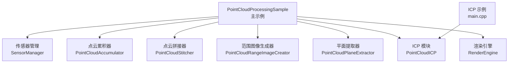
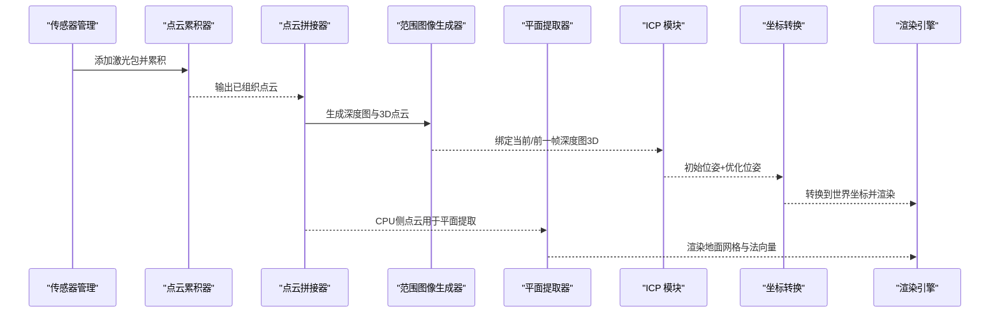
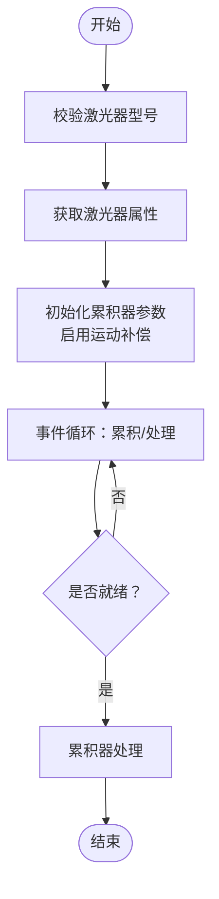
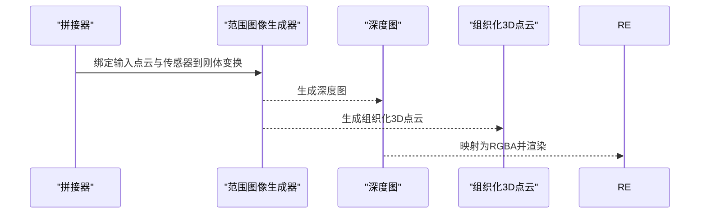
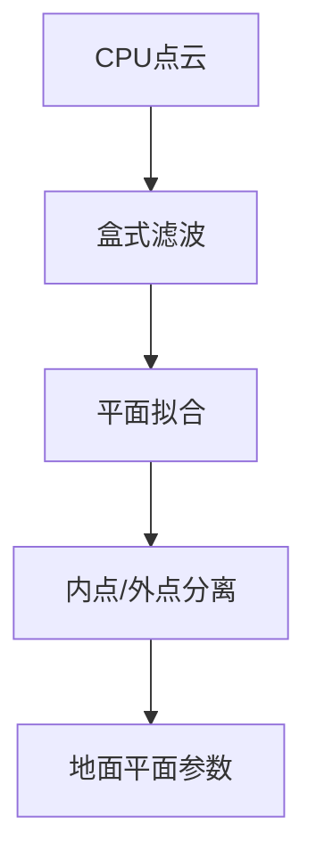
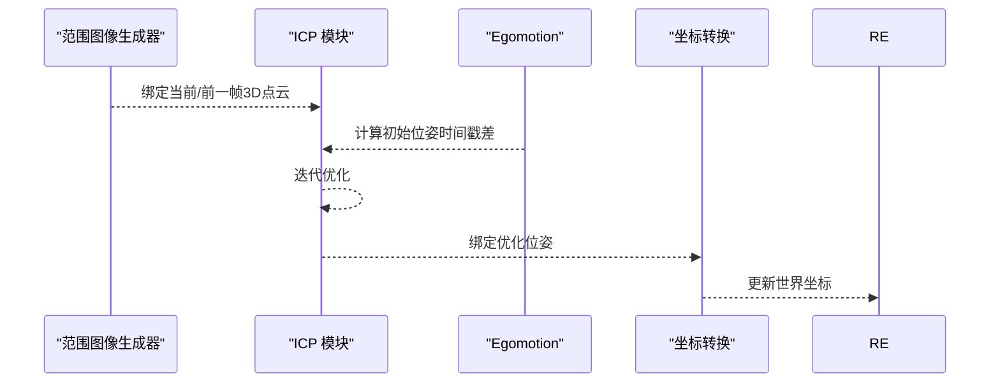
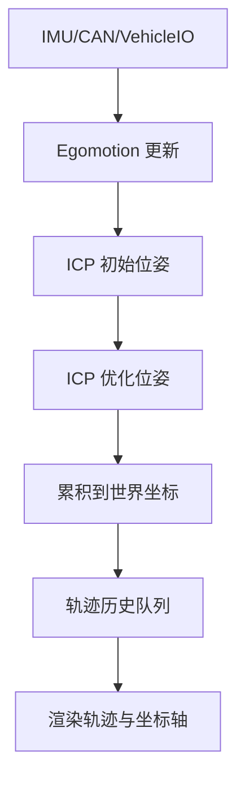
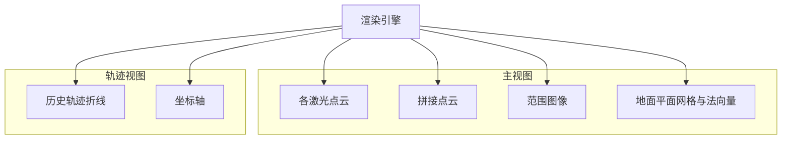
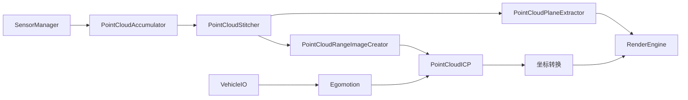

# 点云处理示例

<cite>
**本文档引用的文件**
- [PointCloudProcessingSample.cpp](file://driverorks-5.10/samples/src/pointcloudprocessing/PointCloudProcessingSample.cpp)
- [PointCloudProcessingSample.hpp](file://driverorks-5.10/samples/src/pointcloudprocessing/PointCloudProcessingSample.hpp)
- [PointCloudProcessingCommonTypes.hpp](file://driverorks-5.10/include/dwframework/dwnodes/common/PointCloudProcessingCommonTypes.hpp)
- [PointCloudICP.h](file://driverorks-5.10/include/dw/pointcloudprocessing/icp/PointCloudICP.h)
- [main.cpp（ICP示例）](file://driverorks-5.10/samples/src/icp/main.cpp)
- [README.md（ICP示例）](file://driverorks-5.10/samples/src/icp/README.md)
</cite>

## 目录
1. [简介](#简介)
2. [项目结构](#项目结构)
3. [核心组件](#核心组件)
4. [架构总览](#架构总览)
5. [详细组件分析](#详细组件分析)
6. [依赖关系分析](#依赖关系分析)
7. [性能考虑](#性能考虑)
8. [故障排查指南](#故障排查指南)
9. [结论](#结论)
10. [附录](#附录)

## 简介
本文件系统性解析 DriveWorks 代码库中的点云处理示例，围绕以下目标展开：
- 深入讲解 PointCloudProcessingSample 的实现：点云加载、滤波、分割与特征提取、ICP 配准、姿态估计、运动估计与轨迹重建、点云拼接与地图构建、可视化与交互。
- 对比分析 ICP 示例与主示例在流程上的异同，突出迭代最近点算法在不同场景下的应用。
- 提供性能优化建议与大数据集处理策略，帮助开发者高效处理高密度点云数据。

## 项目结构
该示例位于 samples/src/pointcloudprocessing 与 samples/src/icp 目录中，分别演示了完整的点云处理管线与 ICP 单模块使用方式。关键文件如下：
- 主示例：PointCloudProcessingSample.cpp/.hpp
- ICP 示例：main.cpp（含 README）
- 公共类型定义：PointCloudProcessingCommonTypes.hpp
- ICP 接口：PointCloudICP.h

图表来源
- [PointCloudProcessingSample.cpp:436-484](file://driverorks-5.10/samples/src/pointcloudprocessing/PointCloudProcessingSample.cpp#L436-L484)
- [PointCloudProcessingSample.hpp:63-257](file://driverorks-5.10/samples/src/pointcloudprocessing/PointCloudProcessingSample.hpp#L63-L257)
- [main.cpp（ICP示例）:206-332](file://driverorks-5.10/samples/src/icp/main.cpp#L206-L332)

章节来源
- [PointCloudProcessingSample.cpp:436-484](file://driverorks-5.10/samples/src/pointcloudprocessing/PointCloudProcessingSample.cpp#L436-L484)
- [PointCloudProcessingSample.hpp:63-257](file://driverorks-5.10/samples/src/pointcloudprocessing/PointCloudProcessingSample.hpp#L63-L257)
- [main.cpp（ICP示例）:206-332](file://driverorks-5.10/samples/src/icp/main.cpp#L206-L332)

## 核心组件
- 传感器与平台初始化：车辆配置、传感器管理、Egomotion（全局运动估计）、VehicleIO（CAN/安全状态）。
- 点云缓冲区与内存管理：GPU/CPU 双缓冲，容量规划与格式统一（XYZI）。
- 累积与拼接：多激光雷达累积、运动补偿、坐标系对齐与组织化输出。
- 范围图像与深度图：将点云映射为深度图，用于 ICP 输入与可视化。
- 平面分割与特征提取：地面平面提取，辅助导航与避障。
- ICP 配准：深度图 ICP，姿态估计与轨迹更新。
- 可视化：多视图渲染（主视图/轨迹视图）、范围图像叠加、坐标轴与法向量标注。

章节来源
- [PointCloudProcessingSample.cpp:115-167](file://driverorks-5.10/samples/src/pointcloudprocessing/PointCloudProcessingSample.cpp#L115-L167)
- [PointCloudProcessingSample.cpp:169-212](file://driverorks-5.10/samples/src/pointcloudprocessing/PointCloudProcessingSample.cpp#L169-L212)
- [PointCloudProcessingSample.cpp:214-278](file://driverorks-5.10/samples/src/pointcloudprocessing/PointCloudProcessingSample.cpp#L214-L278)
- [PointCloudProcessingSample.cpp:280-294](file://driverorks-5.10/samples/src/pointcloudprocessing/PointCloudProcessingSample.cpp#L280-L294)
- [PointCloudProcessingSample.cpp:296-313](file://driverorks-5.10/samples/src/pointcloudprocessing/PointCloudProcessingSample.cpp#L296-L313)
- [PointCloudProcessingSample.cpp:385-401](file://driverorks-5.10/samples/src/pointcloudprocessing/PointCloudProcessingSample.cpp#L385-L401)

## 架构总览
下图展示了主示例从传感器事件到最终渲染的关键路径与模块交互：

图表来源
- [PointCloudProcessingSample.cpp:587-703](file://driverorks-5.10/samples/src/pointcloudprocessing/PointCloudProcessingSample.cpp#L587-L703)
- [PointCloudProcessingSample.cpp:727-769](file://driverorks-5.10/samples/src/pointcloudprocessing/PointCloudProcessingSample.cpp#L727-L769)
- [PointCloudProcessingSample.cpp:836-836](file://driverorks-5.10/samples/src/pointcloudprocessing/PointCloudProcessingSample.cpp#L836-L836)

## 详细组件分析

### 点云加载与累积
- 设备类型校验：仅支持特定 Velodyne 型号。
- 多激光雷达管理：统计数量、索引与句柄，获取设备属性（每圈点数、包数）。
- 累积参数：禁用组织化输出、启用运动补偿、绑定 Egomotion 与传感器到刚体变换。
- 流水线：事件循环按传感器类型分发，累积完成后触发处理。

图表来源
- [PointCloudProcessingSample.cpp:39-47](file://driverorks-5.10/samples/src/pointcloudprocessing/PointCloudProcessingSample.cpp#L39-L47)
- [PointCloudProcessingSample.cpp:75-113](file://driverorks-5.10/samples/src/pointcloudprocessing/PointCloudProcessingSample.cpp#L75-L113)
- [PointCloudProcessingSample.cpp:169-186](file://driverorks-5.10/samples/src/pointcloudprocessing/PointCloudProcessingSample.cpp#L169-L186)
- [PointCloudProcessingSample.cpp:587-703](file://driverorks-5.10/samples/src/pointcloudprocessing/PointCloudProcessingSample.cpp#L587-L703)

章节来源
- [PointCloudProcessingSample.cpp:39-47](file://driverorks-5.10/samples/src/pointcloudprocessing/PointCloudProcessingSample.cpp#L39-L47)
- [PointCloudProcessingSample.cpp:75-113](file://driverorks-5.10/samples/src/pointcloudprocessing/PointCloudProcessingSample.cpp#L75-L113)
- [PointCloudProcessingSample.cpp:169-186](file://driverorks-5.10/samples/src/pointcloudprocessing/PointCloudProcessingSample.cpp#L169-L186)
- [PointCloudProcessingSample.cpp:587-703](file://driverorks-5.10/samples/src/pointcloudprocessing/PointCloudProcessingSample.cpp#L587-L703)

### 点云拼接与范围图像
- 拼接器绑定多个输入点云与对应传感器到刚体变换，输出统一坐标系下的点云。
- 范围图像生成：限制高度/宽度、裁剪参数、包围盒；生成深度图与对应的组织化3D点云。
- 图像映射：将深度图映射为 RGBA 以供 OpenGL 渲染。

图表来源
- [PointCloudProcessingSample.cpp:189-212](file://driverorks-5.10/samples/src/pointcloudprocessing/PointCloudProcessingSample.cpp#L189-L212)
- [PointCloudProcessingSample.cpp:214-278](file://driverorks-5.10/samples/src/pointcloudprocessing/PointCloudProcessingSample.cpp#L214-L278)

章节来源
- [PointCloudProcessingSample.cpp:189-212](file://driverorks-5.10/samples/src/pointcloudprocessing/PointCloudProcessingSample.cpp#L189-L212)
- [PointCloudProcessingSample.cpp:214-278](file://driverorks-5.10/samples/src/pointcloudprocessing/PointCloudProcessingSample.cpp#L214-L278)

### 平面分割与特征提取
- 参数设置：最大输入点数、最小内点比例、盒式滤波器半轴尺寸。
- 输入/输出绑定：CPU侧点云作为输入，内/外点与地面平面作为输出。
- 运行：在每个循环中执行平面提取，用于导航与可视化。

图表来源
- [PointCloudProcessingSample.cpp:280-294](file://driverorks-5.10/samples/src/pointcloudprocessing/PointCloudProcessingSample.cpp#L280-L294)

章节来源
- [PointCloudProcessingSample.cpp:280-294](file://driverorks-5.10/samples/src/pointcloudprocessing/PointCloudProcessingSample.cpp#L280-L294)

### ICP 算法与姿态估计
- ICP 初始化：选择深度图模式，设置深度图尺寸、最大点数、最大迭代次数。
- 输入/输出绑定：源/目标组织化3D点云与初始位姿，输出优化位姿。
- 姿态融合：若 ICP 成功则采用优化位姿，否则回退到初始位姿；随后进行旋转矩阵归一化。
- 与 Egomotion 协同：以两帧时间戳差计算初始位姿，作为先验约束。

图表来源
- [PointCloudProcessingSample.cpp:296-313](file://driverorks-5.10/samples/src/pointcloudprocessing/PointCloudProcessingSample.cpp#L296-L313)
- [PointCloudProcessingSample.cpp:727-769](file://driverorks-5.10/samples/src/pointcloudprocessing/PointCloudProcessingSample.cpp#L727-L769)

章节来源
- [PointCloudProcessingSample.cpp:296-313](file://driverorks-5.10/samples/src/pointcloudprocessing/PointCloudProcessingSample.cpp#L296-L313)
- [PointCloudProcessingSample.cpp:727-769](file://driverorks-5.10/samples/src/pointcloudprocessing/PointCloudProcessingSample.cpp#L727-L769)

### 运动估计与轨迹重建
- 全局运动估计：通过 IMU/CAN/VehicleIO 获取状态，更新 Egomotion。
- 局部运动跟踪：ICP 在相邻帧间估计相对位姿。
- 轨迹重建：历史位姿存储于队列，渲染为折线轨迹并显示坐标轴。

图表来源
- [PointCloudProcessingSample.cpp:49-73](file://driverorks-5.10/samples/src/pointcloudprocessing/PointCloudProcessingSample.cpp#L49-L73)
- [PointCloudProcessingSample.cpp:727-769](file://driverorks-5.10/samples/src/pointcloudprocessing/PointCloudProcessingSample.cpp#L727-L769)
- [PointCloudProcessingSample.cpp:893-926](file://driverorks-5.10/samples/src/pointcloudprocessing/PointCloudProcessingSample.cpp#L893-L926)

章节来源
- [PointCloudProcessingSample.cpp:49-73](file://driverorks-5.10/samples/src/pointcloudprocessing/PointCloudProcessingSample.cpp#L49-L73)
- [PointCloudProcessingSample.cpp:727-769](file://driverorks-5.10/samples/src/pointcloudprocessing/PointCloudProcessingSample.cpp#L727-L769)
- [PointCloudProcessingSample.cpp:893-926](file://driverorks-5.10/samples/src/pointcloudprocessing/PointCloudProcessingSample.cpp#L893-L926)

### 可视化与交互
- 多视图渲染：主视图（各激光点云与拼接结果）、轨迹视图（历史轨迹与坐标轴）、范围图像。
- 文本与标注：FPS、迭代次数、范围图像标题、地面法向量箭头。
- 交互控制：左右方向键切换视图；鼠标控制相机。

图表来源
- [PointCloudProcessingSample.cpp:782-836](file://driverorks-5.10/samples/src/pointcloudprocessing/PointCloudProcessingSample.cpp#L782-L836)
- [PointCloudProcessingSample.cpp:893-926](file://driverorks-5.10/samples/src/pointcloudprocessing/PointCloudProcessingSample.cpp#L893-L926)
- [PointCloudProcessingSample.cpp:950-990](file://driverorks-5.10/samples/src/pointcloudprocessing/PointCloudProcessingSample.cpp#L950-L990)

章节来源
- [PointCloudProcessingSample.cpp:782-836](file://driverorks-5.10/samples/src/pointcloudprocessing/PointCloudProcessingSample.cpp#L782-L836)
- [PointCloudProcessingSample.cpp:893-926](file://driverorks-5.10/samples/src/pointcloudprocessing/PointCloudProcessingSample.cpp#L893-L926)
- [PointCloudProcessingSample.cpp:950-990](file://driverorks-5.10/samples/src/pointcloudprocessing/PointCloudProcessingSample.cpp#L950-L990)

### ICP 示例对比分析
- ICP 示例专注于单激光器连续自旋的配准，使用深度图 ICP，强调迭代收敛统计与轨迹累积。
- 主示例在 ICP 基础上增加了多激光器拼接、范围图像生成、平面分割与复杂渲染管线。

章节来源
- [main.cpp（ICP示例）:206-332](file://driverorks-5.10/samples/src/icp/main.cpp#L206-L332)
- [README.md（ICP示例）:7-68](file://driverorks-5.10/samples/src/icp/README.md#L7-L68)

## 依赖关系分析
- 内部模块耦合：主示例通过 SensorManager 驱动累积器，再由拼接器与范围图像生成器串联至 ICP；平面提取器独立运行于 CPU。
- 外部接口：RenderEngine、ImageStreamerGL、Egomotion、VehicleIO。
- 类型与常量：公共类型定义中包含激光位姿结构与最大拼接端口数。

图表来源
- [PointCloudProcessingSample.cpp:436-484](file://driverorks-5.10/samples/src/pointcloudprocessing/PointCloudProcessingSample.cpp#L436-L484)
- [PointCloudProcessingCommonTypes.hpp:41-46](file://driverorks-5.10/include/dwframework/dwnodes/common/PointCloudProcessingCommonTypes.hpp#L41-L46)

章节来源
- [PointCloudProcessingSample.cpp:436-484](file://driverorks-5.10/samples/src/pointcloudprocessing/PointCloudProcessingSample.cpp#L436-L484)
- [PointCloudProcessingCommonTypes.hpp:41-46](file://driverorks-5.10/include/dwframework/dwnodes/common/PointCloudProcessingCommonTypes.hpp#L41-L46)

## 性能考虑
- 内存与带宽
  - 使用 GPU 缓冲承载累积与拼接中间结果，减少主机内存压力。
  - 深度图尺寸受 ICP 最大深度图大小限制，需动态调整高度/宽度。
- 并行与流水线
  - 各模块均支持 CUDA 流绑定，可与主循环并行执行。
  - 累积器、拼接器、范围图像生成器与 ICP 分别绑定不同流，提升吞吐。
- 数据组织
  - 组织化点云有利于深度图映射与后续处理。
  - 平面提取在 CPU 上执行，避免 GPU 内存占用。
- ICP 收敛
  - 设置合理的角度/距离收敛阈值与最大迭代次数，平衡精度与速度。
  - 使用 Egomotion 提供的初始位姿可显著加速收敛。

章节来源
- [PointCloudProcessingSample.cpp:214-278](file://driverorks-5.10/samples/src/pointcloudprocessing/PointCloudProcessingSample.cpp#L214-L278)
- [PointCloudProcessingSample.cpp:296-313](file://driverorks-5.10/samples/src/pointcloudprocessing/PointCloudProcessingSample.cpp#L296-L313)
- [PointCloudICP.h:71-93](file://driverorks-5.10/include/dw/pointcloudprocessing/icp/PointCloudICP.h#L71-L93)

## 故障排查指南
- 设备不兼容
  - 若激光器型号不在支持列表，示例会抛出异常并终止。请确认录制设备为指定型号。
- 传感器缺失
  - 示例要求 IMU、CAN 与至少一个激光器存在，否则直接停止。
- 累积器就绪失败
  - 累积器在收集完一圈包后仍报告未就绪时，应检查包计数与点数配置。
- ICP 失败
  - ICP 返回非成功状态时记录错误码；检查深度图尺寸、输入点云质量与初始位姿。
- 渲染异常
  - 若范围图像无法显示，检查 ImageStreamerGL 的发送/接收与返回流程。

章节来源
- [PointCloudProcessingSample.cpp:39-47](file://driverorks-5.10/samples/src/pointcloudprocessing/PointCloudProcessingSample.cpp#L39-L47)
- [PointCloudProcessingSample.cpp:75-113](file://driverorks-5.10/samples/src/pointcloudprocessing/PointCloudProcessingSample.cpp#L75-L113)
- [PointCloudProcessingSample.cpp:587-703](file://driverorks-5.10/samples/src/pointcloudprocessing/PointCloudProcessingSample.cpp#L587-L703)
- [PointCloudProcessingSample.cpp:966-990](file://driverorks-5.10/samples/src/pointcloudprocessing/PointCloudProcessingSample.cpp#L966-L990)

## 结论
PointCloudProcessingSample 将 DriveWorks 的点云处理能力整合为一条完整管线：从多传感器数据采集，到点云累积、拼接、范围图像生成、平面分割、ICP 配准与轨迹重建，并通过渲染引擎提供直观的可视化反馈。结合 ICP 示例，开发者可以快速掌握从单帧配准到长时间序列建图的核心技术路径。针对高密度数据，建议优先采用 GPU 缓冲、合理组织数据与设置 ICP 收敛参数，以获得最佳性能与稳定性。

## 附录
- ICP 接口要点
  - 支持深度图模式的 ICP，参数包括最大点数、深度图尺寸、收敛阈值与最大迭代次数。
  - 提供默认参数获取、CUDA 流绑定、收敛回调与结果统计查询。

章节来源
- [PointCloudICP.h:56-93](file://driverorks-5.10/include/dw/pointcloudprocessing/icp/PointCloudICP.h#L56-L93)
- [PointCloudICP.h:125-177](file://driverorks-5.10/include/dw/pointcloudprocessing/icp/PointCloudICP.h#L125-L177)
- [PointCloudICP.h:190-218](file://driverorks-5.10/include/dw/pointcloudprocessing/icp/PointCloudICP.h#L190-L218)
- [PointCloudICP.h:230-283](file://driverorks-5.10/include/dw/pointcloudprocessing/icp/PointCloudICP.h#L230-L283)