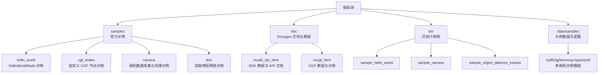
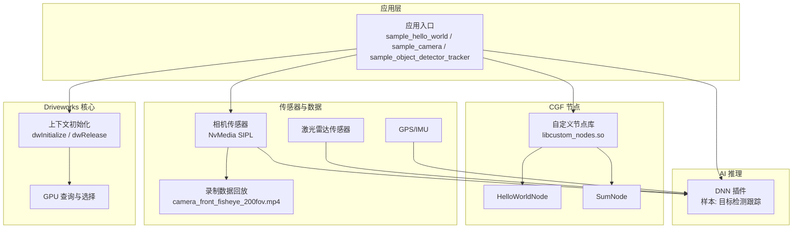
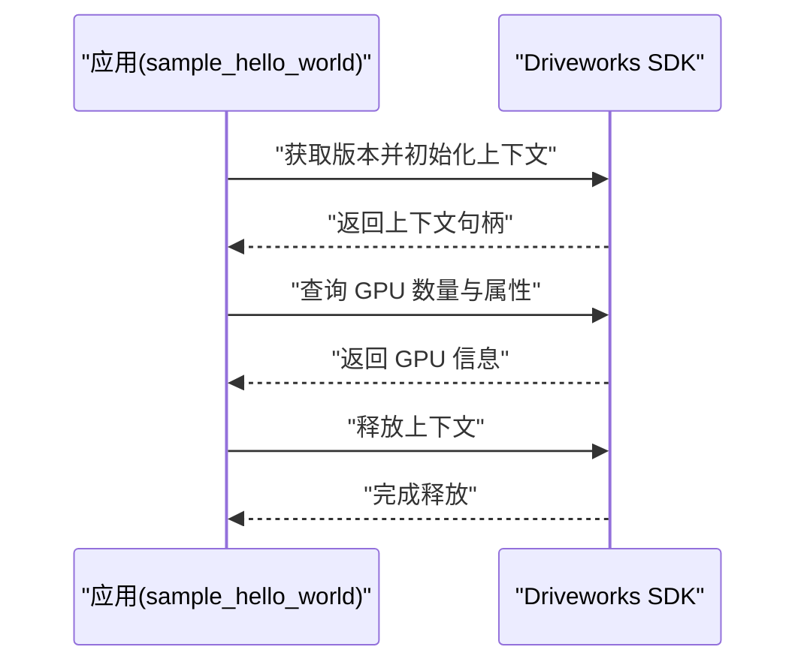
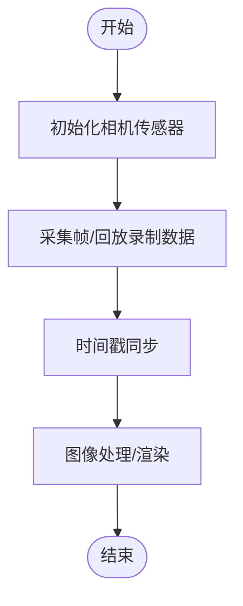
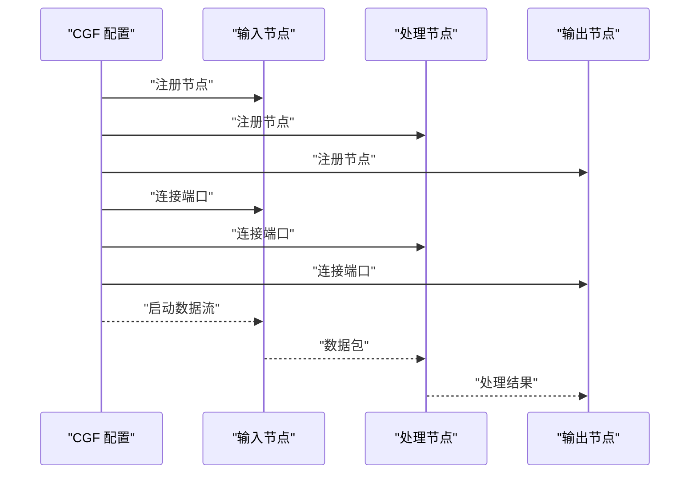
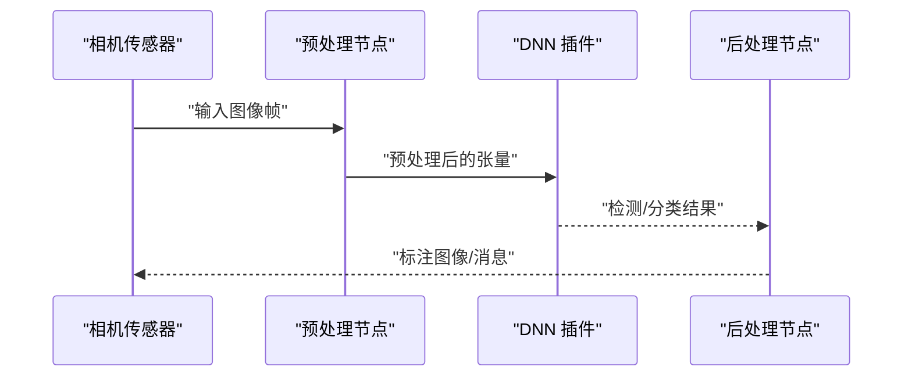
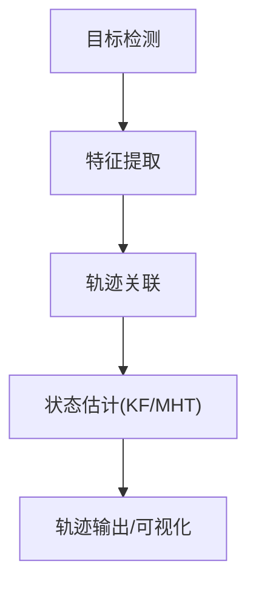
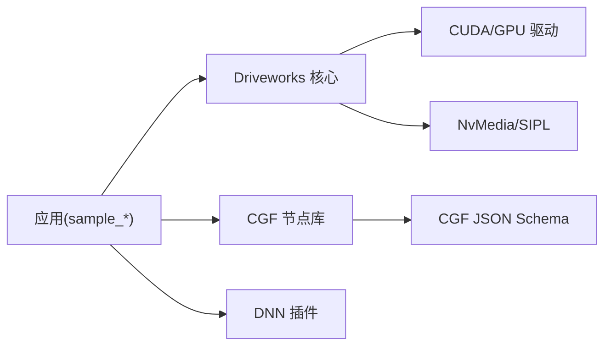

# 示例和教程

<cite>
**本文引用的文件**
- [README.md](file://README.md)
- [README_en.md](file://README_en.md)
- [driverorks-5.10/samples/src/hello_world/README.md](file://driverorks-5.10/samples/src/hello_world/README.md)
- [driverorks-5.10/doc/nvsdk_dw_html/dwx_hello_world.html](file://driverorks-5.10/doc/nvsdk_dw_html/dwx_hello_world.html)
- [driverorks-5.10/doc/nvsdk_dw_html/dwx_hello_world_sample.html](file://driverorks-5.10/doc/nvsdk_dw_html/dwx_hello_world_sample.html)
- [driverorks-5.10/doc/nvsdk_dw_html/basic_tutorials.html](file://driverorks-5.10/doc/nvsdk_dw_html/basic_tutorials.html)
- [driverorks-5.10/samples/src/cgf_nodes/README.md](file://driverorks-5.10/samples/src/cgf_nodes/README.md)
- [driverorks-5.10/doc/nvcgf_html/cgf_tutorials.html](file://driverorks-5.10/doc/nvcgf_html/cgf_tutorials.html)
- [driverorks-5.10/doc/nvcgf_html/cgf_tutorials_node.html](file://driverorks-5.10/doc/nvcgf_html/cgf_tutorials_node.html)
- [driverorks-5.10/doc/nvcgf_html/cgf_samples_camera_interprocess.html](file://driverorks-5.10/doc/nvcgf_html/cgf_samples_camera_interprocess.html)
- [driverorks-5.10/doc/nvsdk_dw_html/dwx_dnn_plugin_sample.html](file://driverorks-5.10/doc/nvsdk_dw_html/dwx_dnn_plugin_sample.html)
- [driverorks-5.10/doc/nvsdk_dw_html/dwx_object_detector_tracker_sample.html](file://driverorks-5.10/doc/nvsdk_dw_html/dwx_object_detector_tracker_sample.html)
- [driverorks-5.10/doc/nvsdk_dw_html/dnn_usecase1.html](file://driverorks-5.10/doc/nvsdk_dw_html/dnn_usecase1.html)
- [driverorks-5.10/doc/nvsdk_dw_html/dnn_usecase2.html](file://driverorks-5.10/doc/nvsdk_dw_html/dnn_usecase2.html)
- [driverorks-5.10/doc/nvsdk_dw_html/dnn_usecase3.html](file://driverorks-5.10/doc/nvsdk_dw_html/dnn_usecase3.html)
- [driverorks-5.10/bin/sample_hello_world](file://driverorks-5.10/bin/sample_hello_world)
- [driverorks-5.10/bin/sample_camera](file://driverorks-5.10/bin/sample_camera)
- [driverorks-5.10/bin/sample_object_detector_tracker](file://driverorks-5.10/bin/sample_object_detector_tracker)
- [driverorks-5.10/data/samples/cgf/trafficlightturning-hyperion8/camera_front_fisheye_200fov.mp4](file://driverorks-5.10/data/samples/cgf/trafficlightturning-hyperion8/camera_front_fisheye_200fov.mp4)
</cite>

## 目录
1. [简介](#简介)
2. [项目结构](#项目结构)
3. [核心组件](#核心组件)
4. [架构总览](#架构总览)
5. [详细组件分析](#详细组件分析)
6. [依赖分析](#依赖分析)
7. [性能考虑](#性能考虑)
8. [故障排查指南](#故障排查指南)
9. [结论](#结论)
10. [附录](#附录)

## 简介
本教程旨在帮助开发者快速掌握 Driveworks 的使用方法，覆盖从入门到高级的完整学习路径。内容包括：
- 基础示例：HelloWorldNode 节点、相机帧处理示例、简单数据流示例
- 高级示例：复杂数据流处理、多传感器融合、实时性能优化
- 实际应用：交通标志识别、车道线检测、障碍物跟踪
- 渐进式学习路径与性能基准测试及优化建议

## 项目结构
仓库包含多个版本的 Driveworks SDK（如 5.8、5.10、5.14），以及丰富的示例与文档。以下为与示例和教程相关的关键目录与文件：
- samples：官方示例程序与说明
- doc：Doxygen 文档与教程页面
- bin：可执行样例程序
- data/samples：示例数据与配置

**图表来源**
- [README.md](file://README.md)
- [README_en.md](file://README_en.md)
- [driverorks-5.10/samples/src/hello_world/README.md](file://driverorks-5.10/samples/src/hello_world/README.md)
- [driverorks-5.10/samples/src/cgf_nodes/README.md](file://driverorks-5.10/samples/src/cgf_nodes/README.md)
- [driverorks-5.10/bin/sample_hello_world](file://driverorks-5.10/bin/sample_hello_world)
- [driverorks-5.10/bin/sample_camera](file://driverorks-5.10/bin/sample_camera)
- [driverorks-5.10/bin/sample_object_detector_tracker](file://driverorks-5.10/bin/sample_object_detector_tracker)
- [driverorks-5.10/data/samples/cgf/trafficlightturning-hyperion8/camera_front_fisheye_200fov.mp4](file://driverorks-5.10/data/samples/cgf/trafficlightturning-hyperion8/camera_front_fisheye_200fov.mp4)

**章节来源**
- [README.md](file://README.md)
- [README_en.md](file://README_en.md)

## 核心组件
- 上下文初始化与 GPU 查询：通过上下文 API 初始化 SDK 并查询 GPU 数量与属性，是所有示例的基础步骤。
- CGF（Compute Graph Framework）节点：支持编写自定义节点（如 HelloWorldNode、SumNode），并以动态库形式集成到 CGF 数据流中。
- 相机数据采集与处理：提供相机生命周期管理、时间戳同步、虚拟传感器回放等能力。
- 深度神经网络插件：支持加载 DNN 插件、张量处理与目标检测跟踪示例。

**章节来源**
- [driverorks-5.10/doc/nvsdk_dw_html/dwx_hello_world.html](file://driverorks-5.10/doc/nvsdk_dw_html/dwx_hello_world.html)
- [driverorks-5.10/samples/src/cgf_nodes/README.md](file://driverorks-5.10/samples/src/cgf_nodes/README.md)
- [driverorks-5.10/doc/nvsdk_dw_html/basic_tutorials.html](file://driverorks-5.10/doc/nvsdk_dw_html/basic_tutorials.html)
- [driverorks-5.10/doc/nvsdk_dw_html/dwx_dnn_plugin_sample.html](file://driverorks-5.10/doc/nvsdk_dw_html/dwx_dnn_plugin_sample.html)

## 架构总览
下图展示了从“HelloWorldNode”到“多传感器融合+目标检测”的端到端数据流架构：

**图表来源**
- [driverorks-5.10/doc/nvsdk_dw_html/dwx_hello_world.html](file://driverorks-5.10/doc/nvsdk_dw_html/dwx_hello_world.html)
- [driverorks-5.10/samples/src/cgf_nodes/README.md](file://driverorks-5.10/samples/src/cgf_nodes/README.md)
- [driverorks-5.10/doc/nvcgf_html/cgf_tutorials.html](file://driverorks-5.10/doc/nvcgf_html/cgf_tutorials.html)
- [driverorks-5.10/doc/nvsdk_dw_html/dwx_dnn_plugin_sample.html](file://driverorks-5.10/doc/nvsdk_dw_html/dwx_dnn_plugin_sample.html)
- [driverorks-5.10/data/samples/cgf/trafficlightturning-hyperion8/camera_front_fisheye_200fov.mp4](file://driverorks-5.10/data/samples/cgf/trafficlightturning-hyperion8/camera_front_fisheye_200fov.mp4)

## 详细组件分析

### HelloWorldNode 示例（基础）
- 目标：演示如何初始化 Driveworks 上下文、查询 GPU 信息，并在退出时释放上下文。
- 关键步骤：
  - 获取 SDK 版本并初始化上下文
  - 查询 GPU 数量与属性
  - 释放上下文
- 可执行样例：[sample_hello_world](file://driverorks-5.10/bin/sample_hello_world)
- 文档参考：
  - [dwx_hello_world.html](file://driverorks-5.10/doc/nvsdk_dw_html/dwx_hello_world.html)
  - [dwx_hello_world_sample.html](file://driverorks-5.10/doc/nvsdk_dw_html/dwx_hello_world_sample.html)
  - [hello_world/README.md](file://driverorks-5.10/samples/src/hello_world/README.md)

**图表来源**
- [driverorks-5.10/doc/nvsdk_dw_html/dwx_hello_world.html](file://driverorks-5.10/doc/nvsdk_dw_html/dwx_hello_world.html)
- [driverorks-5.10/bin/sample_hello_world](file://driverorks-5.10/bin/sample_hello_world)

**章节来源**
- [driverorks-5.10/doc/nvsdk_dw_html/dwx_hello_world.html](file://driverorks-5.10/doc/nvsdk_dw_html/dwx_hello_world.html)
- [driverorks-5.10/doc/nvsdk_dw_html/dwx_hello_world_sample.html](file://driverorks-5.10/doc/nvsdk_dw_html/dwx_hello_world_sample.html)
- [driverorks-5.10/samples/src/hello_world/README.md](file://driverorks-5.10/samples/src/hello_world/README.md)

### 相机帧处理示例（基础）
- 目标：展示相机传感器的接入、时间戳同步与回放。
- 关键步骤：
  - 使用相机模块接入传感器或虚拟传感器
  - 读取帧并进行处理
  - 支持录制数据回放
- 示例数据：[camera_front_fisheye_200fov.mp4](file://driverorks-5.10/data/samples/cgf/trafficlightturning-hyperion8/camera_front_fisheye_200fov.mp4)
- 文档参考：
  - [basic_tutorials.html](file://driverorks-5.10/doc/nvsdk_dw_html/basic_tutorials.html)
  - [cgf_samples_camera_interprocess.html](file://driverorks-5.10/doc/nvcgf_html/cgf_samples_camera_interprocess.html)

**图表来源**
- [driverorks-5.10/doc/nvsdk_dw_html/basic_tutorials.html](file://driverorks-5.10/doc/nvsdk_dw_html/basic_tutorials.html)
- [driverorks-5.10/data/samples/cgf/trafficlightturning-hyperion8/camera_front_fisheye_200fov.mp4](file://driverorks-5.10/data/samples/cgf/trafficlightturning-hyperion8/camera_front_fisheye_200fov.mp4)

**章节来源**
- [driverorks-5.10/doc/nvsdk_dw_html/basic_tutorials.html](file://driverorks-5.10/doc/nvsdk_dw_html/basic_tutorials.html)
- [driverorks-5.10/doc/nvcgf_html/cgf_samples_camera_interprocess.html](file://driverorks-5.10/doc/nvcgf_html/cgf_samples_camera_interprocess.html)

### 简单数据流示例（基础）
- 目标：在 CGF 中构建简单数据流，串联输入、处理与输出节点。
- 关键步骤：
  - 定义节点与端口
  - 配置通道与连接关系
  - 运行与调试
- 文档参考：
  - [cgf_tutorials.html](file://driverorks-5.10/doc/nvcgf_html/cgf_tutorials.html)
  - [cgf_tutorials_node.html](file://driverorks-5.10/doc/nvcgf_html/cgf_tutorials_node.html)

**图表来源**
- [driverorks-5.10/doc/nvcgf_html/cgf_tutorials.html](file://driverorks-5.10/doc/nvcgf_html/cgf_tutorials.html)
- [driverorks-5.10/doc/nvcgf_html/cgf_tutorials_node.html](file://driverorks-5.10/doc/nvcgf_html/cgf_tutorials_node.html)

**章节来源**
- [driverorks-5.10/samples/src/cgf_nodes/README.md](file://driverorks-5.10/samples/src/cgf_nodes/README.md)
- [driverorks-5.10/doc/nvcgf_html/cgf_tutorials.html](file://driverorks-5.10/doc/nvcgf_html/cgf_tutorials.html)
- [driverorks-5.10/doc/nvcgf_html/cgf_tutorials_node.html](file://driverorks-5.10/doc/nvcgf_html/cgf_tutorials_node.html)

### 复杂数据流处理（进阶）
- 目标：在 CGF 中实现多源异步数据汇聚、条件分支与并行处理。
- 关键技术：
  - 多通道并发写入与同步
  - 条件判断与路由
  - 性能监控与健康信号
- 文档参考：
  - [cgf_tutorials.html](file://driverorks-5.10/doc/nvcgf_html/cgf_tutorials.html)

**章节来源**
- [driverorks-5.10/doc/nvcgf_html/cgf_tutorials.html](file://driverorks-5.10/doc/nvcgf_html/cgf_tutorials.html)

### 多传感器融合（进阶）
- 目标：融合相机、激光雷达、GPS/IMU 等多传感器数据，构建统一坐标系下的感知结果。
- 关键步骤：
  - 传感器生命周期管理与时间戳对齐
  - 刚体变换与外参标定
  - 点云投影与图像特征匹配
- 文档参考：
  - [basic_tutorials.html](file://driverorks-5.10/doc/nvsdk_dw_html/basic_tutorials.html)

**章节来源**
- [driverorks-5.10/doc/nvsdk_dw_html/basic_tutorials.html](file://driverorks-5.10/doc/nvsdk_dw_html/basic_tutorials.html)

### 实时性能优化（进阶）
- 目标：在保证实时性的前提下最大化吞吐，降低延迟。
- 关键技术：
  - GPU/CPU/VPX 多资源调度
  - 内存池与零拷贝传输
  - 流水线与锁步同步
- 文档参考：
  - [basic_tutorials.html](file://driverorks-5.10/doc/nvsdk_dw_html/basic_tutorials.html)

**章节来源**
- [driverorks-5.10/doc/nvsdk_dw_html/basic_tutorials.html](file://driverorks-5.10/doc/nvsdk_dw_html/basic_tutorials.html)

### 交通标志识别（实际应用）
- 目标：基于相机图像的目标检测与分类，输出标志类别与位置。
- 关键步骤：
  - 图像预处理与归一化
  - 加载 DNN 插件并推理
  - 后处理与可视化
- 示例参考：
  - [dwx_dnn_plugin_sample.html](file://driverorks-5.10/doc/nvsdk_dw_html/dwx_dnn_plugin_sample.html)
  - [dnn_usecase1.html](file://driverorks-5.10/doc/nvsdk_dw_html/dnn_usecase1.html)

**图表来源**
- [driverorks-5.10/doc/nvsdk_dw_html/dwx_dnn_plugin_sample.html](file://driverorks-5.10/doc/nvsdk_dw_html/dwx_dnn_plugin_sample.html)
- [driverorks-5.10/doc/nvsdk_dw_html/dnn_usecase1.html](file://driverorks-5.10/doc/nvsdk_dw_html/dnn_usecase1.html)

**章节来源**
- [driverorks-5.10/doc/nvsdk_dw_html/dwx_dnn_plugin_sample.html](file://driverorks-5.10/doc/nvsdk_dw_html/dwx_dnn_plugin_sample.html)
- [driverorks-5.10/doc/nvsdk_dw_html/dnn_usecase1.html](file://driverorks-5.10/doc/nvsdk_dw_html/dnn_usecase1.html)

### 车道线检测（实际应用）
- 目标：在图像上检测道路标线，辅助车辆横向控制。
- 关键步骤：
  - 几何校正与鸟瞰视角映射
  - 边缘检测与霍夫变换
  - 聚类与拟合
- 示例参考：
  - [dnn_usecase2.html](file://driverorks-5.10/doc/nvsdk_dw_html/dnn_usecase2.html)

**章节来源**
- [driverorks-5.10/doc/nvsdk_dw_html/dnn_usecase2.html](file://driverorks-5.10/doc/nvsdk_dw_html/dnn_usecase2.html)

### 障碍物跟踪（实际应用）
- 目标：在连续帧间维持目标轨迹，预测运动状态。
- 关键步骤：
  - 目标检测（可复用 DNN 插件）
  - 特征提取与匹配
  - 卡尔曼滤波/多假设跟踪
- 示例参考：
  - [dwx_object_detector_tracker_sample.html](file://driverorks-5.10/doc/nvsdk_dw_html/dwx_object_detector_tracker_sample.html)
  - [dnn_usecase3.html](file://driverorks-5.10/doc/nvsdk_dw_html/dnn_usecase3.html)

**图表来源**
- [driverorks-5.10/doc/nvsdk_dw_html/dwx_object_detector_tracker_sample.html](file://driverorks-5.10/doc/nvsdk_dw_html/dwx_object_detector_tracker_sample.html)
- [driverorks-5.10/doc/nvsdk_dw_html/dnn_usecase3.html](file://driverorks-5.10/doc/nvsdk_dw_html/dnn_usecase3.html)

**章节来源**
- [driverorks-5.10/doc/nvsdk_dw_html/dwx_object_detector_tracker_sample.html](file://driverorks-5.10/doc/nvsdk_dw_html/dwx_object_detector_tracker_sample.html)
- [driverorks-5.10/doc/nvsdk_dw_html/dnn_usecase3.html](file://driverorks-5.10/doc/nvsdk_dw_html/dnn_usecase3.html)

## 依赖分析
- 组件耦合：
  - 应用层依赖 Driveworks 核心上下文与模块
  - CGF 节点依赖动态库与通道系统
  - AI 推理依赖 DNN 插件与张量接口
- 外部依赖：
  - CUDA/GPU 驱动
  - NvMedia/SIPL 传感器库
  - JSON Schema（CGF 配置）

**图表来源**
- [driverorks-5.10/doc/nvsdk_dw_html/basic_tutorials.html](file://driverorks-5.10/doc/nvsdk_dw_html/basic_tutorials.html)
- [driverorks-5.10/doc/nvcgf_html/cgf_tutorials.html](file://driverorks-5.10/doc/nvcgf_html/cgf_tutorials.html)
- [driverorks-5.10/doc/nvsdk_dw_html/dwx_dnn_plugin_sample.html](file://driverorks-5.10/doc/nvsdk_dw_html/dwx_dnn_plugin_sample.html)

**章节来源**
- [driverorks-5.10/doc/nvsdk_dw_html/basic_tutorials.html](file://driverorks-5.10/doc/nvsdk_dw_html/basic_tutorials.html)
- [driverorks-5.10/doc/nvcgf_html/cgf_tutorials.html](file://driverorks-5.10/doc/nvcgf_html/cgf_tutorials.html)
- [driverorks-5.10/doc/nvsdk_dw_html/dwx_dnn_plugin_sample.html](file://driverorks-5.10/doc/nvsdk_dw_html/dwx_dnn_plugin_sample.html)

## 性能考虑
- 资源调度：合理分配 CPU/GPU/VPX，避免瓶颈
- 内存管理：使用内存池与零拷贝，减少复制开销
- 并发策略：利用多通道与流水线，提升吞吐
- 时间同步：确保传感器时间戳对齐，降低抖动
- 基准测试：记录端到端延迟与丢帧率，持续优化

[本节为通用指导，无需特定文件来源]

## 故障排查指南
- 上下文初始化失败：检查 SDK 版本与驱动兼容性，确认资源挂载路径
- GPU 查询异常：确认设备驱动与权限
- CGF 节点加载失败：检查动态库路径与符号导出
- DNN 插件错误：核对模型格式与输入/输出张量维度
- 相机无画面：检查设备权限、分辨率与帧率设置

**章节来源**
- [driverorks-5.10/doc/nvsdk_dw_html/dwx_hello_world_sample.html](file://driverorks-5.10/doc/nvsdk_dw_html/dwx_hello_world_sample.html)
- [driverorks-5.10/doc/nvsdk_dw_html/dwx_dnn_plugin_sample.html](file://driverorks-5.10/doc/nvsdk_dw_html/dwx_dnn_plugin_sample.html)

## 结论
通过本教程，开发者可以从 HelloWorldNode 入手，逐步掌握相机帧处理、简单与复杂数据流、多传感器融合与实时优化，并最终应用于交通标志识别、车道线检测与障碍物跟踪等典型自动驾驶任务。建议结合示例程序与文档，按“基础—进阶—应用”的路径循序渐进学习。

[本节为总结，无需特定文件来源]

## 附录
- 可执行样例清单
  - [sample_hello_world](file://driverorks-5.10/bin/sample_hello_world)
  - [sample_camera](file://driverorks-5.10/bin/sample_camera)
  - [sample_object_detector_tracker](file://driverorks-5.10/bin/sample_object_detector_tracker)
- 示例数据
  - [camera_front_fisheye_200fov.mp4](file://driverorks-5.10/data/samples/cgf/trafficlightturning-hyperion8/camera_front_fisheye_200fov.mp4)

**章节来源**
- [driverorks-5.10/bin/sample_hello_world](file://driverorks-5.10/bin/sample_hello_world)
- [driverorks-5.10/bin/sample_camera](file://driverorks-5.10/bin/sample_camera)
- [driverorks-5.10/bin/sample_object_detector_tracker](file://driverorks-5.10/bin/sample_object_detector_tracker)
- [driverorks-5.10/data/samples/cgf/trafficlightturning-hyperion8/camera_front_fisheye_200fov.mp4](file://driverorks-5.10/data/samples/cgf/trafficlightturning-hyperion8/camera_front_fisheye_200fov.mp4)