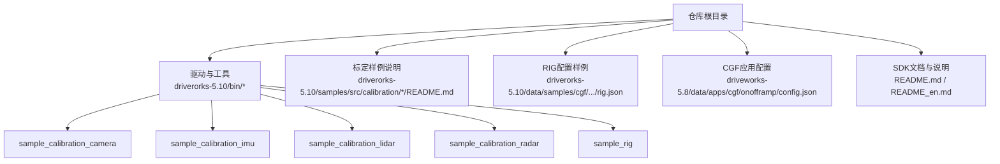
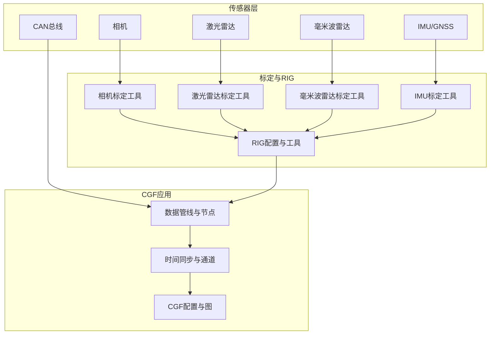
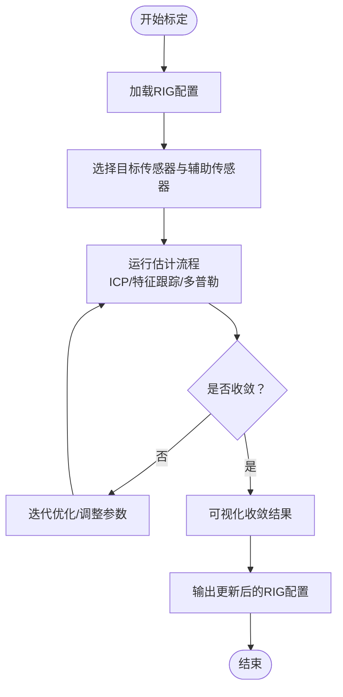
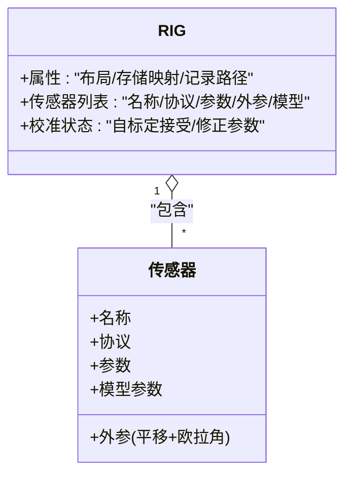
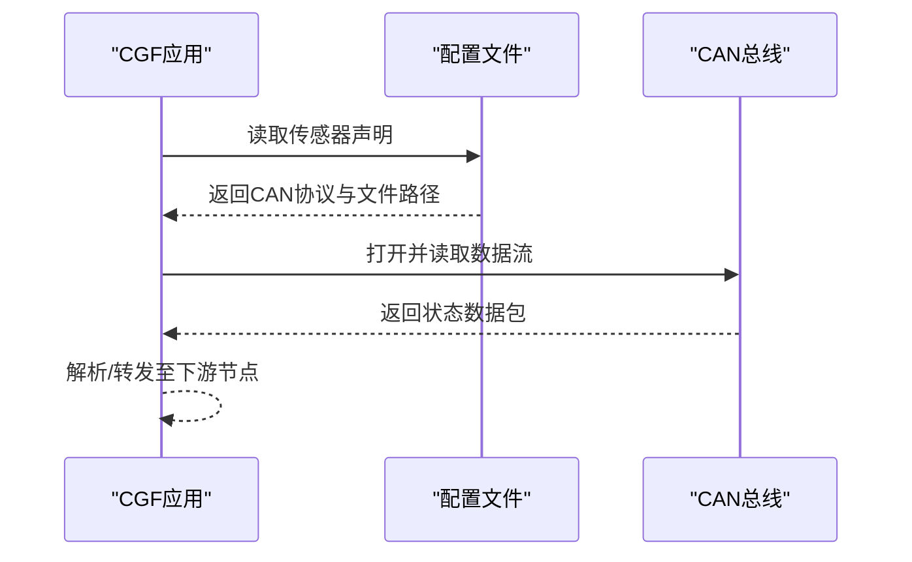
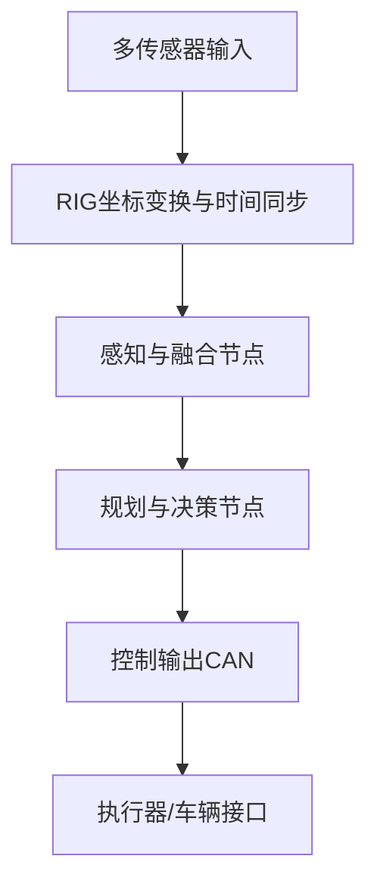
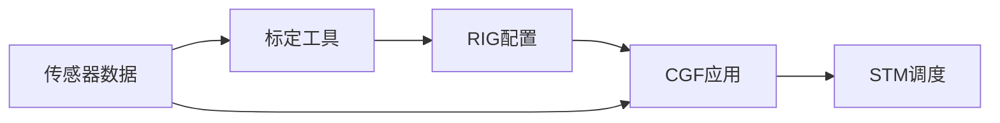

# 高级应用示例

<cite>
**本文引用的文件**
- [README.md](file://README.md)
- [README_en.md](file://README_en.md)
- [driveworks-5.8/data/apps/cgf/onofframp/config.json](file://driveworks-5.8/data/apps/cgf/onofframp/config.json)
- [driverorks-5.10/data/samples/cgf/trafficlightturning-hyperion8/rig.json](file://driverorks-5.10/data/samples/cgf/trafficlightturning-hyperion8/rig.json)
- [driverorks-5.10/bin/sample_calibration_camera](file://driverorks-5.10/bin/sample_calibration_camera)
- [driverorks-5.10/bin/sample_calibration_imu](file://driverorks-5.10/bin/sample_calibration_imu)
- [driverorks-5.10/bin/sample_calibration_lidar](file://driverorks-5.10/bin/sample_calibration_lidar)
- [driverorks-5.10/bin/sample_calibration_radar](file://driverorks-5.10/bin/sample_calibration_radar)
- [driverorks-5.10/bin/sample_rig](file://driverorks-5.10/bin/sample_rig)
- [driverorks-5.10/samples/src/calibration/camera/README.md](file://driverorks-5.10/samples/src/calibration/camera/README.md)
- [driverorks-5.10/samples/src/calibration/imu/README.md](file://driverorks-5.10/samples/src/calibration/imu/README.md)
- [driverorks-5.10/samples/src/calibration/lidar/README.md](file://driverorks-5.10/samples/src/calibration/lidar/README.md)
- [driverorks-5.10/samples/src/calibration/radar/README.md](file://driverorks-5.10/samples/src/calibration/radar/README.md)
</cite>

## 目录
1. [简介](#简介)
2. [项目结构](#项目结构)
3. [核心组件](#核心组件)
4. [架构总览](#架构总览)
5. [详细组件分析](#详细组件分析)
6. [依赖分析](#依赖分析)
7. [性能考虑](#性能考虑)
8. [故障排查指南](#故障排查指南)
9. [结论](#结论)
10. [附录](#附录)

## 简介
本文件面向在Driveworks 5.x平台上开发高级自动驾驶应用的工程师，围绕“真实复杂场景”目标，系统化梳理传感器标定（相机、IMU、激光雷达、毫米波雷达）、机器人学接口RIG（坐标变换、时间同步、数据关联）、车辆接口（CAN总线通信、状态读取、控制命令）以及完整应用案例（如onofframp复杂数据流与实时决策）的实现要点与最佳实践。同时给出系统集成与部署建议、性能监控与调试方法，帮助构建稳定可靠的自动驾驶系统。

## 项目结构
仓库包含多个版本的Driveworks SDK与样例，重点涉及：
- 5.8/5.10/5.14版本的SDK头文件、库、工具与样例
- CGF（计算图框架）与STM（调度中间件）相关文档与工具
- 标定工具链与RIG配置样例
- onofframp等CGF应用配置与数据

下图给出与本主题直接相关的目录与文件映射关系：

图表来源
- [README.md:1-115](file://README.md#L1-L115)
- [README_en.md:1-92](file://README_en.md#L1-L92)
- [driverorks-5.10/data/samples/cgf/trafficlightturning-hyperion8/rig.json:1-800](file://driverorks-5.10/data/samples/cgf/trafficlightturning-hyperion8/rig.json#L1-L800)
- [driveworks-5.8/data/apps/cgf/onofframp/config.json:1-101](file://driveworks-5.8/data/apps/cgf/onofframp/config.json#L1-L101)

章节来源
- [README.md:1-115](file://README.md#L1-L115)
- [README_en.md:1-92](file://README_en.md#L1-L92)

## 核心组件
- 传感器标定系统
  - 相机标定：估计相机外参，支持多传感器联合（IMU/_CAN/相机）参与优化，可视化收敛过程。
  - IMU标定：估计IMU外参，结合相机可视化显示估计结果。
  - 激光雷达标定：基于ICP估计连续扫描间的相对位姿，迭代优化外参。
  - 毫米波雷达标定：利用多普勒运动估计雷达运动，估计雷达偏航角及里程计参数（速度因子、轮径）。
- RIG（机器人学接口）
  - 提供多传感器到RIG坐标系的外参（平移+欧拉角），支持记录存储路径映射与校准状态。
  - 提供RIG工具链进行可视化、转换与验证。
- 车辆接口
  - 通过虚拟协议接入CAN、IMU、GPS等传感器，配置文件中定义传感器名称、参数与协议类型。
- CGF应用与数据流
  - onofframp应用通过配置文件声明多路传感器输入，形成完整的感知与控制数据流。

章节来源
- [driverorks-5.10/samples/src/calibration/camera/README.md:1-80](file://driverorks-5.10/samples/src/calibration/camera/README.md#L1-L80)
- [driverorks-5.10/samples/src/calibration/imu/README.md:1-64](file://driverorks-5.10/samples/src/calibration/imu/README.md#L1-L64)
- [driverorks-5.10/samples/src/calibration/lidar/README.md:1-83](file://driverorks-5.10/samples/src/calibration/lidar/README.md#L1-L83)
- [driverorks-5.10/samples/src/calibration/radar/README.md:1-64](file://driverorks-5.10/samples/src/calibration/radar/README.md#L1-L64)
- [driverorks-5.10/bin/sample_calibration_camera](file://driverorks-5.10/bin/sample_calibration_camera)
- [driverorks-5.10/bin/sample_calibration_imu](file://driverorks-5.10/bin/sample_calibration_imu)
- [driverorks-5.10/bin/sample_calibration_lidar](file://driverorks-5.10/bin/sample_calibration_lidar)
- [driverorks-5.10/bin/sample_calibration_radar](file://driverorks-5.10/bin/sample_calibration_radar)
- [driverorks-5.10/bin/sample_rig](file://driverorks-5.10/bin/sample_rig)
- [driverorks-5.10/data/samples/cgf/trafficlightturning-hyperion8/rig.json:1-800](file://driverorks-5.10/data/samples/cgf/trafficlightturning-hyperion8/rig.json#L1-L800)
- [driveworks-5.8/data/apps/cgf/onofframp/config.json:1-101](file://driveworks-5.8/data/apps/cgf/onofframp/config.json#L1-L101)

## 架构总览
下图展示从传感器输入到CGF应用执行的整体流程，强调RIG坐标变换、时间同步与数据关联的关键作用。

图表来源
- [driverorks-5.10/bin/sample_calibration_camera](file://driverorks-5.10/bin/sample_calibration_camera)
- [driverorks-5.10/bin/sample_calibration_imu](file://driverorks-5.10/bin/sample_calibration_imu)
- [driverorks-5.10/bin/sample_calibration_lidar](file://driverorks-5.10/bin/sample_calibration_lidar)
- [driverorks-5.10/bin/sample_calibration_radar](file://driverorks-5.10/bin/sample_calibration_radar)
- [driverorks-5.10/bin/sample_rig](file://driverorks-5.10/bin/sample_rig)
- [driverorks-5.10/data/samples/cgf/trafficlightturning-hyperion8/rig.json:1-800](file://driverorks-5.10/data/samples/cgf/trafficlightturning-hyperion8/rig.json#L1-L800)
- [driveworks-5.8/data/apps/cgf/onofframp/config.json:1-101](file://driveworks-5.8/data/apps/cgf/onofframp/config.json#L1-L101)

## 详细组件分析

### 传感器标定系统
- 相机标定
  - 输入：RIG配置、相机传感器索引或名称、IMU/CAN信号（可选）。
  - 过程：特征点跟踪与外参估计，支持快速接受历史估计以加速收敛。
  - 输出：可视化显示名义与修正后的标定指示器。
- IMU标定
  - 输入：RIG配置、IMU传感器索引、CAN/相机（可视化）。
  - 过程：估计IMU外参，播放样本数据并循环优化直至收敛。
  - 输出：显示估计的滚动与俯仰方向。
- 激光雷达标定
  - 输入：RIG配置、激光雷达索引、IMU/CAN。
  - 过程：ICP估计相邻扫描间相对位姿，结合全点云计算独立项。
  - 输出：对齐前后扫描的可视化与更新量。
- 毫米波雷达标定
  - 输入：RIG配置、雷达索引、相机/CAN。
  - 过程：多普勒运动估计雷达运动，估计雷达偏航角；可选估计速度因子与轮径。
  - 输出：标定结果与可视化。

图表来源
- [driverorks-5.10/samples/src/calibration/camera/README.md:1-80](file://driverorks-5.10/samples/src/calibration/camera/README.md#L1-L80)
- [driverorks-5.10/samples/src/calibration/imu/README.md:1-64](file://driverorks-5.10/samples/src/calibration/imu/README.md#L1-L64)
- [driverorks-5.10/samples/src/calibration/lidar/README.md:1-83](file://driverorks-5.10/samples/src/calibration/lidar/README.md#L1-L83)
- [driverorks-5.10/samples/src/calibration/radar/README.md:1-64](file://driverorks-5.10/samples/src/calibration/radar/README.md#L1-L64)

章节来源
- [driverorks-5.10/samples/src/calibration/camera/README.md:1-80](file://driverorks-5.10/samples/src/calibration/camera/README.md#L1-L80)
- [driverorks-5.10/samples/src/calibration/imu/README.md:1-64](file://driverorks-5.10/samples/src/calibration/imu/README.md#L1-L64)
- [driverorks-5.10/samples/src/calibration/lidar/README.md:1-83](file://driverorks-5.10/samples/src/calibration/lidar/README.md#L1-L83)
- [driverorks-5.10/samples/src/calibration/radar/README.md:1-64](file://driverorks-5.10/samples/src/calibration/radar/README.md#L1-L64)

### RIG（机器人学接口）使用
- RIG配置结构要点
  - 传感器列表：每个传感器包含名称、协议、参数、外参（平移+欧拉角）、模型参数等。
  - 记录存储映射：将不同传感器映射到不同的存储路径，便于离线回放与分析。
  - 校准状态：部分传感器可标注自标定接受状态。
- 工具链
  - 提供RIG查看、转换与验证工具，便于在开发与部署阶段检查坐标一致性与标定质量。

图表来源
- [driverorks-5.10/data/samples/cgf/trafficlightturning-hyperion8/rig.json:1-800](file://driverorks-5.10/data/samples/cgf/trafficlightturning-hyperion8/rig.json#L1-L800)

章节来源
- [driverorks-5.10/data/samples/cgf/trafficlightturning-hyperion8/rig.json:1-800](file://driverorks-5.10/data/samples/cgf/trafficlightturning-hyperion8/rig.json#L1-L800)
- [driverorks-5.10/bin/sample_rig](file://driverorks-5.10/bin/sample_rig)

### 车辆接口（CAN总线通信）
- 配置方式
  - 在CGF应用配置中声明CAN传感器，指定协议与数据文件，形成统一的数据入口。
- 数据读取与控制
  - 通过虚拟协议读取车辆状态（如车速、转向角、刹车等），并可扩展至发送控制命令（需根据实际硬件与安全策略实现）。

图表来源
- [driveworks-5.8/data/apps/cgf/onofframp/config.json:1-101](file://driveworks-5.8/data/apps/cgf/onofframp/config.json#L1-L101)

章节来源
- [driveworks-5.8/data/apps/cgf/onofframp/config.json:1-101](file://driveworks-5.8/data/apps/cgf/onofframp/config.json#L1-L101)

### onofframp完整应用案例
- 复杂数据流处理
  - 多路相机（前/后/侧视）、多路雷达（前后/侧方/交叉）、IMU/GNSS、CAN等传感器汇聚到CGF图中。
  - 通过RIG完成坐标变换与时间同步，确保各传感器在同一参考系与时间戳下工作。
- 实时决策
  - 基于融合后的感知结果，进行轨迹预测、避障与车道保持等决策，再将控制指令下发至CAN总线。

图表来源
- [driveworks-5.8/data/apps/cgf/onofframp/config.json:1-101](file://driveworks-5.8/data/apps/cgf/onofframp/config.json#L1-L101)
- [driverorks-5.10/data/samples/cgf/trafficlightturning-hyperion8/rig.json:1-800](file://driverorks-5.10/data/samples/cgf/trafficlightturning-hyperion8/rig.json#L1-L800)

章节来源
- [driveworks-5.8/data/apps/cgf/onofframp/config.json:1-101](file://driveworks-5.8/data/apps/cgf/onofframp/config.json#L1-L101)
- [driverorks-5.10/data/samples/cgf/trafficlightturning-hyperion8/rig.json:1-800](file://driverorks-5.10/data/samples/cgf/trafficlightturning-hyperion8/rig.json#L1-L800)

## 依赖分析
- 组件耦合
  - 标定工具依赖RIG配置与传感器数据；RIG配置依赖标定结果；CGF应用依赖RIG与传感器数据。
- 外部依赖
  - 开发与运行依赖SDK版本、工具链与平台环境；CGF应用依赖STM调度中间件生成的调度计划与通道。
- 版本演进
  - 5.x版本引入CGF与STM；7.x版本移除CGF，仅保留STM，需自行实现节点与调度集成。

图表来源
- [README.md:1-115](file://README.md#L1-L115)
- [README_en.md:1-92](file://README_en.md#L1-L92)

章节来源
- [README.md:1-115](file://README.md#L1-L115)
- [README_en.md:1-92](file://README_en.md#L1-L92)

## 性能考虑
- 时间同步与带宽
  - 使用RIG统一时间戳，避免跨传感器的时间漂移；合理设置通道缓冲与帧池大小，平衡延迟与吞吐。
- 计算负载
  - 将高耗时任务（如激光雷达ICP、相机特征跟踪）分配到GPU/VPU，利用多核与多进程提升并发。
- 存储与回放
  - 利用RIG的记录存储映射，将不同传感器分流到不同磁盘，降低I/O争用。
- 实时性保障
  - 通过STM的调度计划与WCET估算，确保关键节点的硬实时约束。

## 故障排查指南
- 标定不收敛
  - 检查RIG初始外参是否合理；增加特征点数量或调整估计参数；确认IMU/CAN信号可用。
- 坐标不一致
  - 使用RIG工具查看各传感器外参；核对模型参数与安装位姿；重新运行标定并保存更新后的RIG。
- CGF应用启动失败
  - 检查配置文件中传感器声明与协议是否匹配；确认数据文件路径与权限；查看日志目录输出。
- NVSCI/Socket问题
  - 参考官方文档与样例说明，修复通道参数与端点配置；必要时升级SDK版本。

章节来源
- [driverorks-5.10/samples/src/calibration/camera/README.md:1-80](file://driverorks-5.10/samples/src/calibration/camera/README.md#L1-L80)
- [driverorks-5.10/samples/src/calibration/imu/README.md:1-64](file://driverorks-5.10/samples/src/calibration/imu/README.md#L1-L64)
- [driverorks-5.10/samples/src/calibration/lidar/README.md:1-83](file://driverorks-5.10/samples/src/calibration/lidar/README.md#L1-L83)
- [driverorks-5.10/samples/src/calibration/radar/README.md:1-64](file://driverorks-5.10/samples/src/calibration/radar/README.md#L1-L64)
- [README_en.md:64-92](file://README_en.md#L64-L92)

## 结论
通过将传感器标定、RIG坐标变换、时间同步与数据关联、车辆接口与CGF应用有机结合，可在Driveworks 5.x平台上构建高可靠性的自动驾驶系统。建议在开发中坚持“先标定、后集成”的原则，配合RIG工具链与STM调度，持续优化性能与稳定性，并建立完善的监控与故障排查机制。

## 附录
- 开发与部署建议
  - 使用官方样例作为起点，逐步替换为真实传感器数据；在Orin设备上进行端到端验证。
- 文档与工具
  - 参考SDK文档与样例说明，结合RIG工具链与标定工具，完成从标定到应用的闭环。