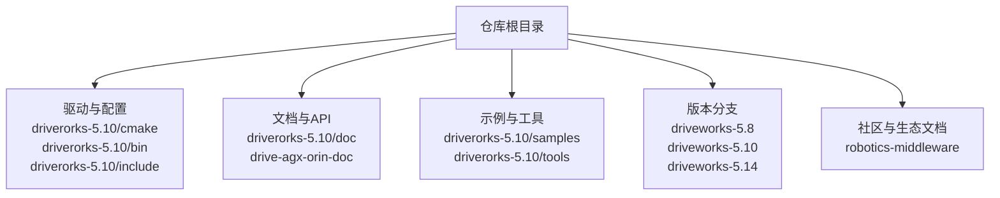
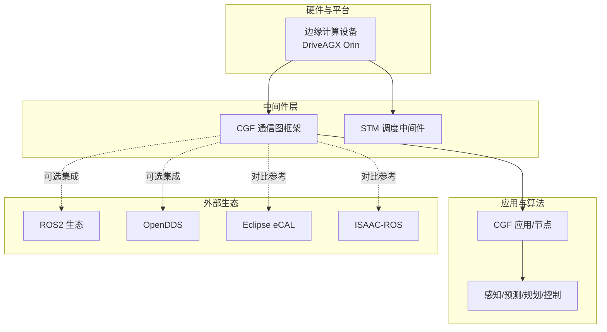
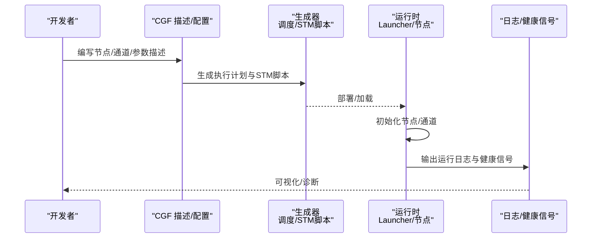
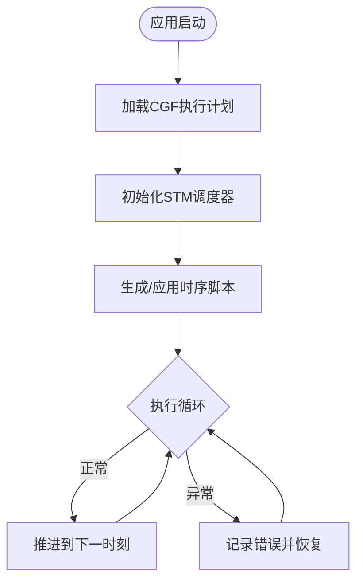
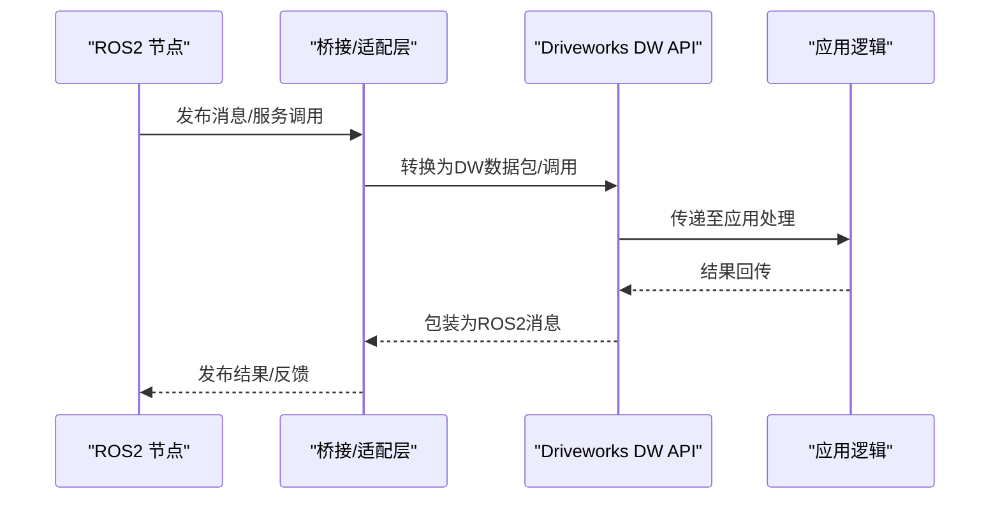
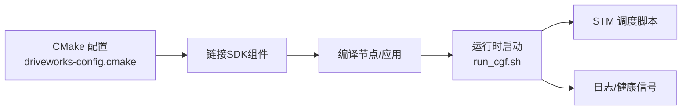

# 社区和生态系统

<cite>
**本文引用的文件**
- [README.md](file://README.md)
- [README_en.md](file://README_en.md)
- [driveworks-config.cmake](file://driverorks-5.10/cmake/driveworks-config.cmake)
- [dwcgf-config.cmake](file://driverorks-5.10/cmake/dwcgf-config.cmake)
- [dwframework-config.cmake](file://driverorks-5.10/cmake/dwframework-config.cmake)
- [driveworks-config.cmake（5.14）](file://driveworks-5.14/cmake/driveworks-config.cmake)
- [driveworks-config.cmake（5.8）](file://driveworks-5.8/cmake/driveworks-config.cmake)
- [NVIDIA-STM-Userguide-do6050.pdf](file://drive-agx-orin-doc/3-drive-works/Nvidia-STM-Userguide-do6050.pdf)
- [DRIVE-Platform-For-Developers-2302.pdf](file://drive-agx-orin-doc/0-overview/DRIVE-Platform-For-Developers-2302.pdf)
- [Nvidia-OpenDDS in DriveOS-2021.pdf](file://robotics-middleware/driveworks-ROS-doc/Nvidia-OpenDDS-in-DriveOS-2021.pdf)
- [NvROS-Integration-nvmedia-and-eglstream-in-ROS-2021.pdf](file://robotics-middleware/driveworks-ROS-doc/NvROS-Integration-nvmedia-and-eglstream-in-ROS-2021.pdf)
- [driveworks-cgf-bug 论坛:45-50](file://README.md#L45-L50)
- [nv_driveworks_demo:41-44](file://README.md#L41-L44)
- [run_cgf.sh](file://driverorks-5.10/bin/config/run_cgf.sh)
- [stm.h](file://driverorks-5.10/include/stm.h)
- [stm_manager.h](file://driverorks-5.10/include/stm_manager.h)
- [stm_error.h](file://driverorks-5.10/include/stm_error.h)
- [driveworks-5.10 文档索引](file://driverorks-5.10/doc/index_nvcgf.html)
- [driveworks-5.10 文档索引（SDK）](file://driverorks-5.10/doc/index_nvsdk_dw.html)
</cite>

## 目录
1. [简介](#简介)
2. [项目结构](#项目结构)
3. [核心组件](#核心组件)
4. [架构总览](#架构总览)
5. [详细组件分析](#详细组件分析)
6. [依赖分析](#依赖分析)
7. [性能考虑](#性能考虑)
8. [故障排查指南](#故障排查指南)
9. [结论](#结论)
10. [附录](#附录)

## 简介
本文件面向Driveworks社区与生态，系统梳理其在自动驾驶中间件领域的定位、版本演进与关键组件，重点对比开源替代方案（如Eclipse eCAL、NVIDIA ISAAC-ROS），并给出官方社区资源、与ROS2及OpenDDS的集成方式、以及与各类传感器/算法库的对接路径。同时提供社区贡献与问题反馈渠道，以及行业应用与最佳实践的参考方向。

## 项目结构
仓库以“版本化SDK + 文档 + 示例 + 工具”组织，核心包括：
- 驱动与配置：各版本CMake配置文件、运行脚本、STM头文件
- 文档与API：CGF与SDK文档索引页、用户手册PDF
- 示例与工具：CGF示例、传感器标定/采集工具、节点描述器/Stub生成器等
- 中间件与调度：CGF（通信图框架）、STM（调度中间件）

章节来源
- [README.md:1-115](file://README.md#L1-L115)

## 核心组件
- Compute Graph Framework（CGF）
  - 通信中间件，用于构建自动驾驶应用的数据流图，支持节点、通道、参数与执行计划的声明式建模。
  - 文档入口与索引页位于driveworks-5.10/doc，包含CGF入门、应用构建、通道与节点教程等。
- Scheduling Middleware（STM）
  - 调度中间件，提供确定性时序与资源调度能力，配套用户手册PDF。
- ROS2与OpenDDS集成历史
  - DriveOS 5.1提供NvROS（ROS1+nvmedia+eglstream），5.2提供OpenDDS；两者在DriveOS 6.x被Driveworks 5.x替代。
- 开源替代方案
  - Eclipse eCAL与NVIDIA ISAAC-ROS作为开源/半开源生态中的通信与中间件方案，可作为对比与迁移参考。

章节来源
- [README.md:22-70](file://README.md#L22-L70)
- [driveworks-5.10 文档索引](file://driverorks-5.10/doc/index_nvcgf.html)
- [driveworks-5.10 文档索引（SDK）](file://driverorks-5.10/doc/index_nvsdk_dw.html)

## 架构总览
下图展示Driveworks在自动驾驶系统中的位置与关键交互：CGF负责节点间数据通路与参数管理，STM负责执行时序与资源调度；二者共同支撑从传感器到算法再到控制的端到端流水线。

## 详细组件分析

### CGF（通信图框架）
- 组件职责
  - 节点定义与连接：通过JSON/YAML描述节点、端口、通道与参数，生成执行计划与调度脚本。
  - 数据类型与通道：内置多种传感器/处理结果的数据包类型，支持自定义数据类型扩展。
  - 参数提供与上下文：支持从JSON/类型化提供者加载参数，便于不同场景快速切换。
- 关键接口与模块
  - 通道工厂/连接器：用于创建与管理跨进程/跨节点的数据通道。
  - 节点工厂：用于按描述动态创建节点实例。
  - 参数集合/提供者：统一管理应用参数与上下文。
- 典型工作流
  - 设计阶段：编写节点描述与图谱，生成调度计划与STM脚本。
  - 构建阶段：使用CMake配置文件链接SDK，编译节点与应用。
  - 运行阶段：通过启动脚本加载图与调度，输出日志并监控健康信号。

章节来源
- [driveworks-5.10 文档索引](file://driverorks-5.10/doc/index_nvcgf.html)
- [driveworks-5.10 文档索引（SDK）](file://driverorks-5.10/doc/index_nvsdk_dw.html)

### STM（调度中间件）
- 组件职责
  - 提供确定性时序与资源分配，确保关键任务按时完成。
  - 与CGF配合，将逻辑执行计划映射为实际的时序调度脚本。
- 接口与头文件
  - 提供调度句柄、错误码与管理器接口，便于在应用中集成与查询状态。

章节来源
- [NVIDIA-STM-Userguide-do6050.pdf](file://drive-agx-orin-doc/3-drive-works/Nvidia-STM-Userguide-do6050.pdf)
- [stm.h](file://driverorks-5.10/include/stm.h)
- [stm_manager.h](file://driverorks-5.10/include/stm_manager.h)
- [stm_error.h](file://driverorks-5.10/include/stm_error.h)

### 与ROS2的兼容性与集成
- 历史背景
  - DriveOS 5.1提供NvROS（ROS1+nvmedia+eglstream）；5.2提供OpenDDS。
  - DriveOS 6.x起，Driveworks 5.x替代上述方案，强调与ROS2的全面优势。
- 当前建议
  - 在Driveworks 5.x中，官方推荐直接使用DW API进行开发，CGF框架不再提供。
  - 若需与ROS2互通，可在应用边界通过桥接或适配层实现数据/命令的双向转换。

章节来源
- [README.md:13-27](file://README.md#L13-L27)
- [README.md:51-63](file://README.md#L51-L63)
- [NvROS-Integration-nvmedia-and-eglstream-in-ROS-2021.pdf](file://robotics-middleware/driveworks-ROS-doc/NvROS-Integration-nvmedia-and-eglstream-in-ROS-2021.pdf)
- [Nvidia-OpenDDS in DriveOS-2021.pdf](file://robotics-middleware/driveworks-ROS-doc/Nvidia-OpenDDS-in-DriveOS-2021.pdf)

### 与OpenDDS的分布式通信支持
- DriveOS 5.2提供OpenDDS环境，可用于分布式通信场景。
- 在Driveworks 5.x时代，OpenDDS作为可选通信后端之一；进入DriveOS SDK 7.x后，CGF被移除，需开发者自行实现与STM的集成。

章节来源
- [README.md:17-20](file://README.md#L17-L20)
- [README.md:55-62](file://README.md#L55-L62)
- [Nvidia-OpenDDS in DriveOS-2021.pdf](file://robotics-middleware/driveworks-ROS-doc/Nvidia-OpenDDS-in-DriveOS-2021.pdf)

### 与传感器与算法库的集成
- 传感器侧
  - 提供标定、采集、重放与传感器映射工具，便于接入摄像头、激光雷达、毫米波雷达、IMU等。
- 算法侧
  - 通过节点化封装算法，利用CGF的通道与参数机制实现灵活组合与切换。
- 工具链
  - 节点描述器/Stub生成器、Schema校验工具、描述转YAML生成器等，提升开发效率。

章节来源
- [README.md:39-44](file://README.md#L39-L44)
- [driverorks-5.10/tools](file://driverorks-5.10/tools)

## 依赖分析
- 版本配置与构建
  - 各版本SDK提供driveworks-config.cmake、dwcgf-config.cmake、dwframework-config.cmake等，用于在CMake中查找与链接SDK组件。
- 运行时依赖
  - 通过run_cgf.sh等脚本加载CGF应用与日志目录，结合STM生成的调度脚本运行。
- 头文件与接口
  - STM相关头文件提供调度器初始化、错误处理与管理接口。

章节来源
- [driveworks-config.cmake](file://driverorks-5.10/cmake/driveworks-config.cmake)
- [dwcgf-config.cmake](file://driverorks-5.10/cmake/dwcgf-config.cmake)
- [dwframework-config.cmake](file://driverorks-5.10/cmake/dwframework-config.cmake)
- [run_cgf.sh](file://driverorks-5.10/bin/config/run_cgf.sh)
- [driveworks-config.cmake（5.14）](file://driveworks-5.14/cmake/driveworks-config.cmake)
- [driveworks-config.cmake（5.8）](file://driveworks-5.8/cmake/driveworks-config.cmake)

## 性能考虑
- 确定性与时序
  - STM提供时序约束与资源分配，适合对延迟与抖动敏感的任务。
- 跨进程/跨节点通信
  - CGF通道支持高效数据传输与缓存复用，减少拷贝与同步开销。
- 调度生成与验证
  - 使用描述转YAML生成器与校验工具，提前发现潜在的时序冲突与资源瓶颈。

## 故障排查指南
- 官方问题反馈
  - 通过NVIDIA开发者论坛的driveworks-cgf标签提交Bug与问题。
- 常见问题线索
  - NVSCISocket相关问题（已修复）与大块数据传输问题，可通过日志与健康信号定位。
- 开发与运行
  - 使用run_cgf.sh启动应用，检查日志目录与退出状态，清理旧日志后再试。

章节来源
- [README.md:45-50](file://README.md#L45-L50)
- [README_en.md:64-92](file://README_en.md#L64-L92)
- [run_cgf.sh](file://driverorks-5.10/bin/config/run_cgf.sh)

## 结论
Driveworks在DriveOS SDK 7.x中完成了从CGF到STM的架构演进：移除了CGF，强调直接使用DW API与STM调度。对于需要与ROS2/OpenDDS互通的场景，可在应用边界通过桥接实现；对于追求确定性与高性能的自动驾驶系统，STM与DW API的组合提供了可控的执行模型。开源替代方案（eCAL/ISAAC-ROS）可作为技术选型与迁移的参考。

## 附录

### 官方社区与资源
- 官方文档与演示
  - CGF入门与应用构建教程、STM用户手册PDF、DRIVE平台开发者文档。
- 示例与演示
  - nv_driveworks_demo提供完整的开发、仿真、部署与调试环境。
- 论坛与Bug反馈
  - 通过driveworks-cgf标签在NVIDIA开发者论坛提交问题。

章节来源
- [README.md:33-38](file://README.md#L33-L38)
- [README.md:41-44](file://README.md#L41-L44)
- [README.md:45-50](file://README.md#L45-L50)
- [DRIVE-Platform-For-Developers-2302.pdf](file://drive-agx-orin-doc/0-overview/DRIVE-Platform-For-Developers-2302.pdf)

### 开源替代方案对比概览
- Eclipse eCAL
  - 特点：轻量、跨语言、高吞吐、可视化工具丰富。
  - 适用：多传感器融合、仿真/实车数据采集与回放。
- NVIDIA ISAAC-ROS
  - 特点：基于ROS2生态，节点化程度高，工具链成熟。
  - 适用：快速原型、算法迭代与社区协作。
- Driveworks对比要点
  - 在DriveOS 6.x前，Driveworks 5.x宣称具备与ROS2相当的全面优势；7.x后移除CGF，更强调DW API与STM的确定性执行。

章节来源
- [README.md:64-70](file://README.md#L64-L70)

### 使用场景与最佳实践
- 场景选择
  - 需要强确定性与低抖动：优先STM+DW API。
  - 快速原型与生态协同：可考虑eCAL/ISAAC-ROS。
  - 与现有ROS2系统共存：通过桥接层实现数据互通。
- 最佳实践
  - 使用节点描述器/Stub与Schema校验工具，保证描述一致性。
  - 利用日志与健康信号持续监控运行状态。
  - 在多传感器融合场景中，合理划分通道与参数域，避免耦合。