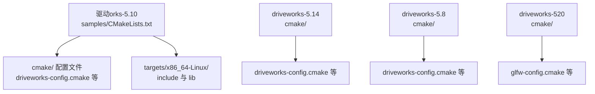
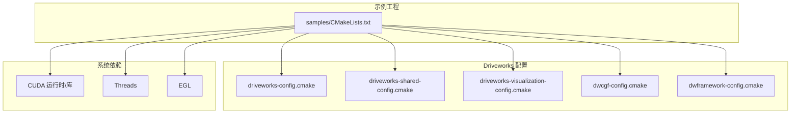
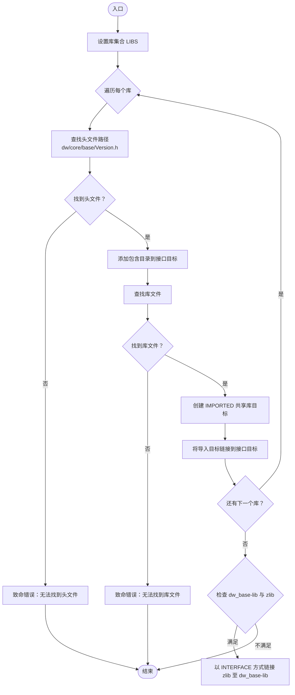
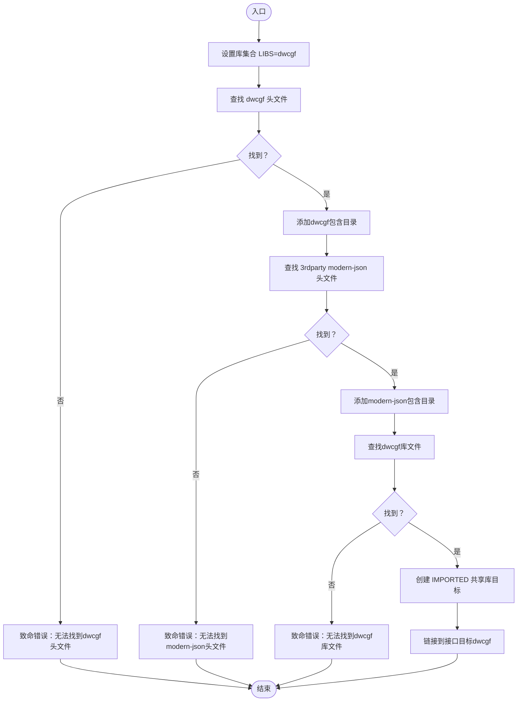
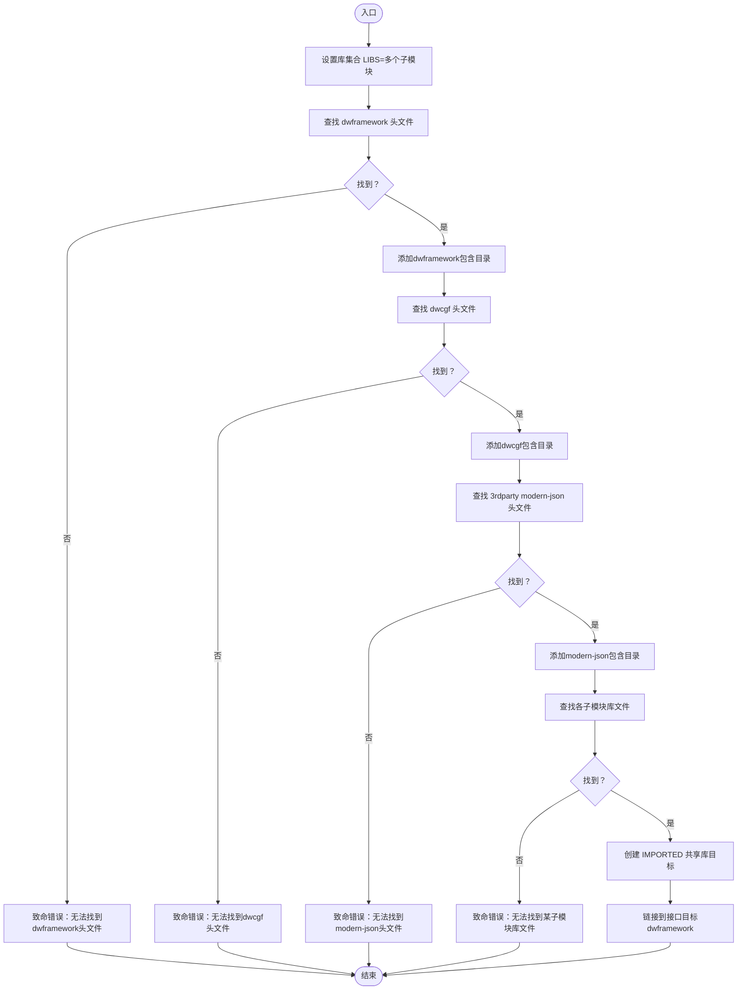
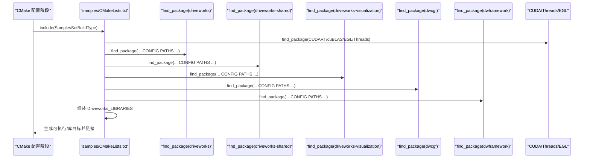

# 构建配置

<cite>
**本文引用的文件**
- [driverorks-5.10/cmake/driveworks-config.cmake](file://driverorks-5.10/cmake/driveworks-config.cmake)
- [driverorks-5.10/cmake/dwcgf-config.cmake](file://driverorks-5.10/cmake/dwcgf-config.cmake)
- [driverorks-5.10/cmake/dwframework-config.cmake](file://driverorks-5.10/cmake/dwframework-config.cmake)
- [driverorks-5.10/cmake/driveworks-shared-config.cmake](file://driverorks-5.10/cmake/driveworks-shared-config.cmake)
- [driverorks-5.10/cmake/driveworks-visualization-config.cmake](file://driverorks-5.10/cmake/driveworks-visualization-config.cmake)
- [driveworks-5.14/cmake/driveworks-config.cmake](file://driveworks-5.14/cmake/driveworks-config.cmake)
- [driveworks-5.14/cmake/dwcgf-config.cmake](file://driveworks-5.14/cmake/dwcgf-config.cmake)
- [driveworks-5.14/cmake/dwframework-config.cmake](file://driveworks-5.14/cmake/dwframework-config.cmake)
- [driveworks-5.8/cmake/driveworks-config.cmake](file://driveworks-5.8/cmake/driveworks-config.cmake)
- [driveworks-5.8/cmake/dwcgf-config.cmake](file://driveworks-5.8/cmake/dwcgf-config.cmake)
- [driveworks-520/cmake/glfw-config.cmake](file://driveworks-520/cmake/glfw-config.cmake)
- [driveworks-520/cmake/glew-config.cmake](file://driveworks-520/cmake/glew-config.cmake)
- [driveworks-520/cmake/lodepng-config.cmake](file://driveworks-520/cmake/lodepng-config.cmake)
- [driverorks-5.10/samples/CMakeLists.txt](file://driverorks-5.10/samples/CMakeLists.txt)
</cite>

## 目录
1. [简介](#简介)
2. [项目结构](#项目结构)
3. [核心组件](#核心组件)
4. [架构总览](#架构总览)
5. [详细组件分析](#详细组件分析)
6. [依赖关系分析](#依赖关系分析)
7. [性能考虑](#性能考虑)
8. [故障排查指南](#故障排查指南)
9. [结论](#结论)
10. [附录](#附录)

## 简介
本指南聚焦于Driveworks在Linux x86_64平台上的构建配置，系统性讲解CMake配置文件的作用与参数设置，涵盖以下关键配置文件：driveworks-config.cmake、dwcgf-config.cmake、dwframework-config.cmake、driveworks-shared-config.cmake、driveworks-visualization-config.cmake；并结合5.8、5.10、5.14、520版本差异，说明依赖库管理（CUDA、NvSci、OpenGL/GLFW等）、编译选项与宏定义、平台特定配置、自定义构建目标与安装配置方法。文档同时提供可操作的配置步骤与排错建议，帮助开发者在不同版本间平滑迁移。

## 项目结构
Driveworks仓库按版本划分SDK目录，每个版本包含：
- cmake/：提供各模块的CMake配置文件，用于find_package与导入目标
- include/、lib/、targets/x86_64-Linux/：头文件与二进制库的组织结构
- samples/：示例工程，展示如何在实际项目中集成Driveworks

下图给出与构建配置相关的核心目录关系：

图表来源
- [driverorks-5.10/samples/CMakeLists.txt](file://driverorks-5.10/samples/CMakeLists.txt)
- [driverorks-5.10/cmake/driveworks-config.cmake](file://driverorks-5.10/cmake/driveworks-config.cmake)
- [driveworks-5.14/cmake/driveworks-config.cmake](file://driveworks-5.14/cmake/driveworks-config.cmake)
- [driveworks-5.8/cmake/driveworks-config.cmake](file://driveworks-5.8/cmake/driveworks-config.cmake)
- [driveworks-520/cmake/glfw-config.cmake](file://driveworks-520/cmake/glfw-config.cmake)

章节来源
- [driverorks-5.10/samples/CMakeLists.txt](file://driverorks-5.10/samples/CMakeLists.txt)

## 核心组件
本节概述关键CMake配置文件的功能与作用域，便于快速定位到对应实现细节。

- driveworks-config.cmake
  - 作用：为基础库集合（如dw_base、dw_sensors、dw_dnn_base等）生成导入目标，自动查找头文件与库文件路径，并建立接口目标driveworks供上层链接。
  - 版本差异：5.8采用传统命名与RELEASE配置，5.10/5.14引入更多模块与顺序调整。
- dwcgf-config.cmake
  - 作用：为CGF（计算图形框架）模块提供导入目标，同时查找dwcgf头文件与3rdparty的modern-json头文件。
- dwframework-config.cmake
  - 作用：为dwframework及其子模块（如dwframework_dwnodes）提供导入目标，同时查找dwframework与dwcgf头文件及modern-json。
- driveworks-shared-config.cmake
  - 作用：为共享库模块（dwshared）提供导入目标，并附加dwshared、dwcbor、dwfoundation、dwsocket、dwtrace等子目录的头文件路径。
- driveworks-visualization-config.cmake
  - 作用：为可视化模块（driveworks_visualization、driveworks_visualization_av）提供导入目标，对_av后缀库进行特殊处理（允许缺失）。
- driveworks-520新增第三方可视化依赖
  - glfw-config.cmake、glew-config.cmake、lodepng-config.cmake：为可视化示例提供OpenGL/GLFW环境支持。

章节来源
- [driverorks-5.10/cmake/driveworks-config.cmake](file://driverorks-5.10/cmake/driveworks-config.cmake)
- [driverorks-5.10/cmake/dwcgf-config.cmake](file://driverorks-5.10/cmake/dwcgf-config.cmake)
- [driverorks-5.10/cmake/dwframework-config.cmake](file://driverorks-5.10/cmake/dwframework-config.cmake)
- [driverorks-5.10/cmake/driveworks-shared-config.cmake](file://driverorks-5.10/cmake/driveworks-shared-config.cmake)
- [driverorks-5.10/cmake/driveworks-visualization-config.cmake](file://driverorks-5.10/cmake/driveworks-visualization-config.cmake)
- [driveworks-5.14/cmake/driveworks-config.cmake](file://driveworks-5.14/cmake/driveworks-config.cmake)
- [driveworks-5.14/cmake/dwcgf-config.cmake](file://driveworks-5.14/cmake/dwcgf-config.cmake)
- [driveworks-5.14/cmake/dwframework-config.cmake](file://driveworks-5.14/cmake/dwframework-config.cmake)
- [driveworks-5.8/cmake/driveworks-config.cmake](file://driveworks-5.8/cmake/driveworks-config.cmake)
- [driveworks-5.8/cmake/dwcgf-config.cmake](file://driveworks-5.8/cmake/dwcgf-config.cmake)
- [driveworks-520/cmake/glfw-config.cmake](file://driveworks-520/cmake/glfw-config.cmake)
- [driveworks-520/cmake/glew-config.cmake](file://driveworks-520/cmake/glew-config.cmake)
- [driveworks-520/cmake/lodepng-config.cmake](file://driveworks-520/cmake/lodepng-config.cmake)

## 架构总览
下图展示示例工程如何通过find_package加载Driveworks系列配置文件，并将其与系统依赖（CUDA、线程、EGL等）组合，最终形成可链接的库列表。

图表来源
- [driverorks-5.10/samples/CMakeLists.txt](file://driverorks-5.10/samples/CMakeLists.txt)
- [driverorks-5.10/cmake/driveworks-config.cmake](file://driverorks-5.10/cmake/driveworks-config.cmake)
- [driverorks-5.10/cmake/driveworks-shared-config.cmake](file://driverorks-5.10/cmake/driveworks-shared-config.cmake)
- [driverorks-5.10/cmake/driveworks-visualization-config.cmake](file://driverorks-5.10/cmake/driveworks-visualization-config.cmake)
- [driverorks-5.10/cmake/dwcgf-config.cmake](file://driverorks-5.10/cmake/dwcgf-config.cmake)
- [driverorks-5.10/cmake/dwframework-config.cmake](file://driverorks-5.10/cmake/dwframework-config.cmake)

## 详细组件分析

### 组件A：driveworks-config.cmake（基础库）
- 功能要点
  - 定义库集合（LIBS），遍历每个库名，分别查找头文件与库文件
  - 自动推导targets/x86_64-Linux/include与include路径，确保跨版本一致性
  - 为每个库创建IMPORTED共享库目标，加入接口目标driveworks
  - 特殊依赖：当存在dw_base-lib与zlib时，将zlib以INTERFACE方式链接至dw_base-lib
- 关键行为
  - 头文件定位：以dw/core/base/Version.h作为存在性校验
  - 库文件定位：按名称匹配库文件
  - 错误处理：未找到头文件或库文件时输出致命错误

图表来源
- [driverorks-5.10/cmake/driveworks-config.cmake](file://driverorks-5.10/cmake/driveworks-config.cmake)
- [driveworks-5.14/cmake/driveworks-config.cmake](file://driveworks-5.14/cmake/driveworks-config.cmake)
- [driveworks-5.8/cmake/driveworks-config.cmake](file://driveworks-5.8/cmake/driveworks-config.cmake)

章节来源
- [driverorks-5.10/cmake/driveworks-config.cmake](file://driverorks-5.10/cmake/driveworks-config.cmake)
- [driveworks-5.14/cmake/driveworks-config.cmake](file://driveworks-5.14/cmake/driveworks-config.cmake)
- [driveworks-5.8/cmake/driveworks-config.cmake](file://driveworks-5.8/cmake/driveworks-config.cmake)

### 组件B：dwcgf-config.cmake（CGF模块）
- 功能要点
  - 查找dwcgf头文件（如dwcgf/channel/ChannelFactory.hpp）
  - 同时查找3rdparty的modern-json头文件（modern-json/json.hpp）
  - 为dwcgf库创建IMPORTED目标并链接到接口目标dwcgf
- 版本差异
  - 5.10/5.14与5.8相比，统一了路径查找策略与接口目标命名

图表来源
- [driverorks-5.10/cmake/dwcgf-config.cmake](file://driverorks-5.10/cmake/dwcgf-config.cmake)
- [driveworks-5.14/cmake/dwcgf-config.cmake](file://driveworks-5.14/cmake/dwcgf-config.cmake)
- [driveworks-5.8/cmake/dwcgf-config.cmake](file://driveworks-5.8/cmake/dwcgf-config.cmake)

章节来源
- [driverorks-5.10/cmake/dwcgf-config.cmake](file://driverorks-5.10/cmake/dwcgf-config.cmake)
- [driveworks-5.14/cmake/dwcgf-config.cmake](file://driveworks-5.14/cmake/dwcgf-config.cmake)
- [driveworks-5.8/cmake/dwcgf-config.cmake](file://driveworks-5.8/cmake/dwcgf-config.cmake)

### 组件C：dwframework-config.cmake（框架模块）
- 功能要点
  - 查找dwframework与dwcgf头文件，以及3rdparty的modern-json头文件
  - 为dwframework与其子模块（如dwframework_dwnodes）创建IMPORTED目标并链接到接口目标dwframework
- 版本差异
  - 5.14增加了更多子模块（如dwframework_dwnodes_channel_packets、dwbroadcast-frontend）

图表来源
- [driverorks-5.10/cmake/dwframework-config.cmake](file://driverorks-5.10/cmake/dwframework-config.cmake)
- [driveworks-5.14/cmake/dwframework-config.cmake](file://driveworks-5.14/cmake/dwframework-config.cmake)

章节来源
- [driverorks-5.10/cmake/dwframework-config.cmake](file://driverorks-5.10/cmake/dwframework-config.cmake)
- [driveworks-5.14/cmake/dwframework-config.cmake](file://driveworks-5.14/cmake/dwframework-config.cmake)

### 组件D：driveworks-shared-config.cmake（共享库）
- 功能要点
  - 为dwshared及其子目录（dwshared、dwshared/dwcbor、dwshared/dwfoundation、dwshared/dwsocket、dwshared/dwtrace）添加包含目录
  - 为dwshared库创建IMPORTED目标并链接到接口目标driveworks-shared
- 适用场景
  - 通信、追踪、基础工具等跨模块共享能力

章节来源
- [driverorks-5.10/cmake/driveworks-shared-config.cmake](file://driverorks-5.10/cmake/driveworks-shared-config.cmake)

### 组件E：driveworks-visualization-config.cmake（可视化）
- 功能要点
  - 查找可视化核心头文件（如dwvisualization/core/Visualization.h）
  - 对以_av结尾的库进行特殊处理：允许未找到
  - 为可视化库创建IMPORTED目标并链接到接口目标driveworks-visualization
- 适用场景
  - 可视化渲染与演示功能

章节来源
- [driverorks-5.10/cmake/driveworks-visualization-config.cmake](file://driverorks-5.10/cmake/driveworks-visualization-config.cmake)

### 组件F：第三方可视化依赖（5.20+）
- 功能要点
  - glfw-config.cmake：导入GLFW共享库，设置包含目录与特性
  - glew-config.cmake：导入GLEW静态库
  - lodepng-config.cmake：导入lodepng静态库
- 适用场景
  - 示例工程中的OpenGL可视化与图像处理

章节来源
- [driveworks-520/cmake/glfw-config.cmake](file://driveworks-520/cmake/glfw-config.cmake)
- [driveworks-520/cmake/glew-config.cmake](file://driveworks-520/cmake/glew-config.cmake)
- [driveworks-520/cmake/lodepng-config.cmake](file://driveworks-520/cmake/lodepng-config.cmake)

## 依赖关系分析
下图展示示例工程如何通过find_package加载Driveworks配置，并与系统依赖整合，形成最终的链接列表。

图表来源
- [driverorks-5.10/samples/CMakeLists.txt](file://driverorks-5.10/samples/CMakeLists.txt)
- [driverorks-5.10/cmake/driveworks-config.cmake](file://driverorks-5.10/cmake/driveworks-config.cmake)
- [driverorks-5.10/cmake/driveworks-shared-config.cmake](file://driverorks-5.10/cmake/driveworks-shared-config.cmake)
- [driverorks-5.10/cmake/driveworks-visualization-config.cmake](file://driverorks-5.10/cmake/driveworks-visualization-config.cmake)
- [driverorks-5.10/cmake/dwcgf-config.cmake](file://driverorks-5.10/cmake/dwcgf-config.cmake)
- [driverorks-5.10/cmake/dwframework-config.cmake](file://driverorks-5.10/cmake/dwframework-config.cmake)

章节来源
- [driverorks-5.10/samples/CMakeLists.txt](file://driverorks-5.10/samples/CMakeLists.txt)

## 性能考虑
- 链接顺序与模块粒度
  - 将高频使用的底层库（如dw_base、CUDART、cuBLAS）置于链表前部，有助于链接器优化
  - 使用接口目标（INTERFACE）聚合模块，避免重复链接与冗余符号
- 平台与编译器设置
  - 启用位置无关代码（Position Independent Code）以适配动态库
  - 在CUDA启用后设置合适的CUDA标准与主机编译器，减少编译时间
- 第三方库选择
  - OpenGL/GLFW仅在需要可视化时引入，避免非必要依赖导致的链接负担

## 故障排查指南
- 找不到头文件
  - 症状：提示无法找到dw/core/base/Version.h或dwcgf/channel/ChannelFactory.hpp
  - 排查：确认CMAKE_CURRENT_LIST_DIR指向正确版本目录，检查targets/x86_64-Linux/include与include路径是否存在
- 找不到库文件
  - 症状：提示无法找到指定库（如dw_base、dwcgf等）
  - 排查：确认targets/x86_64-Linux/lib与lib目录存在对应SO文件；核对库名与版本是否一致
- CUDA相关问题
  - 症状：CUDA编译失败或找不到运行时
  - 排查：确保CUDA_DIR或CUDA_TOOLKIT_ROOT_DIR已正确设置，且CUDAToolkit模块可用
- 可视化库_av缺失
  - 症状：_av后缀库未打包但不影响构建
  - 处理：该类库在driveworks-visualization-config.cmake中被允许缺失，无需额外处理
- zlibc依赖
  - 症状：链接阶段缺少zlib
  - 处理：driveworks-config.cmake在满足条件时会将zlib以INTERFACE方式链接至dw_base-lib

章节来源
- [driverorks-5.10/cmake/driveworks-config.cmake](file://driverorks-5.10/cmake/driveworks-config.cmake)
- [driverorks-5.10/cmake/driveworks-visualization-config.cmake](file://driverorks-5.10/cmake/driveworks-visualization-config.cmake)
- [driverorks-5.10/samples/CMakeLists.txt](file://driverorks-5.10/samples/CMakeLists.txt)

## 结论
通过上述配置文件与示例工程的协同，Driveworks在Linux x86_64平台实现了模块化的依赖管理与可移植的构建流程。开发者应根据所选版本选择对应的配置文件，严格遵循头文件与库文件的查找规则，并结合系统依赖（CUDA、Threads、EGL等）完成最终链接。对于需要可视化的场景，可在5.20+版本中引入GL/GLFW相关依赖以完善开发体验。

## 附录

### 不同版本的关键差异速览
- 5.8
  - 使用传统命名（如${LIB}-lib），并区分RELEASE配置
  - dwcgf-config.cmake对dwcgf头文件路径处理略有不同
- 5.10/5.14
  - 统一接口目标命名（如driveworks::${LIB}-lib）
  - dwframework-config.cmake增加更多子模块（如dwbroadcast-frontend）
  - driveworks-config.cmake调整库顺序与依赖声明
- 5.20+
  - 新增glfw、glew、lodepng等第三方可视化依赖配置

章节来源
- [driveworks-5.8/cmake/driveworks-config.cmake](file://driveworks-5.8/cmake/driveworks-config.cmake)
- [driveworks-5.8/cmake/dwcgf-config.cmake](file://driveworks-5.8/cmake/dwcgf-config.cmake)
- [driveworks-5.10/cmake/driveworks-config.cmake](file://driveworks-5.10/cmake/driveworks-config.cmake)
- [driveworks-5.10/cmake/dwframework-config.cmake](file://driveworks-5.10/cmake/dwframework-config.cmake)
- [driveworks-5.14/cmake/driveworks-config.cmake](file://driveworks-5.14/cmake/driveworks-config.cmake)
- [driveworks-5.14/cmake/dwframework-config.cmake](file://driveworks-5.14/cmake/dwframework-config.cmake)
- [driveworks-520/cmake/glfw-config.cmake](file://driveworks-520/cmake/glfw-config.cmake)
- [driveworks-520/cmake/glew-config.cmake](file://driveworks-520/cmake/glew-config.cmake)
- [driveworks-520/cmake/lodepng-config.cmake](file://driveworks-520/cmake/lodepng-config.cmake)