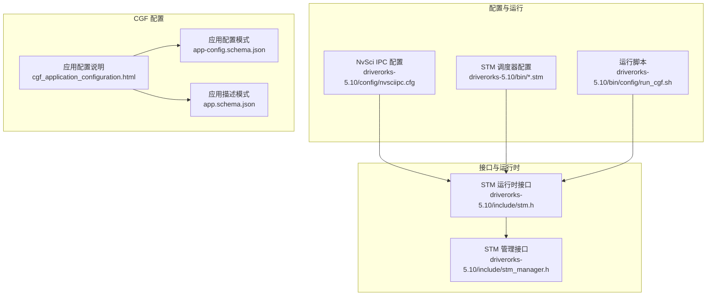
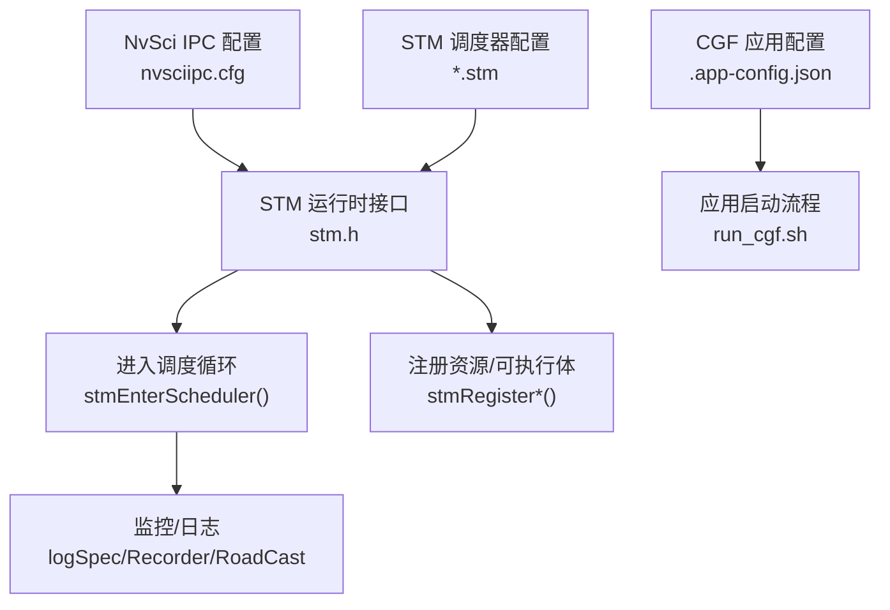
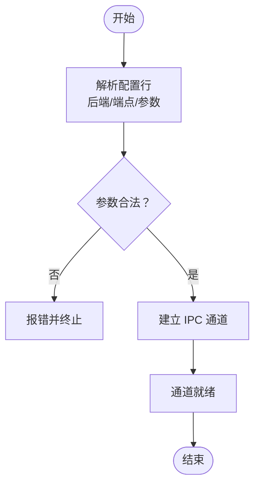
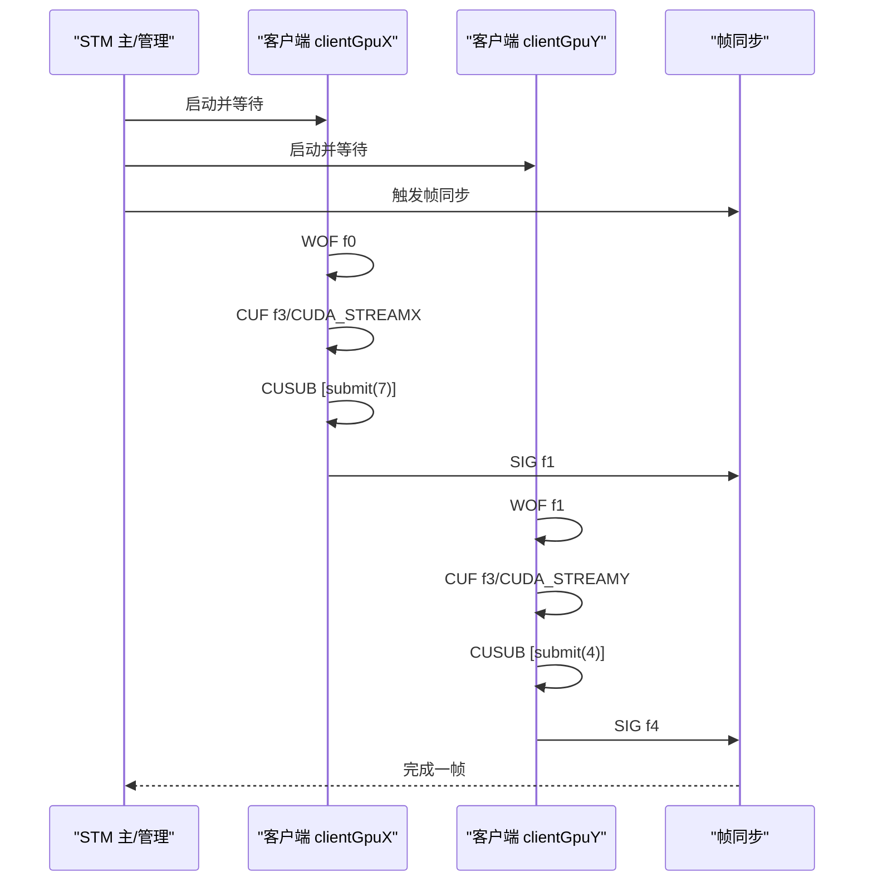
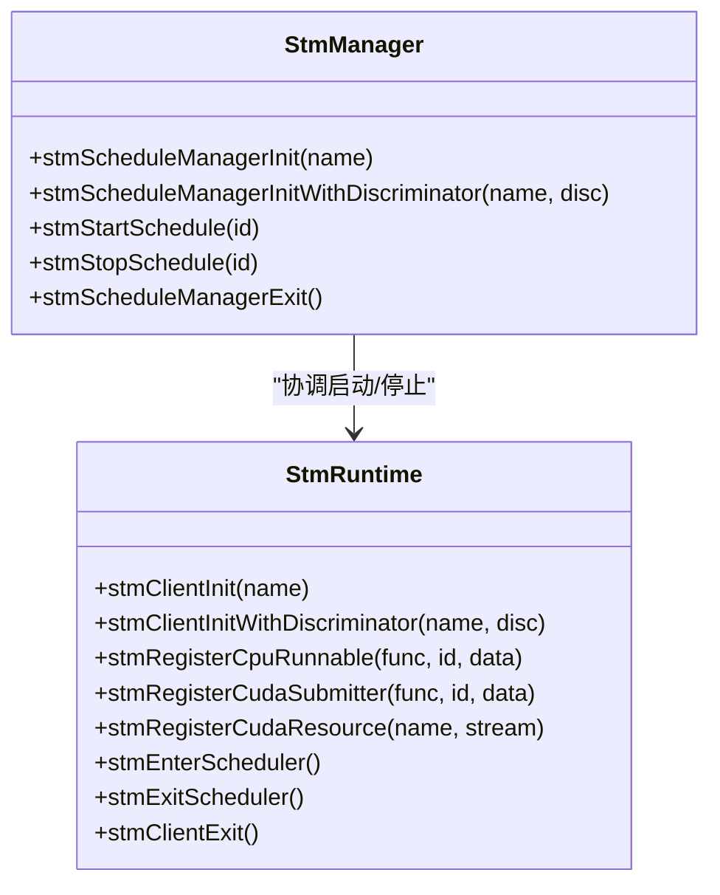
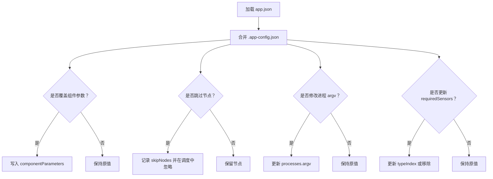
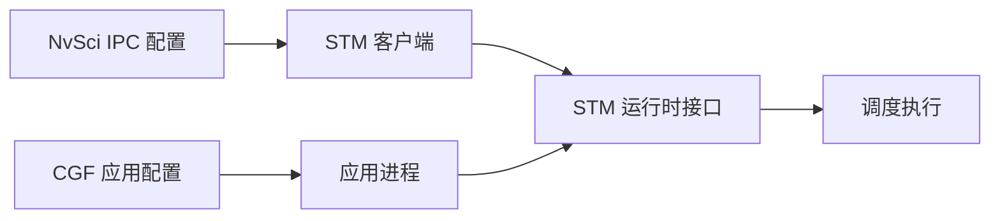

# 运行时配置

<cite>
**本文引用的文件**
- [nvsciipc.cfg（5.10）](file://driverorks-5.10/config/nvsciipc.cfg)
- [nvsciipc.cfg（5.8）](file://driveworks-5.8/config/nvsciipc.cfg)
- [cpu_simple.stm](file://driverorks-5.10/bin/cpu_simple.stm)
- [gpu_multistream_multiprocess.stm](file://driverorks-5.10/bin/gpu_multistream_multiprocess.stm)
- [stm.h](file://driverorks-5.10/include/stm.h)
- [stm_manager.h](file://driverorks-5.10/include/stm_manager.h)
- [cgf_application_configuration.html](file://driverorks-5.10/doc/nvcgf_html/cgf_application_configuration.html)
- [app-config.schema.json（5.10）](file://doc/3-drive-works-infra/7-基于json的cgf设计/5.10/app-config.schema.json)
- [app.schema.json（5.10）](file://doc/3-drive-works-infra/7-基于json的cgf设计/5.10/app.schema.json)
- [run_cgf.sh（5.10）](file://driverorks-5.10/bin/config/run_cgf.sh)
- [run_cgf.sh（5.8）](file://driveworks-5.8/bin/config/run_cgf.sh)
</cite>

## 目录
1. [简介](#简介)
2. [项目结构](#项目结构)
3. [核心组件](#核心组件)
4. [架构总览](#架构总览)
5. [详细组件分析](#详细组件分析)
6. [依赖关系分析](#依赖关系分析)
7. [性能考虑](#性能考虑)
8. [调试与日志配置](#调试与日志配置)
9. [应用场景配置示例](#应用场景配置示例)
10. [配置验证与故障排除](#配置验证与故障排除)
11. [结论](#结论)

## 简介
本指南聚焦于 Driveworks 运行时配置，覆盖以下方面：
- 系统配置参数：NvSci IPC 配置、STM 调度器配置、传感器布局与映射配置
- 性能调优：内存管理、GPU/CPU/VPU 资源分配、多线程与并发策略
- 调试与日志：日志级别、调试输出、性能分析工具集成
- 应用场景：开发调试、性能测试、生产部署的配置差异
- 验证与排障：配置校验方法、常见问题定位与修复

## 项目结构
围绕运行时配置的关键目录与文件：
- 配置与调度
  - NvSci IPC 配置：driverorks-5.10/config/nvsciipc.cfg、driveworks-5.8/config/nvsciipc.cfg
  - STM 调度器配置：driverorks-5.10/bin/*.stm（如 cpu_simple.stm、gpu_multistream_multiprocess.stm）
  - 运行脚本：driverorks-5.10/bin/config/run_cgf.sh、driveworks-5.8/bin/config/run_cgf.sh
- 接口与运行时
  - STM 运行时接口：driverorks-5.10/include/stm.h、driverorks-5.10/include/stm_manager.h
- CGF 应用配置与模式
  - 应用配置说明：driverorks-5.10/doc/nvcgf_html/cgf_application_configuration.html
  - JSON 模式：doc/3-drive-works-infra/7-基于json的cgf设计/5.10/app-config.schema.json、app.schema.json

**图表来源**
- [nvsciipc.cfg（5.10）:1-96](file://driverorks-5.10/config/nvsciipc.cfg#L1-L96)
- [cpu_simple.stm:1-155](file://driverorks-5.10/bin/cpu_simple.stm#L1-L155)
- [gpu_multistream_multiprocess.stm:1-269](file://driverorks-5.10/bin/gpu_multistream_multiprocess.stm#L1-L269)
- [stm.h:1-337](file://driverorks-5.10/include/stm.h#L1-L337)
- [stm_manager.h:1-113](file://driverorks-5.10/include/stm_manager.h#L1-L113)
- [cgf_application_configuration.html:100-134](file://driverorks-5.10/doc/nvcgf_html/cgf_application_configuration.html#L100-L134)
- [app-config.schema.json（5.10）:1-136](file://doc/3-drive-works-infra/7-基于json的cgf设计/5.10/app-config.schema.json#L1-L136)
- [app.schema.json（5.10）:1-520](file://doc/3-drive-works-infra/7-基于json的cgf设计/5.10/app.schema.json#L1-L520)

**章节来源**
- [nvsciipc.cfg（5.10）:1-96](file://driverorks-5.10/config/nvsciipc.cfg#L1-L96)
- [cpu_simple.stm:1-155](file://driverorks-5.10/bin/cpu_simple.stm#L1-L155)
- [gpu_multistream_multiprocess.stm:1-269](file://driverorks-5.10/bin/gpu_multistream_multiprocess.stm#L1-L269)
- [stm.h:1-337](file://driverorks-5.10/include/stm.h#L1-L337)
- [stm_manager.h:1-113](file://driverorks-5.10/include/stm_manager.h#L1-L113)
- [cgf_application_configuration.html:100-134](file://driverorks-5.10/doc/nvcgf_html/cgf_application_configuration.html#L100-L134)
- [app-config.schema.json（5.10）:1-136](file://doc/3-drive-works-infra/7-基于json的cgf设计/5.10/app-config.schema.json#L1-L136)
- [app.schema.json（5.10）:1-520](file://doc/3-drive-works-infra/7-基于json的cgf设计/5.10/app.schema.json#L1-L520)

## 核心组件
- NvSci IPC 配置：定义跨进程/跨 VM 的通道端点、帧数与帧大小等参数，用于构建跨进程数据通路。
- STM 调度器：通过 .stm 文件描述周期性任务、同步、栅栏、资源绑定与 GPU/CPU/VPU 提交器执行顺序。
- STM 运行时接口：提供客户端初始化、注册可执行体、CUDA/DLA/VPU 资源注册、进入调度循环等能力。
- CGF 应用配置：通过 .app-config.json 动态覆盖组件参数、跳过节点、修改进程 argv、更新所需传感器等。

**章节来源**
- [nvsciipc.cfg（5.10）:28-44](file://driverorks-5.10/config/nvsciipc.cfg#L28-L44)
- [cpu_simple.stm:3-39](file://driverorks-5.10/bin/cpu_simple.stm#L3-L39)
- [gpu_multistream_multiprocess.stm:3-63](file://driverorks-5.10/bin/gpu_multistream_multiprocess.stm#L3-L63)
- [stm.h:103-154](file://driverorks-5.10/include/stm.h#L103-L154)
- [app-config.schema.json（5.10）:8-51](file://doc/3-drive-works-infra/7-基于json的cgf设计/5.10/app-config.schema.json#L8-L51)

## 架构总览
下图展示从配置到运行时的整体交互：IPC 配置为跨进程通信提供基础；STM 调度器在各客户端中按计划执行；运行时接口负责资源注册与调度控制；CGF 配置在启动阶段动态调整应用行为。

**图表来源**
- [nvsciipc.cfg（5.10）:28-44](file://driverorks-5.10/config/nvsciipc.cfg#L28-L44)
- [cpu_simple.stm:3-39](file://driverorks-5.10/bin/cpu_simple.stm#L3-L39)
- [gpu_multistream_multiprocess.stm:3-63](file://driverorks-5.10/bin/gpu_multistream_multiprocess.stm#L3-L63)
- [stm.h:103-154](file://driverorks-5.10/include/stm.h#L103-L154)
- [app-config.schema.json（5.10）:8-51](file://doc/3-drive-works-infra/7-基于json的cgf设计/5.10/app-config.schema.json#L8-L51)
- [run_cgf.sh（5.10）](file://driverorks-5.10/bin/config/run_cgf.sh)

## 详细组件分析

### NvSci IPC 配置
- 作用：声明跨进程/跨 VM 的端点连接、队列数量或帧缓冲参数，支撑多进程间高效数据传输。
- 关键字段
  - 后端类型：INTER_PROCESS、INTER_VM、INTER_CHIP 等
  - 端点名称：两个端点需区分（例如以不同后缀命名）
  - 后端信息：进程后端通常包含“帧数”和“帧大小”，VM 后端包含队列数
- 建议
  - 严格遵循端点命名规范，避免同名冲突
  - 根据带宽与延迟需求调整帧数与帧大小
  - 多端点场景建议成对配置，确保收发一致

**图表来源**
- [nvsciipc.cfg（5.10）:28-44](file://driverorks-5.10/config/nvsciipc.cfg#L28-L44)

**章节来源**
- [nvsciipc.cfg（5.10）:28-44](file://driverorks-5.10/config/nvsciipc.cfg#L28-L44)
- [nvsciipc.cfg（5.8）:28-44](file://driveworks-5.8/config/nvsciipc.cfg#L28-L44)

### STM 调度器配置
- 作用：定义周期性任务、同步事件、栅栏、资源绑定与 GPU/CPU/VPU 执行流。
- 关键元素
  - HYPEREPOCH/Epoch：周期长度、帧数、阶段划分
  - SYNC/FENCE：同步信号与栅栏，保证数据与控制序
  - CLIENT/RESOURCES：客户端与资源声明（CPU/GPU/CUDA 流/VPU 等）
  - RUNNABLE：CPU/GPU 提交器、CUDA 提交者、VPU 提交者等
- 典型样例
  - 单 CPU 示例：cpu_simple.stm 展示了基本的客户端、同步与栅栏
  - 多 GPU 多进程：gpu_multistream_multiprocess.stm 展示了多客户端、CUDA 流与提交器

**图表来源**
- [gpu_multistream_multiprocess.stm:9-63](file://driverorks-5.10/bin/gpu_multistream_multiprocess.stm#L9-L63)

**章节来源**
- [cpu_simple.stm:3-39](file://driverorks-5.10/bin/cpu_simple.stm#L3-L39)
- [gpu_multistream_multiprocess.stm:3-63](file://driverorks-5.10/bin/gpu_multistream_multiprocess.stm#L3-L63)

### STM 运行时接口
- 客户端生命周期
  - 初始化：stmClientInit()/stmClientInitWithDiscriminator()
  - 注册：CPU/GPU/VPU/DLA 提交器与 CUDA 流、DLA/VPU 句柄
  - 进入调度：stmEnterScheduler()，直到完成指定周期或显式退出
  - 清理：stmClientExit()
- 管理接口
  - stmScheduleManagerInit()/stmScheduleManagerInitWithDiscriminator()
  - 启停调度：stmStartSchedule()/stmStopSchedule()
  - 清理：stmScheduleManagerExit()

**图表来源**
- [stm.h:103-154](file://driverorks-5.10/include/stm.h#L103-L154)
- [stm_manager.h:45-106](file://driverorks-5.10/include/stm_manager.h#L45-L106)

**章节来源**
- [stm.h:103-154](file://driverorks-5.10/include/stm.h#L103-L154)
- [stm_manager.h:45-106](file://driverorks-5.10/include/stm_manager.h#L45-L106)

### CGF 应用配置（JSON 模式）
- 动态覆盖能力
  - 组件参数覆盖、跳过节点、修改进程 argv、更新所需传感器
- 关键字段
  - componentParameters：按组件全限定名覆盖参数
  - skipNodes：按节点全限定名与 STM 调度标识过滤
  - processes.argv：修改进程命令行参数（支持布尔、字符串、数组）
  - requiredSensors：移除或更新所需传感器属性（如 typeIndex）

**图表来源**
- [app-config.schema.json（5.10）:8-51](file://doc/3-drive-works-infra/7-基于json的cgf设计/5.10/app-config.schema.json#L8-L51)
- [app.schema.json（5.10）:142-274](file://doc/3-drive-works-infra/7-基于json的cgf设计/5.10/app.schema.json#L142-L274)

**章节来源**
- [cgf_application_configuration.html:104-122](file://driverorks-5.10/doc/nvcgf_html/cgf_application_configuration.html#L104-L122)
- [app-config.schema.json（5.10）:8-51](file://doc/3-drive-works-infra/7-基于json的cgf设计/5.10/app-config.schema.json#L8-L51)
- [app.schema.json（5.10）:142-274](file://doc/3-drive-works-infra/7-基于json的cgf设计/5.10/app.schema.json#L142-L274)

## 依赖关系分析
- IPC 与 STM：IPC 提供跨进程数据通路，STM 在客户端侧按计划消费/产生数据
- STM 与运行时：运行时接口负责资源注册与调度控制，确保同步与栅栏生效
- CGF 配置与运行：启动前通过 .app-config.json 动态调整应用行为，影响调度与资源使用

**图表来源**
- [nvsciipc.cfg（5.10）:28-44](file://driverorks-5.10/config/nvsciipc.cfg#L28-L44)
- [cpu_simple.stm:3-39](file://driverorks-5.10/bin/cpu_simple.stm#L3-L39)
- [stm.h:103-154](file://driverorks-5.10/include/stm.h#L103-L154)
- [app-config.schema.json（5.10）:8-51](file://doc/3-drive-works-infra/7-基于json的cgf设计/5.10/app-config.schema.json#L8-L51)

**章节来源**
- [nvsciipc.cfg（5.10）:28-44](file://driverorks-5.10/config/nvsciipc.cfg#L28-L44)
- [cpu_simple.stm:3-39](file://driverorks-5.10/bin/cpu_simple.stm#L3-L39)
- [stm.h:103-154](file://driverorks-5.10/include/stm.h#L103-L154)
- [app-config.schema.json（5.10）:8-51](file://doc/3-drive-works-infra/7-基于json的cgf设计/5.10/app-config.schema.json#L8-L51)

## 性能考虑
- 内存管理
  - IPC 帧数与帧大小：增大帧数可提升吞吐但增加延迟；增大帧大小可减少拷贝次数但占用更多内存
  - 建议：根据链路带宽与处理延迟权衡，优先保证关键路径不阻塞
- GPU/CPU/VPU 资源分配
  - CUDA 流：为不同任务分配独立流，避免默认流隐式同步
  - 多客户端多流：gpu_multistream_multiprocess.stm 展示了多客户端与多流的组合
  - 资源绑定：在 STM 中明确资源亲和，减少上下文切换
- 多线程与并发
  - CPU 可执行体应避免阻塞 API 与内部线程创建
  - CUDA 提交器仅做异步内核提交，避免同步操作
- 调度周期与 WCET
  - 合理设置 HYPEREPOCH/Epoch 周期，确保关键路径满足 WCET
  - 使用 passDependencies 明确跨阶段依赖，避免不必要的串行

**章节来源**
- [gpu_multistream_multiprocess.stm:27-63](file://driverorks-5.10/bin/gpu_multistream_multiprocess.stm#L27-L63)
- [stm.h:86-101](file://driverorks-5.10/include/stm.h#L86-L101)

## 调试与日志配置
- 日志规格
  - 应用层：app.schema.json 中 logSpec 字段用于全局日志配置
  - 进程层：单个进程可覆盖其 logSpec
- 调试输出
  - CGF 启动阶段可通过 .app-config.json 修改进程 argv，添加调试开关
  - Recorder 与 RoadCast 参数可在 .app-config.json 中配置
- 性能分析
  - 结合 STM 调度元数据（METADATA）定位瓶颈
  - 利用日志与 Recorder 输出进行回放与分析

**章节来源**
- [app.schema.json（5.10）:24-27](file://doc/3-drive-works-infra/7-基于json的cgf设计/5.10/app.schema.json#L24-L27)
- [app.schema.json（5.10）:369-372](file://doc/3-drive-works-infra/7-基于json的cgf设计/5.10/app.schema.json#L369-L372)
- [app-config.schema.json（5.10）:122-133](file://doc/3-drive-works-infra/7-基于json的cgf设计/5.10/app-config.schema.json#L122-L133)
- [cgf_application_configuration.html:104-122](file://driverorks-5.10/doc/nvcgf_html/cgf_application_configuration.html#L104-L122)

## 应用场景配置示例
- 开发调试
  - 使用 cpu_simple.stm 简化模型快速验证
  - 通过 .app-config.json 跳过非关键节点，缩短迭代周期
  - 设置更详细的日志级别与 Recorder 输出
- 性能测试
  - 使用 gpu_multistream_multiprocess.stm 充分利用多流与多客户端
  - 调整 IPC 帧数与帧大小，评估吞吐与延迟权衡
  - 启用 RoadCast 服务进行外部观测
- 生产部署
  - 固定 STM 调度标识，确保资源亲和与 WCET 稳定
  - 通过 run_cgf.sh 统一启动参数，避免手工遗漏
  - 限制日志级别，降低 IO 压力

**章节来源**
- [cpu_simple.stm:3-39](file://driverorks-5.10/bin/cpu_simple.stm#L3-L39)
- [gpu_multistream_multiprocess.stm:3-63](file://driverorks-5.10/bin/gpu_multistream_multiprocess.stm#L3-L63)
- [run_cgf.sh（5.10）](file://driverorks-5.10/bin/config/run_cgf.sh)
- [run_cgf.sh（5.8）](file://driveworks-5.8/bin/config/run_cgf.sh)

## 配置验证与故障排除
- 配置验证
  - JSON 模式校验：使用 app-config.schema.json 与 app.schema.json 对 .app-config.json 与 app.json 进行校验
  - STM 调度一致性：检查同步/栅栏与资源声明是否匹配
  - IPC 参数一致性：确保端点配对、帧数与帧大小合理
- 常见问题
  - 调度卡顿：检查 passDependencies 与资源绑定，避免死锁与过度串行
  - IPC 丢帧：检查后端类型与队列数，适当提高帧数或帧大小
  - CUDA 同步阻塞：确认未使用默认流，避免隐式同步
- 故障排除步骤
  1) 启用详细日志，定位最早异常点
  2) 缩小范围：禁用非关键节点，复现问题
  3) 校验 JSON 与 STM 配置，逐项比对
  4) 逐步恢复，确认修复点

**章节来源**
- [app-config.schema.json（5.10）:8-51](file://doc/3-drive-works-infra/7-基于json的cgf设计/5.10/app-config.schema.json#L8-L51)
- [app.schema.json（5.10）:142-274](file://doc/3-drive-works-infra/7-基于json的cgf设计/5.10/app.schema.json#L142-L274)
- [stm.h:286-330](file://driverorks-5.10/include/stm.h#L286-L330)

## 结论
- NvSci IPC 与 STM 是 Driveworks 运行时的两大基石，前者保障跨进程数据通路，后者确保确定性调度
- 通过 CGF 应用配置可在启动阶段灵活调整行为，满足不同场景需求
- 性能优化需从 IPC 参数、资源分配、调度周期与日志策略多维度协同
- 建议在开发、测试、生产三阶段采用差异化配置，并建立完善的验证与排障流程