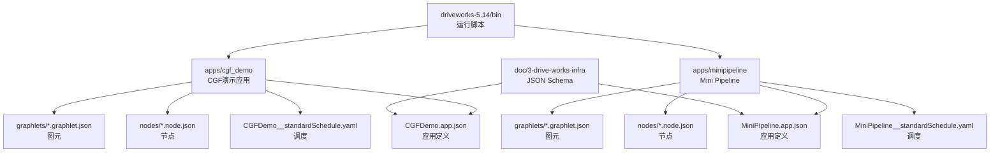
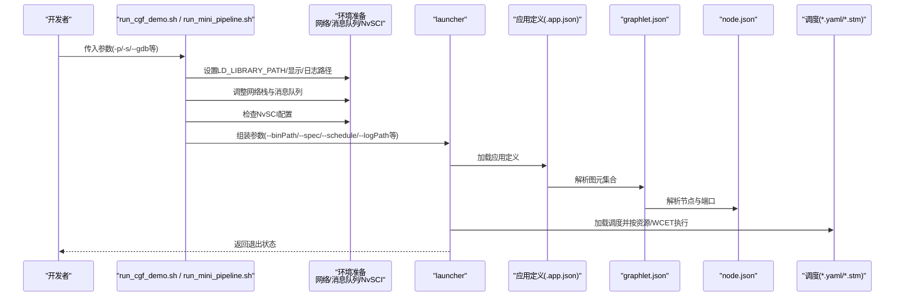
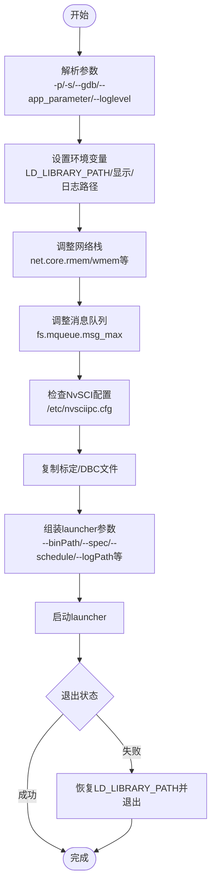
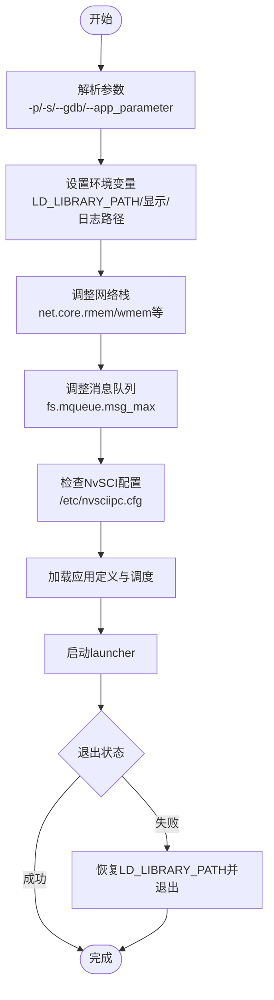
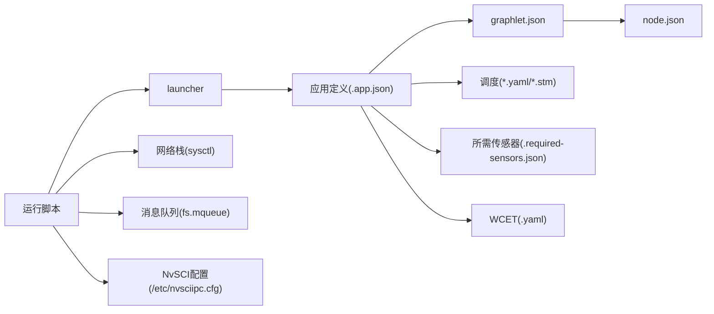

# 部署场景

<cite>
**本文引用的文件**
- [README.md](file://README.md)
- [README_en.md](file://README_en.md)
- [run_cgf_demo.sh（5.14）](file://driveworks-5.14/bin/run_cgf_demo.sh)
- [run_mini_pipeline.sh（5.14）](file://driveworks-5.14/bin/run_mini_pipeline.sh)
- [run_cgf.sh（5.8）](file://driveworks-5.8/bin/config/run_cgf.sh)
- [CGFDemo 标准调度（5.14）](file://driveworks-5.14/apps/cgf_demo/CGFDemo__standardSchedule.yaml)
- [MiniPipeline 标准调度（5.14）](file://driveworks-5.14/apps/minipipeline/MiniPipeline__standardSchedule.yaml)
- [CGFDemo 应用定义（5.14）](file://driveworks-5.14/apps/cgf_demo/CGFDemo.app.json)
- [MiniPipeline 应用定义（5.14）](file://driveworks-5.14/apps/minipipeline/applications/MiniPipeline.app.json)
- [CGFDemo 所需传感器（5.14）](file://driveworks-5.14/apps/cgf_demo/CGFDemo.required-sensors.json)
- [MiniPipeline 所需传感器（5.14）](file://driveworks-5.14/apps/minipipeline/applications/MiniPipeline.required-sensors.json)
- [CGFDemo WCET（5.14）](file://driveworks-5.14/apps/cgf_demo/CGFDemo_wcet.yaml)
- [MiniPipeline WCET（5.14）](file://driveworks-5.14/apps/minipipeline/applications/MiniPipeline_wcet.yaml)
- [CGFDemo graphlet（5.14）](file://driveworks-5.14/apps/cgf_demo/graphlets/CGFDemo.graphlet.json)
- [MiniPipeline graphlet（5.14）](file://driveworks-5.14/apps/minipipeline/graphlets/MiniPipeline.graphlet.json)
- [CGFDemo 节点（5.14）](file://driveworks-5.14/apps/cgf_demo/nodes/SensorSyncNode.node.json)
- [MiniPipeline 节点（5.14）](file://driveworks-5.14/apps/minipipeline/nodes/Visualization.node.json)
- [CGFDemo LiveSensor 标准调度（5.14）](file://driveworks-5.14/apps/cgf_demo/CGFDemoLiveSensor__standardSchedule.yaml)
- [CGFDemo LiveSensor 应用定义（5.14）](file://driveworks-5.14/apps/cgf_demo/CGFDemoLiveSensor.app.json)
- [CGFDemo LiveSensor graphlet（5.14）](file://driveworks-5.14/apps/cgf_demo/graphlets/CameraPipeline.graphlet.json)
- [CGFDemo LiveSensor 节点（5.14）](file://driveworks-5.14/apps/cgf_demo/nodes/RenderingCGFDemoNode.node.json)
- [CGFDemo 标准调度（5.8）](file://driveworks-5.8/src/cgf/graphs/CGFDemo__standardSchedule.yaml)
- [CGFDemo 应用定义（5.8）](file://driveworks-5.8/src/cgf/graphs/descriptions/systems/CGFDemo.app.json)
- [CGFDemo 所需传感器（5.8）](file://driveworks-5.8/src/cgf/graphs/descriptions/systems/CGFDemo.required-sensors.json)
- [CGFDemo graphlet（5.8）](file://driveworks-5.8/src/cgf/graphs/descriptions/systems/CGFDemo.graphlet.json)
- [CGFDemo 节点（5.8）](file://driveworks-5.8/src/cgf/graphs/descriptions/systems/SensorSyncNode.node.json)
- [CGFDemo WCET（5.8）](file://driveworks-5.8/src/cgf/graphs/descriptions/systems/CGFDemo_wcet.yaml)
- [app-config.schema.json（5.14）](file://doc/3-drive-works-infra/7-基于json的cgf设计/5.14/app-config.schema.json)
- [app.schema.json（5.14）](file://doc/3-drive-works-infra/7-基于json的cgf设计/5.14/app.schema.json)
- [node.schema.json（5.14）](file://doc/3-drive-works-infra/7-基于json的cgf设计/5.14/node.schema.json)
- [node-wcets.schema.json（5.14）](file://doc/3-drive-works-infra/7-基于json的cgf设计/5.14/node-wcets.schema.json)
- [sensor-mappings.schema.json（5.14）](file://doc/3-drive-works-infra/7-基于json的cgf设计/5.14/sensor-mappings.schema.json)
- [trans.schema.json（5.14）](file://doc/3-drive-works-infra/7-基于json的cgf设计/5.14/trans.schema.json)
- [launcher.schema.json（5.14）](file://doc/3-drive-works-infra/7-基于json的cgf设计/5.14/launcher.schema.json)
- [app-config.schema.json（5.10）](file://doc/3-drive-works-infra/7-基于json的cgf设计/5.10/app-config.schema.json)
- [app.schema.json（5.10）](file://doc/3-drive-works-infra/7-基于json的cgf设计/5.10/app.schema.json)
- [node.schema.json（5.10）](file://doc/3-drive-works-infra/7-基于json的cgf设计/5.10/node.schema.json)
- [node-wcets.schema.json（5.10）](file://doc/3-drive-works-infra/7-基于json的cgf设计/5.10/node-wcets.schema.json)
- [sensor-mappings.schema.json（5.10）](file://doc/3-drive-works-infra/7-基于json的cgf设计/5.10/sensor-mappings.schema.json)
- [trans.schema.json（5.10）](file://doc/3-drive-works-infra/7-基于json的cgf设计/5.10/trans.schema.json)
- [app-config.schema.json（5.8）](file://doc/3-drive-works-infra/7-基于json的cgf设计/5.8/app.schema.json)
- [app.schema.json（5.8）](file://doc/3-drive-works-infra/7-基于json的cgf设计/5.8/app.schema.json)
- [node.schema.json（5.8）](file://doc/3-drive-works-infra/7-基于json的cgf设计/5.8/node-param.schema.json)
- [sensor-mappings.schema.json（5.8）](file://doc/3-drive-works-infra/7-基于json的cgf设计/5.8/sensors.schema.json)
- [trans.schema.json（5.8）](file://doc/3-drive-works-infra/7-基于json的cgf设计/5.8/sensors.schema.json)
</cite>

## 目录
1. [简介](#简介)
2. [项目结构](#项目结构)
3. [核心组件](#核心组件)
4. [架构总览](#架构总览)
5. [详细组件分析](#详细组件分析)
6. [依赖分析](#依赖分析)
7. [性能考虑](#性能考虑)
8. [故障排除指南](#故障排除指南)
9. [结论](#结论)
10. [附录](#附录)

## 简介
本指南面向使用 Driveworks 5.x 中间件进行自动驾驶应用部署的工程师，覆盖从开发到生产的多环境配置、CGF 演示应用与 Mini Pipeline 的部署配置、容器化与云/边缘部署思路、监控与运维集成以及部署验证与故障排除方法。文档以仓库中的脚本、配置与样例为依据，提供可操作的步骤与最佳实践。

## 项目结构
仓库包含多个 Driveworks 版本（5.8/5.10/5.14/520），以及与 CGF/STM 相关的应用样例、运行脚本、调度与配置模式。关键目录与文件如下：
- 运行脚本：各版本 bin 下的 run_* 脚本，负责环境准备、参数解析、网络与消息队列调优、启动 launcher 等。
- 应用样例：cgf_demo 与 minipipeline，包含应用定义、graphlet、节点、所需传感器、WCET 等。
- 调度文件：标准/慢速调度 YAML，描述任务执行图、资源与 WCET。
- JSON Schema：应用、节点、传感器映射等的校验规范。
- 文档：README 及各版本说明，提供背景、迁移与参考链接。

图表来源
- [run_cgf_demo.sh（5.14）:1-509](file://driveworks-5.14/bin/run_cgf_demo.sh#L1-L509)
- [run_mini_pipeline.sh（5.14）:1-392](file://driveworks-5.14/bin/run_mini_pipeline.sh#L1-L392)
- [CGFDemo 应用定义（5.14）](file://driveworks-5.14/apps/cgf_demo/CGFDemo.app.json)
- [MiniPipeline 应用定义（5.14）](file://driveworks-5.14/apps/minipipeline/applications/MiniPipeline.app.json)
- [CGFDemo 标准调度（5.14）:1-800](file://driveworks-5.14/apps/cgf_demo/CGFDemo__standardSchedule.yaml#L1-L800)
- [MiniPipeline 标准调度（5.14）:1-294](file://driveworks-5.14/apps/minipipeline/MiniPipeline__standardSchedule.yaml#L1-L294)

章节来源
- [README.md:1-115](file://README.md#L1-L115)
- [README_en.md:1-92](file://README_en.md#L1-L92)

## 核心组件
- 运行脚本（run_cgf_demo.sh / run_mini_pipeline.sh）
  - 解析参数、设置环境变量、调整网络栈与消息队列、检查 NvSCI 配置、准备显示与日志路径、拼装 launcher 参数并启动。
- 应用定义（.app.json）
  - 描述系统入口、图元集合、节点、所需传感器、WCET 等。
- 图元（graphlet.json）
  - 将节点与端口组织为可复用的子图单元。
- 节点（node.json）
  - 定义节点行为、输入输出、参数与资源需求。
- 调度（*.yaml / *.stm）
  - 描述任务执行顺序、周期、资源分配与 WCET。
- JSON Schema
  - 校验应用、节点、传感器映射等结构，确保一致性与可部署性。

章节来源
- [run_cgf_demo.sh（5.14）:86-126](file://driveworks-5.14/bin/run_cgf_demo.sh#L86-L126)
- [run_mini_pipeline.sh（5.14）:57-86](file://driveworks-5.14/bin/run_mini_pipeline.sh#L57-L86)
- [CGFDemo 应用定义（5.14）](file://driveworks-5.14/apps/cgf_demo/CGFDemo.app.json)
- [MiniPipeline 应用定义（5.14）](file://driveworks-5.14/apps/minipipeline/applications/MiniPipeline.app.json)
- [CGFDemo graphlet（5.14）](file://driveworks-5.14/apps/cgf_demo/graphlets/CGFDemo.graphlet.json)
- [MiniPipeline graphlet（5.14）](file://driveworks-5.14/apps/minipipeline/graphlets/MiniPipeline.graphlet.json)
- [CGFDemo 节点（5.14）](file://driveworks-5.14/apps/cgf_demo/nodes/SensorSyncNode.node.json)
- [MiniPipeline 节点（5.14）](file://driveworks-5.14/apps/minipipeline/nodes/Visualization.node.json)
- [CGFDemo 标准调度（5.14）:1-800](file://driveworks-5.14/apps/cgf_demo/CGFDemo__standardSchedule.yaml#L1-L800)
- [MiniPipeline 标准调度（5.14）:1-294](file://driveworks-5.14/apps/minipipeline/MiniPipeline__standardSchedule.yaml#L1-L294)

## 架构总览
下图展示从运行脚本到 launcher 的启动流程，以及应用定义、图元、节点与调度之间的关系。

图表来源
- [run_cgf_demo.sh（5.14）:291-313](file://driveworks-5.14/bin/run_cgf_demo.sh#L291-L313)
- [run_mini_pipeline.sh（5.14）:237-257](file://driveworks-5.14/bin/run_mini_pipeline.sh#L237-L257)
- [CGFDemo 应用定义（5.14）](file://driveworks-5.14/apps/cgf_demo/CGFDemo.app.json)
- [MiniPipeline 应用定义（5.14）](file://driveworks-5.14/apps/minipipeline/applications/MiniPipeline.app.json)
- [CGFDemo 标准调度（5.14）:1-800](file://driveworks-5.14/apps/cgf_demo/CGFDemo__standardSchedule.yaml#L1-L800)
- [MiniPipeline 标准调度（5.14）:1-294](file://driveworks-5.14/apps/minipipeline/MiniPipeline__standardSchedule.yaml#L1-L294)

## 详细组件分析

### CGF 演示应用（CGFDemo）部署
- 启动流程
  - 使用 run_cgf_demo.sh，解析参数（产品名、Car、Schedule、GDB、应用参数、日志级别等），准备环境（网络栈、消息队列、NvSCI）、复制标定/DBC 文件、拼装 launcher 参数并启动。
- 关键配置
  - 应用定义：CGFDemo.app.json；图元：graphlets/*.graphlet.json；节点：nodes/*.node.json；所需传感器：CGFDemo.required-sensors.json；WCET：CGFDemo_wcet.yaml。
  - 调度：CGFDemo__standardSchedule.yaml 或 CGFDemoLiveSensor__standardSchedule.yaml。
- 数据源
  - 实车：读取车辆标定 overlay 与 rig；仿真：读取数据集路径与地图。
- 日志与清理
  - 日志目录 LogFolder；退出后恢复 LD_LIBRARY_PATH。

图表来源
- [run_cgf_demo.sh（5.14）:86-126](file://driveworks-5.14/bin/run_cgf_demo.sh#L86-L126)
- [run_cgf_demo.sh（5.14）:291-313](file://driveworks-5.14/bin/run_cgf_demo.sh#L291-L313)
- [run_cgf_demo.sh（5.14）:418-490](file://driveworks-5.14/bin/run_cgf_demo.sh#L418-L490)

章节来源
- [run_cgf_demo.sh（5.14）:86-126](file://driveworks-5.14/bin/run_cgf_demo.sh#L86-L126)
- [run_cgf_demo.sh（5.14）:181-235](file://driveworks-5.14/bin/run_cgf_demo.sh#L181-L235)
- [run_cgf_demo.sh（5.14）:237-289](file://driveworks-5.14/bin/run_cgf_demo.sh#L237-L289)
- [run_cgf_demo.sh（5.14）:418-490](file://driveworks-5.14/bin/run_cgf_demo.sh#L418-L490)
- [CGFDemo 应用定义（5.14）](file://driveworks-5.14/apps/cgf_demo/CGFDemo.app.json)
- [CGFDemo 所需传感器（5.14）](file://driveworks-5.14/apps/cgf_demo/CGFDemo.required-sensors.json)
- [CGFDemo WCET（5.14）](file://driveworks-5.14/apps/cgf_demo/CGFDemo_wcet.yaml)
- [CGFDemo graphlet（5.14）](file://driveworks-5.14/apps/cgf_demo/graphlets/CGFDemo.graphlet.json)
- [CGFDemo 节点（5.14）](file://driveworks-5.14/apps/cgf_demo/nodes/SensorSyncNode.node.json)
- [CGFDemo 标准调度（5.14）:1-800](file://driveworks-5.14/apps/cgf_demo/CGFDemo__standardSchedule.yaml#L1-L800)
- [CGFDemo LiveSensor 应用定义（5.14）](file://driveworks-5.14/apps/cgf_demo/CGFDemoLiveSensor.app.json)
- [CGFDemo LiveSensor graphlet（5.14）](file://driveworks-5.14/apps/cgf_demo/graphlets/CameraPipeline.graphlet.json)
- [CGFDemo LiveSensor 节点（5.14）](file://driveworks-5.14/apps/cgf_demo/nodes/RenderingCGFDemoNode.node.json)
- [CGFDemo LiveSensor 标准调度（5.14）](file://driveworks-5.14/apps/cgf_demo/CGFDemoLiveSensor__standardSchedule.yaml)

### Mini Pipeline 部署
- 启动流程
  - 使用 run_mini_pipeline.sh，解析参数（产品名、Schedule、GDB、应用参数），准备环境（网络栈、消息队列、NvSCI），加载 MiniPipeline 应用定义与调度，启动 launcher。
- 关键配置
  - 应用定义：MiniPipeline.app.json；图元：graphlets/*.graphlet.json；节点：nodes/*.node.json；所需传感器：MiniPipeline.required-sensors.json；WCET：MiniPipeline_wcet.yaml。
  - 调度：MiniPipeline__standardSchedule.yaml。
- 数据源
  - 仿真数据集路径 data/samples/minipipeline/<dataset>。

图表来源
- [run_mini_pipeline.sh（5.14）:57-86](file://driveworks-5.14/bin/run_mini_pipeline.sh#L57-L86)
- [run_mini_pipeline.sh（5.14）:237-257](file://driveworks-5.14/bin/run_mini_pipeline.sh#L237-L257)
- [run_mini_pipeline.sh（5.14）:313-353](file://driveworks-5.14/bin/run_mini_pipeline.sh#L313-L353)

章节来源
- [run_mini_pipeline.sh（5.14）:57-86](file://driveworks-5.14/bin/run_mini_pipeline.sh#L57-L86)
- [run_mini_pipeline.sh（5.14）:148-202](file://driveworks-5.14/bin/run_mini_pipeline.sh#L148-L202)
- [run_mini_pipeline.sh（5.14）:204-235](file://driveworks-5.14/bin/run_mini_pipeline.sh#L204-L235)
- [run_mini_pipeline.sh（5.14）:313-353](file://driveworks-5.14/bin/run_mini_pipeline.sh#L313-L353)
- [MiniPipeline 应用定义（5.14）](file://driveworks-5.14/apps/minipipeline/applications/MiniPipeline.app.json)
- [MiniPipeline 所需传感器（5.14）](file://driveworks-5.14/apps/minipipeline/applications/MiniPipeline.required-sensors.json)
- [MiniPipeline WCET（5.14）](file://driveworks-5.14/apps/minipipeline/applications/MiniPipeline_wcet.yaml)
- [MiniPipeline graphlet（5.14）](file://driveworks-5.14/apps/minipipeline/graphlets/MiniPipeline.graphlet.json)
- [MiniPipeline 节点（5.14）](file://driveworks-5.14/apps/minipipeline/nodes/Visualization.node.json)
- [MiniPipeline 标准调度（5.14）:1-294](file://driveworks-5.14/apps/minipipeline/MiniPipeline__standardSchedule.yaml#L1-L294)

### 5.8 版本对比
- 运行脚本：run_cgf.sh（5.8）与 5.14 的 run_cgf_demo.sh 结构相似，参数解析、环境准备、网络与消息队列调优、NvSCI 检查、日志与数据路径处理一致。
- 应用与调度：5.8 的 CGFDemo.app.json、graphlet、node、required-sensors、wcet 与 5.14 对应文件结构一致，便于迁移。

章节来源
- [run_cgf.sh（5.8）:57-82](file://driveworks-5.8/bin/config/run_cgf.sh#L57-L82)
- [run_cgf.sh（5.8）:142-196](file://driveworks-5.8/bin/config/run_cgf.sh#L142-L196)
- [run_cgf.sh（5.8）:198-229](file://driveworks-5.8/bin/config/run_cgf.sh#L198-L229)
- [run_cgf.sh（5.8）:305-350](file://driveworks-5.8/bin/config/run_cgf.sh#L305-L350)
- [CGFDemo 应用定义（5.8）](file://driveworks-5.8/src/cgf/graphs/descriptions/systems/CGFDemo.app.json)
- [CGFDemo 所需传感器（5.8）](file://driveworks-5.8/src/cgf/graphs/descriptions/systems/CGFDemo.required-sensors.json)
- [CGFDemo graphlet（5.8）](file://driveworks-5.8/src/cgf/graphs/descriptions/systems/CGFDemo.graphlet.json)
- [CGFDemo 节点（5.8）](file://driveworks-5.8/src/cgf/graphs/descriptions/systems/SensorSyncNode.node.json)
- [CGFDemo WCET（5.8）](file://driveworks-5.8/src/cgf/graphs/descriptions/systems/CGFDemo_wcet.yaml)
- [CGFDemo 标准调度（5.8）:1-200](file://driveworks-5.8/src/cgf/graphs/CGFDemo__standardSchedule.yaml#L1-L200)

## 依赖分析
- 组件耦合
  - 运行脚本与 launcher 强耦合，通过参数传递应用定义、调度、日志路径等。
  - 应用定义依赖 graphlet 与节点；graphlet 依赖节点；调度依赖 graphlet/节点与 WCET。
- 外部依赖
  - 网络栈与消息队列参数需满足 STM/IPC 要求；NvSCI 配置文件必须存在且包含 STM 相关段落。
- 版本差异
  - 5.8 与 5.14 在脚本结构与部分路径上保持一致，便于跨版本迁移。

图表来源
- [run_cgf_demo.sh（5.14）:291-313](file://driveworks-5.14/bin/run_cgf_demo.sh#L291-L313)
- [run_mini_pipeline.sh（5.14）:237-257](file://driveworks-5.14/bin/run_mini_pipeline.sh#L237-L257)
- [CGFDemo 应用定义（5.14）](file://driveworks-5.14/apps/cgf_demo/CGFDemo.app.json)
- [MiniPipeline 应用定义（5.14）](file://driveworks-5.14/apps/minipipeline/applications/MiniPipeline.app.json)
- [CGFDemo 标准调度（5.14）:1-800](file://driveworks-5.14/apps/cgf_demo/CGFDemo__standardSchedule.yaml#L1-L800)
- [MiniPipeline 标准调度（5.14）:1-294](file://driveworks-5.14/apps/minipipeline/MiniPipeline__standardSchedule.yaml#L1-L294)

章节来源
- [run_cgf_demo.sh（5.14）:181-235](file://driveworks-5.14/bin/run_cgf_demo.sh#L181-L235)
- [run_mini_pipeline.sh（5.14）:148-202](file://driveworks-5.14/bin/run_mini_pipeline.sh#L148-L202)
- [CGFDemo 所需传感器（5.14）](file://driveworks-5.14/apps/cgf_demo/CGFDemo.required-sensors.json)
- [MiniPipeline 所需传感器（5.14）](file://driveworks-5.14/apps/minipipeline/applications/MiniPipeline.required-sensors.json)

## 性能考虑
- 网络栈与消息队列
  - 脚本会检查并建议增大 net.core.rmem/wmem、TCP 缓冲区与 fs.mqueue.msg_max，以降低高吞吐下的延迟与丢包风险。
- 资源与调度
  - 调度文件明确标注 CPU/GPU/CUDA_STREAM/CUDA_MUTEX_LOCK 等资源占用与 WCET，有助于评估系统负载与峰值带宽。
- 显示与窗口
  - 脚本根据显示环境设置 DISPLAY，避免在无头环境中出现显示问题。

章节来源
- [run_cgf_demo.sh（5.14）:181-235](file://driveworks-5.14/bin/run_cgf_demo.sh#L181-L235)
- [run_mini_pipeline.sh（5.14）:148-202](file://driveworks-5.14/bin/run_mini_pipeline.sh#L148-L202)
- [CGFDemo 标准调度（5.14）:1-800](file://driveworks-5.14/apps/cgf_demo/CGFDemo__standardSchedule.yaml#L1-L800)
- [MiniPipeline 标准调度（5.14）:1-294](file://driveworks-5.14/apps/minipipeline/MiniPipeline__standardSchedule.yaml#L1-L294)

## 故障排除指南
- 网络栈不足
  - 现象：默认缓冲区过小导致高延迟。
  - 处理：按脚本提示修改 sysctl 并生效。
- 消息队列过小
  - 现象：STM 需要至少 4096 条消息，否则启动失败。
  - 处理：增大 fs.mqueue.msg_max 并 sysctl 生效。
- NvSCI 配置缺失或不完整
  - 现象：缺少 /etc/nvsciipc.cfg 或未包含 STM 相关段落。
  - 处理：补齐配置文件并确保包含 STM 段。
- 应用/调度/图元缺失
  - 现象：找不到 .app.json、*.yaml 或 graphlet/node 文件。
  - 处理：确认路径与文件存在，必要时重新生成调度与 graphlet。
- 退出状态
  - launcher 退出状态为 0 表示成功；非 0 时检查 LogFolder 与日志文件定位问题。

章节来源
- [run_cgf_demo.sh（5.14）:181-235](file://driveworks-5.14/bin/run_cgf_demo.sh#L181-L235)
- [run_cgf_demo.sh（5.14）:237-289](file://driveworks-5.14/bin/run_cgf_demo.sh#L237-L289)
- [run_mini_pipeline.sh（5.14）:148-202](file://driveworks-5.14/bin/run_mini_pipeline.sh#L148-L202)
- [run_mini_pipeline.sh（5.14）:204-235](file://driveworks-5.14/bin/run_mini_pipeline.sh#L204-L235)
- [run_cgf_demo.sh（5.14）:371-416](file://driveworks-5.14/bin/run_cgf_demo.sh#L371-L416)
- [run_mini_pipeline.sh（5.14）:334-353](file://driveworks-5.14/bin/run_mini_pipeline.sh#L334-L353)

## 结论
通过运行脚本与应用/图元/节点/调度的协同，Driveworks 5.x 提供了从开发到部署的一体化路径。遵循网络栈与消息队列调优、正确配置 NvSCI、严格校验应用定义与调度结构，可显著提升部署稳定性与性能。版本间结构高度一致，便于在 5.8/5.14 间迁移。

## 附录

### 开发环境配置要点
- 系统要求
  - Linux（Ubuntu）或 QNX；确保具备足够的网络缓冲与消息队列容量。
- 工具链
  - 使用 README_en.md 中的 CMake 工具链与安装流程，生成并安装样例。
- 环境变量
  - 运行脚本会自动设置 LD_LIBRARY_PATH；如需本地开发，确保库路径正确。

章节来源
- [README_en.md:1-92](file://README_en.md#L1-L92)
- [run_cgf_demo.sh（5.14）:291-313](file://driveworks-5.14/bin/run_cgf_demo.sh#L291-L313)
- [run_mini_pipeline.sh（5.14）:237-257](file://driveworks-5.14/bin/run_mini_pipeline.sh#L237-L257)

### 测试/生产环境差异与最佳实践
- 测试环境
  - 使用仿真数据集与虚拟数据源；开启调试参数（--gdb）；降低日志级别以便快速定位问题。
- 生产环境
  - 使用实车数据源与标定 overlay；关闭调试参数；提高日志级别以满足审计需求；确保网络与消息队列参数已固化为系统默认值。

章节来源
- [run_cgf_demo.sh（5.14）:477-490](file://driveworks-5.14/bin/run_cgf_demo.sh#L477-L490)
- [run_mini_pipeline.sh（5.14）:362-373](file://driveworks-5.14/bin/run_mini_pipeline.sh#L362-L373)

### 应用程序部署示例
- CGF 演示应用
  - 步骤：准备运行脚本 → 调整网络与消息队列 → 检查 NvSCI → 复制标定/DBC → 启动 launcher → 查看 LogFolder。
- Mini Pipeline
  - 步骤：准备运行脚本 → 调整网络与消息队列 → 检查 NvSCI → 加载应用定义与调度 → 启动 launcher → 查看 LogFolder。

章节来源
- [run_cgf_demo.sh（5.14）:494-509](file://driveworks-5.14/bin/run_cgf_demo.sh#L494-L509)
- [run_mini_pipeline.sh（5.14）:377-391](file://driveworks-5.14/bin/run_mini_pipeline.sh#L377-L391)

### 容器化部署方案（概念性指导）
- 镜像构建
  - 基于目标系统镜像（Ubuntu/QNX）安装 Driveworks 运行时与依赖；打包运行脚本、应用定义、graphlet、节点与调度文件。
- 容器编排
  - 使用 Docker/Kubernetes 运行；挂载数据卷（日志、数据集、标定文件）；设置 sysctl（网络栈与消息队列）与设备直通（GPU/IPC）。
- 注意事项
  - 确保容器内 NvSCI 配置可用；网络栈参数需通过 --sysctl 或 hostNetwork 方式配置；GPU/CUDA 资源需正确授权。

[本节为概念性内容，不直接对应具体源码文件]

### 云端与边缘部署（概念性指导）
- 边缘侧
  - 在 DriveAGX Orin 设备上部署，遵循网络与消息队列调优；使用 run_cgf_demo.sh/run_mini_pipeline.sh 启动。
- 云端
  - 通过容器化方式在云端运行仿真场景；注意网络延迟与带宽对实时性的影响；日志与监控集中采集。

[本节为概念性内容，不直接对应具体源码文件]

### 监控与运维集成（概念性指导）
- 性能监控
  - 结合调度中的 WCET 与实际执行时间，评估资源占用与瓶颈。
- 日志收集
  - 使用 LogFolder 输出日志；结合系统日志与应用日志统一收集与归档。
- 健康检查
  - 通过 launcher 退出状态判断应用健康；结合网络与消息队列指标进行健康评估。

[本节为概念性内容，不直接对应具体源码文件]

### 部署验证与故障排除清单
- 部署验证
  - 确认网络栈与消息队列参数；确认 NvSCI 配置；确认应用定义、graphlet、节点、调度与所需传感器齐全；启动 launcher 并检查退出状态。
- 常见问题
  - 网络延迟高：增大缓冲区；消息队列不足：增大 fs.mqueue.msg_max；NvSCI 缺失：补齐配置；文件缺失：核对路径与生成流程。

[本节为通用实践总结，不直接对应具体源码文件]