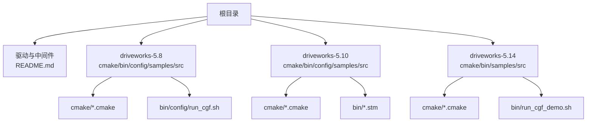
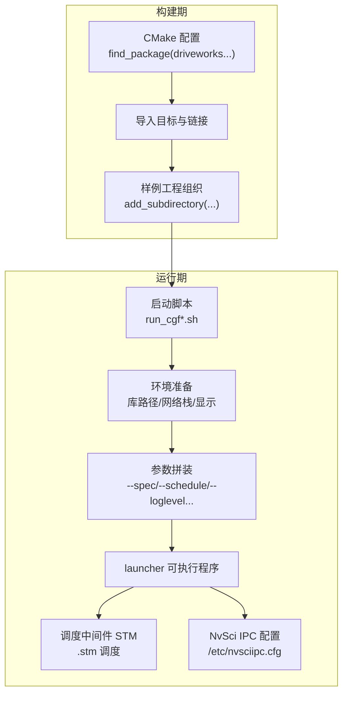
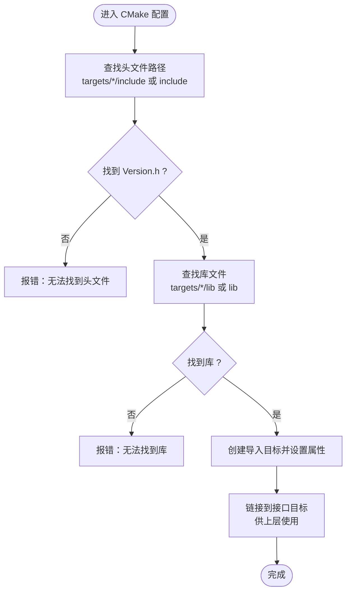
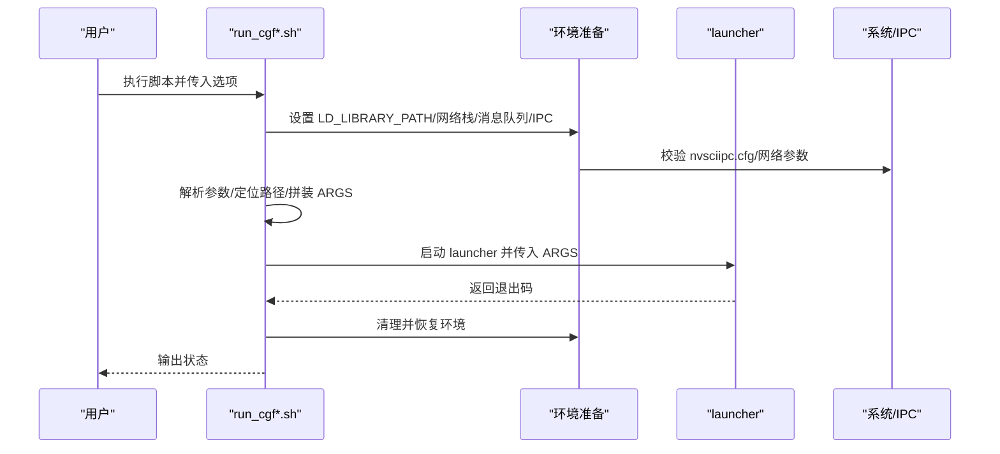
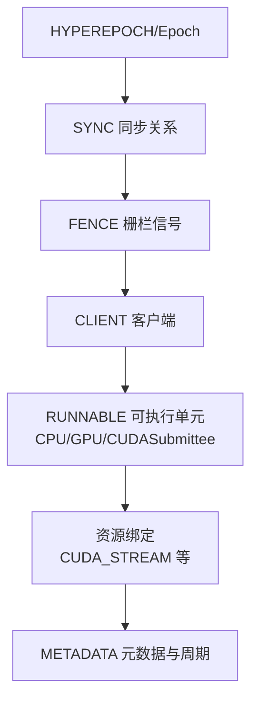
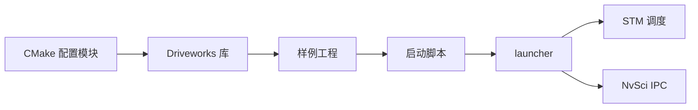

# 配置和部署

<cite>
**本文引用的文件**
- [README.md](file://README.md)
- [run_cgf_demo.sh（5.14）](file://driveworks-5.14/bin/run_cgf_demo.sh)
- [run_cgf.sh（5.8）](file://driveworks-5.8/bin/config/run_cgf.sh)
- [driveworks-config.cmake（5.10）](file://driverorks-5.10/cmake/driveworks-config.cmake)
- [driveworks-config.cmake（5.14）](file://driveworks-5.14/cmake/driveworks-config.cmake)
- [driveworks-config.cmake（5.8）](file://driveworks-5.8/cmake/driveworks-config.cmake)
- [nvsciipc.cfg（5.10）](file://driverorks-5.10/config/nvsciipc.cfg)
- [cpu_simple.stm](file://driverorks-5.10/bin/cpu_simple.stm)
- [gpu_multistream_multiprocess.stm](file://driverorks-5.10/bin/gpu_multistream_multiprocess.stm)
- [samples/CMakeLists.txt（5.10）](file://driverorks-5.10/samples/CMakeLists.txt)
- [samples/CMakeLists.txt（5.14）](file://driveworks-5.14/samples/CMakeLists.txt)
</cite>

## 目录
1. [简介](#简介)
2. [项目结构](#项目结构)
3. [核心组件](#核心组件)
4. [架构总览](#架构总览)
5. [详细组件分析](#详细组件分析)
6. [依赖分析](#依赖分析)
7. [性能考虑](#性能考虑)
8. [故障排查指南](#故障排查指南)
9. [结论](#结论)
10. [附录](#附录)

## 简介
本指南面向使用 Driveworks 5.x 进行自动驾驶应用开发与部署的工程师，覆盖从构建配置、依赖管理、编译与链接选项，到运行时配置、性能调优、调试与日志、多环境部署策略（开发/测试/生产）、容器化与 Kubernetes 部署，以及性能监控与常见问题诊断。内容以仓库中的 CMake 配置、启动脚本、调度模板与样例工程为依据，帮助读者建立从本地开发到边缘实车部署的完整配置与运维体系。

## 项目结构
仓库包含多个版本的 Driveworks 发行版（5.8/5.10/5.14），以及对应的 CMake 配置、运行脚本、调度模板与样例工程。顶层 README 提供了版本演进与中间件定位说明；各版本目录下包含 cmake、bin、config、samples 等子树，分别对应构建配置、运行脚本、IPC 配置与示例工程。

**图表来源**
- [README.md](file://README.md)
- [run_cgf.sh（5.8）](file://driveworks-5.8/bin/config/run_cgf.sh)
- [run_cgf_demo.sh（5.14）](file://driveworks-5.14/bin/run_cgf_demo.sh)
- [driveworks-config.cmake（5.8）](file://driveworks-5.8/cmake/driveworks-config.cmake)
- [driveworks-config.cmake（5.10）](file://driverorks-5.10/cmake/driveworks-config.cmake)
- [driveworks-config.cmake（5.14）](file://driveworks-5.14/cmake/driveworks-config.cmake)
- [cpu_simple.stm](file://driverorks-5.10/bin/cpu_simple.stm)
- [gpu_multistream_multiprocess.stm](file://driverorks-5.10/bin/gpu_multistream_multiprocess.stm)

**章节来源**
- [README.md](file://README.md)

## 核心组件
- 构建与依赖管理
  - 使用 CMake 查找并链接 Driveworks 各子库（如 dw_base、dw_sensors、dw_pointcloudprocessing 等），通过导入目标方式统一暴露给上层工程。
  - 样例工程通过 find_package 加载 driveworks、driveworks-shared、driveworks-visualization、dwdynamicmemory 等配置模块，完成编译与链接。
- 运行时与调度
  - 启动脚本负责环境准备（库路径、网络栈、消息队列、显示环境等），解析命令行参数，拼装 launcher 参数并执行。
  - 调度模板（.stm）定义资源、客户端、同步与栅栏，描述帧级调度与 GPU/CPU 并行策略。
- IPC 与通信
  - NvSci IPC 配置文件定义跨进程通道端点与缓冲参数，确保跨进程/跨 VM 的高性能数据通路。
- 日志与调试
  - 启动脚本支持日志级别参数与 gdb 调试开关；样例工程提供可视化与动态内存分配器等辅助组件。

**章节来源**
- [driveworks-config.cmake（5.10）](file://driverorks-5.10/cmake/driveworks-config.cmake)
- [driveworks-config.cmake（5.14）](file://driveworks-5.14/cmake/driveworks-config.cmake)
- [driveworks-config.cmake（5.8）](file://driveworks-5.8/cmake/driveworks-config.cmake)
- [samples/CMakeLists.txt（5.10）](file://driverorks-5.10/samples/CMakeLists.txt)
- [samples/CMakeLists.txt（5.14）](file://driveworks-5.14/samples/CMakeLists.txt)
- [run_cgf.sh（5.8）](file://driveworks-5.8/bin/config/run_cgf.sh)
- [run_cgf_demo.sh（5.14）](file://driveworks-5.14/bin/run_cgf_demo.sh)
- [nvsciipc.cfg（5.10）](file://driverorks-5.10/config/nvsciipc.cfg)
- [cpu_simple.stm](file://driverorks-5.10/bin/cpu_simple.stm)
- [gpu_multistream_multiprocess.stm](file://driverorks-5.10/bin/gpu_multistream_multiprocess.stm)

## 架构总览
下图展示了 Driveworks 应用从构建到运行的关键路径：CMake 模块查找与链接、样例工程组织、启动脚本环境准备与参数传递、调度模板与 IPC 配置协同工作，最终由 launcher 执行。

**图表来源**
- [driveworks-config.cmake（5.10）](file://driverorks-5.10/cmake/driveworks-config.cmake)
- [driveworks-config.cmake（5.14）](file://driveworks-5.14/cmake/driveworks-config.cmake)
- [samples/CMakeLists.txt（5.10）](file://driverorks-5.10/samples/CMakeLists.txt)
- [samples/CMakeLists.txt（5.14）](file://driveworks-5.14/samples/CMakeLists.txt)
- [run_cgf.sh（5.8）](file://driveworks-5.8/bin/config/run_cgf.sh)
- [run_cgf_demo.sh（5.14）](file://driveworks-5.14/bin/run_cgf_demo.sh)
- [nvsciipc.cfg（5.10）](file://driverorks-5.10/config/nvsciipc.cfg)
- [cpu_simple.stm](file://driverorks-5.10/bin/cpu_simple.stm)
- [gpu_multistream_multiprocess.stm](file://driverorks-5.10/bin/gpu_multistream_multiprocess.stm)

## 详细组件分析

### 构建配置与依赖管理（CMake）
- 通用流程
  - CMake 模块在指定目录内查找头文件与共享库，构造导入目标并将其链接到接口目标，供上层工程统一使用。
  - 不同版本的配置文件会包含不同的库集合（例如 5.14 引入了 dwtrace）。
- 关键要点
  - 头文件与库搜索路径包含 targets/<arch>-<OS>/include 与 include/lib 两套路径，确保跨平台与交叉编译兼容。
  - 若找不到头文件或库，会直接报错，便于早期发现缺失。
  - 5.10/5.14 的配置文件在导入目标命名与属性设置上略有差异，需按版本选择对应配置。
- 典型使用
  - 样例工程通过 find_package 加载 driveworks、driveworks-shared、driveworks-visualization、dwdynamicmemory 等，再将这些库加入目标链接列表。

**图表来源**
- [driveworks-config.cmake（5.10）](file://driverorks-5.10/cmake/driveworks-config.cmake)
- [driveworks-config.cmake（5.14）](file://driveworks-5.14/cmake/driveworks-config.cmake)
- [driveworks-config.cmake（5.8）](file://driveworks-5.8/cmake/driveworks-config.cmake)

**章节来源**
- [driveworks-config.cmake（5.10）](file://driverorks-5.10/cmake/driveworks-config.cmake)
- [driveworks-config.cmake（5.14）](file://driveworks-5.14/cmake/driveworks-config.cmake)
- [driveworks-config.cmake（5.8）](file://driveworks-5.8/cmake/driveworks-config.cmake)
- [samples/CMakeLists.txt（5.10）](file://driverorks-5.10/samples/CMakeLists.txt)
- [samples/CMakeLists.txt（5.14）](file://driveworks-5.14/samples/CMakeLists.txt)

### 运行时配置与启动流程（run_cgf*.sh）
- 环境准备
  - 设置 LD_LIBRARY_PATH，追加节点库、二进制目录与库目录。
  - 在 Linux 上进行网络栈与消息队列参数检查与必要调整；校验 NvSci IPC 配置文件存在性与内容。
  - 准备显示环境（XAUTHORITY、DISPLAY），适配 SSH 与本地会话。
- 参数解析与路径定位
  - 解析产品名、调度文件、日志级别、gdb 调试开关等参数。
  - 根据 dazel/部署构建与实际安装路径，确定 DW_TOP_PATH、RR_TOP_PATH、CGF_SYS_PATH、RR_GRAPHS_PATH 等。
- 数据源与参数拼装
  - 支持实车传感器数据与录制数据两种模式；根据数据源设置 datapath、rig、virtual 等参数。
  - 将 spec、schedule、logPath、loglevel、窗口尺寸、gdb_debug 等参数传给 launcher。
- 执行与清理
  - 后台启动 launcher，等待退出码；退出前恢复 LD_LIBRARY_PATH 并输出状态。

**图表来源**
- [run_cgf.sh（5.8）](file://driveworks-5.8/bin/config/run_cgf.sh)
- [run_cgf_demo.sh（5.14）](file://driveworks-5.14/bin/run_cgf_demo.sh)
- [nvsciipc.cfg（5.10）](file://driverorks-5.10/config/nvsciipc.cfg)

**章节来源**
- [run_cgf.sh（5.8）](file://driveworks-5.8/bin/config/run_cgf.sh)
- [run_cgf_demo.sh（5.14）](file://driveworks-5.14/bin/run_cgf_demo.sh)

### 调度中间件 STM（.stm）
- 资源与客户端
  - 客户端定义在特定核心上运行的可执行单元（CPU/GPU/CUDASubmittee），并声明所需资源（如 CUDA_STREAM）。
- 同步与栅栏
  - SYNC 描述跨客户端的同步关系；FENCE 定义栅栏信号，控制可执行单元的触发与等待。
- 元数据与周期
  - METADATA 中包含编译后的可执行单元映射、优先级、资源占用与周期长度，便于验证与分析。
- 示例
  - cpu_simple.stm 展示单核 CPU 串行与帧同步逻辑。
  - gpu_multistream_multiprocess.stm 展示多客户端、多 CUDA 流、跨客户端提交与栅栏协作的复杂调度。

**图表来源**
- [cpu_simple.stm](file://driverorks-5.10/bin/cpu_simple.stm)
- [gpu_multistream_multiprocess.stm](file://driverorks-5.10/bin/gpu_multistream_multiprocess.stm)

**章节来源**
- [cpu_simple.stm](file://driverorks-5.10/bin/cpu_simple.stm)
- [gpu_multistream_multiprocess.stm](file://driverorks-5.10/bin/gpu_multistream_multiprocess.stm)

### IPC 配置（NvSci IPC）
- 配置文件位置与格式
  - Linux 下通常位于 /etc/nvsciipc.cfg，定义 INTER_PROCESS/INTER_VM 等后端类型及端点对、帧数与帧大小等参数。
- 必要性
  - 启动脚本会在 Linux 环境下检查该文件是否存在，并在 x86_64 平台上要求包含特定标记，否则拒绝启动。
- Docker 场景
  - 当消息队列参数过低时，脚本会提示通过 sysctl 或容器启动参数调整 fs.mqueue.msg_max。

**章节来源**
- [nvsciipc.cfg（5.10）](file://driverorks-5.10/config/nvsciipc.cfg)
- [run_cgf.sh（5.8）](file://driveworks-5.8/bin/config/run_cgf.sh)
- [run_cgf_demo.sh（5.14）](file://driveworks-5.14/bin/run_cgf_demo.sh)

### 日志与调试配置
- 日志级别
  - 启动脚本支持通过 --loglevel 传入日志级别（如 DW_LOG_ERROR），并写入 LogFolder。
- 调试
  - 支持 --gdb 调试开关，便于在 launcher 启动时启用 gdb。
- 可视化与动态内存
  - 样例工程链接可视化与动态内存分配器库，便于开发与调试阶段观察与分析。

**章节来源**
- [run_cgf.sh（5.8）](file://driveworks-5.8/bin/config/run_cgf.sh)
- [run_cgf_demo.sh（5.14）](file://driveworks-5.14/bin/run_cgf_demo.sh)
- [samples/CMakeLists.txt（5.10）](file://driverorks-5.10/samples/CMakeLists.txt)
- [samples/CMakeLists.txt（5.14）](file://driveworks-5.14/samples/CMakeLists.txt)

### 多环境配置示例（开发/测试/生产）
- 开发环境
  - 使用样例工程与本地数据集，开启可视化与详细日志；通过 run_cgf.sh/run_cgf_demo.sh 选择虚拟数据源，便于离线调试。
- 测试环境
  - 使用录制数据集与真实地图路径，关闭 fullscreen 或调整窗口尺寸；提高日志级别以便问题定位。
- 生产环境
  - 使用实车传感器数据源，严格校验 NvSci IPC 配置与网络栈参数；禁用可视化与调试参数，确保实时性与稳定性。

**章节来源**
- [run_cgf.sh（5.8）](file://driveworks-5.8/bin/config/run_cgf.sh)
- [run_cgf_demo.sh（5.14）](file://driveworks-5.14/bin/run_cgf_demo.sh)

### 容器化部署与 Kubernetes（建议实践）
- Docker 镜像构建
  - 基于官方 SDK 发行包构建镜像，将 /usr/local/driveworks 内容打包并挂载到容器中。
  - 在容器启动时设置必要的 sysctl（如 fs.mqueue.msg_max），并确保 /etc/nvsciipc.cfg 可读。
- Kubernetes 部署
  - 使用 Deployment/StatefulSet 管理 launcher 实例；通过 ConfigMap 挂载配置文件，通过 PersistentVolume/PersistentVolumeClaim 提供数据卷。
  - 为 GPU/CUDA 工作负载配置 DevicePlugins 与资源请求；为可视化场景配置合适的显示环境变量（DISPLAY/XAUTHORITY）。
- 注意事项
  - 确保容器具备访问 /dev/nvidia* 设备的能力；网络栈参数需在宿主机或通过 sysctl 注入容器。
  - 严格区分开发/测试/生产三套配置，避免在生产环境启用调试与可视化参数。

[本节为概念性指导，不直接分析具体文件，故无“章节来源”]

## 依赖分析
- 组件耦合
  - 样例工程依赖 driveworks、driveworks-shared、driveworks-visualization、dwdynamicmemory 等配置模块；CMake 配置模块负责查找与导入底层库。
  - 启动脚本依赖系统网络栈、消息队列与 NvSci IPC 配置；launcher 接收参数并交由 STM 与 IPC 子系统执行。
- 外部依赖
  - CUDA、cuBLAS、EGL、Threads 等系统库；在 5.14 中还可能涉及 cuDNN、TensorRT、NvSciBuf/NvSciSync 等。
- 循环依赖
  - CMake 配置模块与样例工程之间为单向依赖，启动脚本与运行时组件之间为单向调用，未见循环依赖迹象。

**图表来源**
- [driveworks-config.cmake（5.10）](file://driverorks-5.10/cmake/driveworks-config.cmake)
- [driveworks-config.cmake（5.14）](file://driveworks-5.14/cmake/driveworks-config.cmake)
- [samples/CMakeLists.txt（5.10）](file://driverorks-5.10/samples/CMakeLists.txt)
- [samples/CMakeLists.txt（5.14）](file://driveworks-5.14/samples/CMakeLists.txt)
- [run_cgf.sh（5.8）](file://driveworks-5.8/bin/config/run_cgf.sh)
- [run_cgf_demo.sh（5.14）](file://driveworks-5.14/bin/run_cgf_demo.sh)
- [nvsciipc.cfg（5.10）](file://driverorks-5.10/config/nvsciipc.cfg)

**章节来源**
- [driveworks-config.cmake（5.10）](file://driverorks-5.10/cmake/driveworks-config.cmake)
- [driveworks-config.cmake（5.14）](file://driveworks-5.14/cmake/driveworks-config.cmake)
- [samples/CMakeLists.txt（5.10）](file://driverorks-5.10/samples/CMakeLists.txt)
- [samples/CMakeLists.txt（5.14）](file://driveworks-5.14/samples/CMakeLists.txt)
- [run_cgf.sh（5.8）](file://driveworks-5.8/bin/config/run_cgf.sh)
- [run_cgf_demo.sh（5.14）](file://driveworks-5.14/bin/run_cgf_demo.sh)

## 性能考虑
- 网络栈与消息队列
  - 启动脚本会对网络栈参数与消息队列容量进行检查，不足时给出明确的 sysctl 建议；在容器场景中可通过启动参数注入 sysctl。
- 调度策略
  - 使用 .stm 模板合理划分 CPU/GPU 负载，利用多流与栅栏机制减少阻塞；在多客户端场景中注意同步关系与资源绑定。
- 日志与可视化
  - 生产环境应降低日志级别与关闭可视化，避免 I/O 与渲染开销影响实时性。

**章节来源**
- [run_cgf.sh（5.8）](file://driveworks-5.8/bin/config/run_cgf.sh)
- [run_cgf_demo.sh（5.14）](file://driveworks-5.14/bin/run_cgf_demo.sh)
- [cpu_simple.stm](file://driverorks-5.10/bin/cpu_simple.stm)
- [gpu_multistream_multiprocess.stm](file://driverorks-5.10/bin/gpu_multistream_multiprocess.stm)

## 故障排查指南
- 启动失败：找不到 /etc/nvsciipc.cfg 或缺少特定标记
  - 现象：启动脚本直接退出并提示配置缺失或不正确。
  - 处理：在 Linux x86_64 平台确保配置文件存在且包含必需条目；必要时参考示例配置文件。
- 网络栈参数过小
  - 现象：高延迟或丢帧。
  - 处理：根据脚本提示执行 sysctl 配置，或在容器中通过 --sysctl 注入。
- 消息队列容量不足
  - 现象：远程执行失败或异常。
  - 处理：增大 fs.mqueue.msg_max 至 4096 或更高。
- 缺少 CUDA/cuDNN/TensorRT/NvSciBuf/NvSciSync 等依赖
  - 现象：find_package 报错。
  - 处理：确认已安装相应版本并在 CMake 中正确指定工具链与库路径。
- 日志与调试
  - 使用 --loglevel 提升日志级别，结合 --gdb 启用调试；在容器中确保日志目录可写。

**章节来源**
- [run_cgf.sh（5.8）](file://driveworks-5.8/bin/config/run_cgf.sh)
- [run_cgf_demo.sh（5.14）](file://driveworks-5.14/bin/run_cgf_demo.sh)
- [nvsciipc.cfg（5.10）](file://driverorks-5.10/config/nvsciipc.cfg)

## 结论
通过 CMake 配置模块与样例工程，Driveworks 为构建与链接提供了清晰的依赖管理路径；启动脚本与 .stm 调度模板共同构成了运行时配置与调度执行的核心；IPC 配置与网络栈参数直接影响实时性与稳定性。结合多环境配置与容器化/Kubernetes 部署实践，可实现从开发到生产的全链路可重复配置与运维体系。

## 附录
- 版本与中间件定位
  - README 对 Driveworks 5.x 的中间件定位与版本演进有概述，可作为背景参考。
- 样例工程组织
  - 5.10/5.14 的样例工程均通过 CMakeLists 组织子模块，便于按功能拆分与条件编译。

**章节来源**
- [README.md](file://README.md)
- [samples/CMakeLists.txt（5.10）](file://driverorks-5.10/samples/CMakeLists.txt)
- [samples/CMakeLists.txt（5.14）](file://driveworks-5.14/samples/CMakeLists.txt)