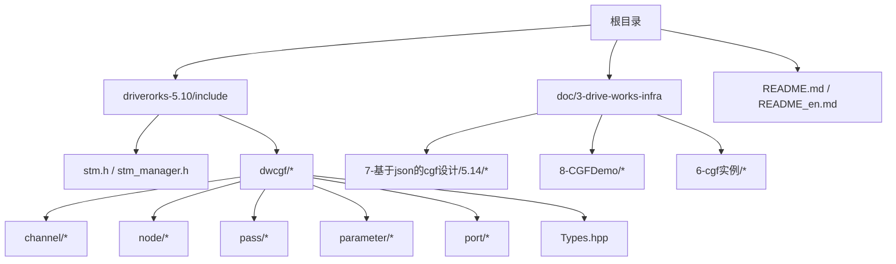
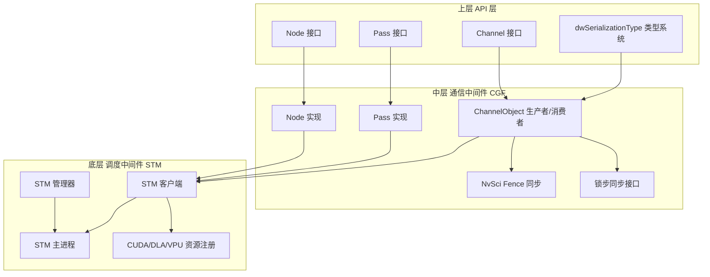
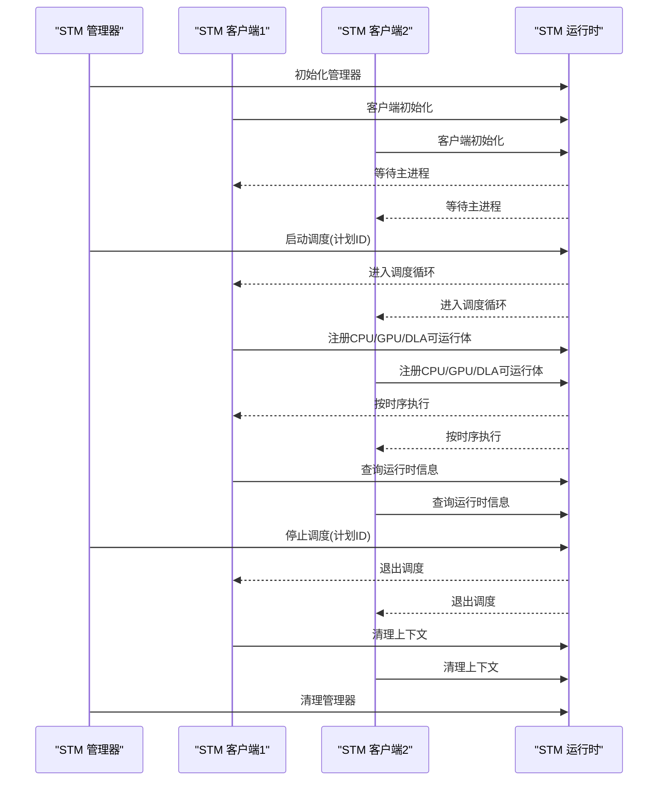
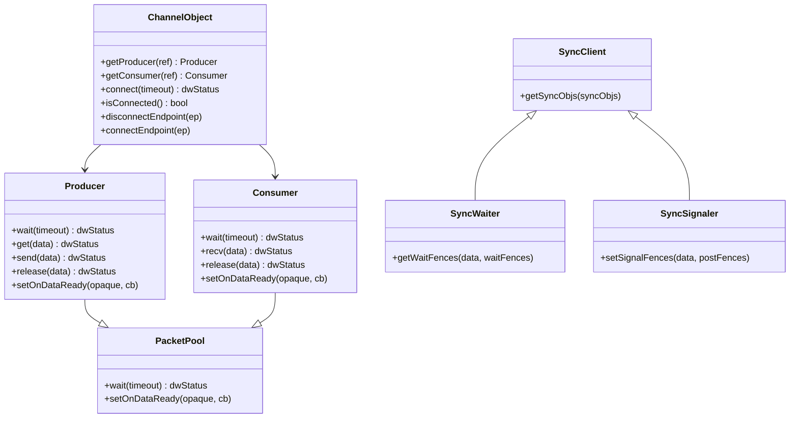
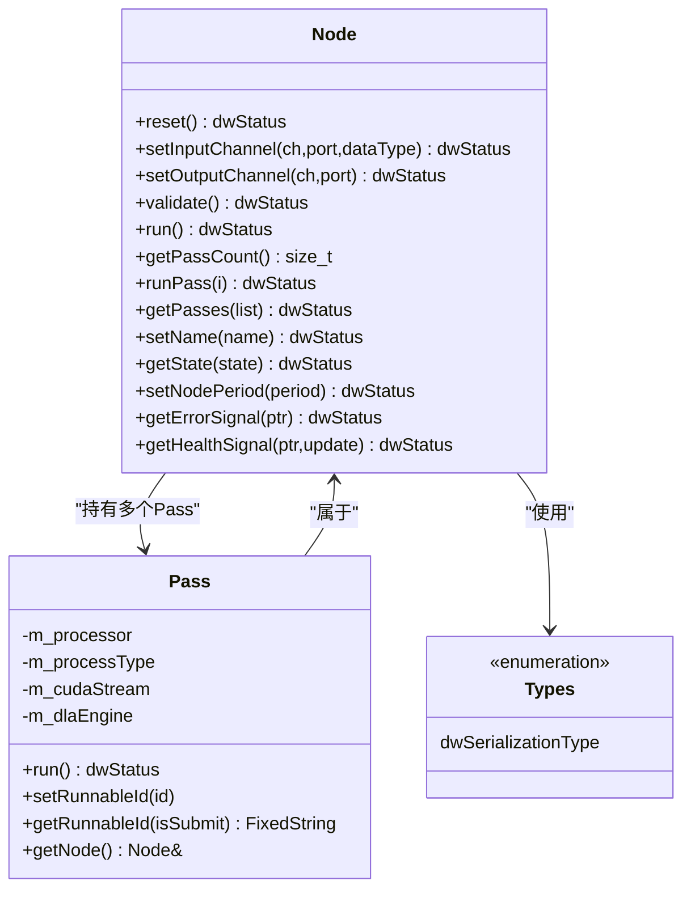
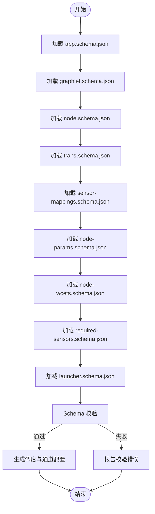
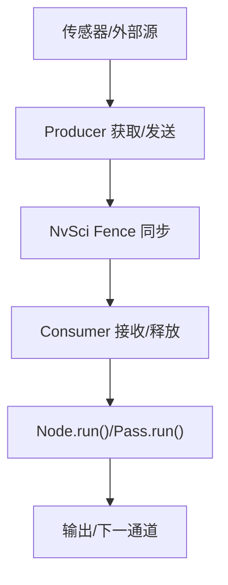
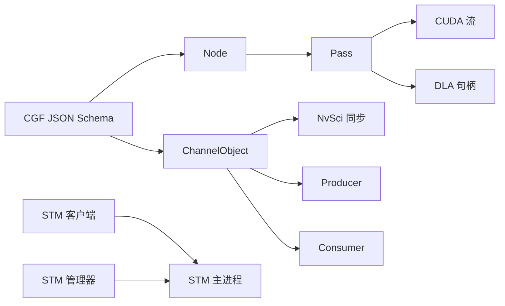

# 技术架构概览

<cite>
**本文引用的文件**
- [README.md](file://README.md)
- [README_en.md](file://README_en.md)
- [stm.h](file://driverorks-5.10/include/stm.h)
- [stm_manager.h](file://driverorks-5.10/include/stm_manager.h)
- [Channel.hpp](file://driverorks-5.10/include/dwcgf/channel/Channel.hpp)
- [Node.hpp](file://driverorks-5.10/include/dwcgf/node/Node.hpp)
- [Pass.hpp](file://driverorks-5.10/include/dwcgf/pass/Pass.hpp)
- [Types.hpp](file://driverorks-5.10/include/dwcgf/Types.hpp)
- [app.schema.json](file://doc/3-drive-works-infra/7-基于json的cgf设计/5.14/app.schema.json)
- [launcher.schema.json](file://doc/3-drive-works-infra/7-基于json的cgf设计/5.14/launcher.schema.json)
- [graphlet.schema.json](file://doc/3-drive-works-infra/7-基于json的cgf设计/5.14/graphlet.schema.json)
- [node.schema.json](file://doc/3-drive-works-infra/7-基于json的cgf设计/5.14/node.schema.json)
- [trans.schema.json](file://doc/3-drive-works-infra/7-基于json的cgf设计/5.14/trans.schema.json)
- [sensor-mappings.schema.json](file://doc/3-drive-works-infra/7-基于json的cgf设计/5.14/sensor-mappings.schema.json)
- [node-wcets.schema.json](file://doc/3-drive-works-infra/7-基于json的cgf设计/5.14/node-wcets.schema.json)
- [node-params.schema.json](file://doc/3-drive-works-infra/7-基于json的cgf设计/5.14/node-params.schema.json)
- [required-sensors.schema.json](file://doc/3-drive-works-infra/7-基于json的cgf设计/5.14/required-sensors.schema.json)
- [app-config.schema.json](file://doc/3-drive-works-infra/7-基于json的cgf设计/5.14/app-config.schema.json)
- [cgf-dwframework-class.pu](file://doc/3-drive-works-infra/8-CGFDemo/cgf-dwframework-class.pu)
- [cgf-helloworld-class.pu](file://doc/3-drive-works-infra/6-cgf实例/cgf-helloworld-class.pu)
</cite>

## 目录
1. [引言](#引言)
2. [项目结构](#项目结构)
3. [核心组件](#核心组件)
4. [架构总览](#架构总览)
5. [详细组件分析](#详细组件分析)
6. [依赖关系分析](#依赖关系分析)
7. [性能考量](#性能考量)
8. [故障排查指南](#故障排查指南)
9. [结论](#结论)
10. [附录](#附录)

## 引言
本文件面向NV Driveworks 5.x的技术架构，聚焦三层架构设计：
- 底层：调度中间件STM（Scheduling Middleware），负责静态时分调度、跨引擎同步与资源管理。
- 中层：通信中间件CGF（Compute Graph Framework），负责节点间通道通信、端口绑定、锁步同步与健康信号。
- 上层：Driveworks API层（Node/Pass/Channel接口），提供节点生命周期、执行流程与数据类型抽象。

文档解释各层协作关系与数据流，阐述实时性保障机制、资源管理策略与系统集成模式；并对比传统ROS2架构的差异，给出系统边界与关键约束。

## 项目结构
仓库包含多个版本的SDK与文档，核心为5.10版本的头文件与示例，以及基于JSON的CGF设计模式与演示类图。下图展示与本架构相关的关键目录与文件：

**图表来源**
- [README.md:1-115](file://README.md#L1-L115)
- [README_en.md:1-92](file://README_en.md#L1-L92)

**章节来源**
- [README.md:1-115](file://README.md#L1-L115)
- [README_en.md:1-92](file://README_en.md#L1-L92)

## 核心组件
- 调度中间件STM
  - 提供静态、协作式、非抢占的周期性调度框架，确保跨CPU/GPU/DLA/VPU等异构引擎的确定性时序与同步。
  - 关键API：客户端初始化、注册CPU/GPU/DLA/VPU可运行体、进入调度循环、查询运行时信息、退出调度。
  - 管理器API：启动/停止指定调度计划，统一协调多客户端执行。
- 通信中间件CGF
  - 以“节点-通道-端口”为核心模型，提供生产者/消费者接口、NvSci同步 Fence 传递、锁步同步、通道连接与断开、参数化配置与健康信号。
  - 关键对象：ChannelObject（Producer/Consumer）、Node（Pass集合与端口绑定）、Pass（可执行单元，支持CPU/GPU/DLA）。
- Driveworks API层
  - 类型系统：dwSerializationType枚举承载图像、点云、感知结果、控制指令等标准数据类型。
  - 配置模式：基于JSON Schema的CGF设计（app、launcher、graphlet、node、trans、sensor-mappings、node-wcets、node-params、required-sensors、app-config）。

**章节来源**
- [stm.h:36-337](file://driverorks-5.10/include/stm.h#L36-L337)
- [stm_manager.h:17-113](file://driverorks-5.10/include/stm_manager.h#L17-L113)
- [Channel.hpp:50-280](file://driverorks-5.10/include/dwcgf/channel/Channel.hpp#L50-L280)
- [Node.hpp:64-276](file://driverorks-5.10/include/dwcgf/node/Node.hpp#L64-L276)
- [Pass.hpp:48-107](file://driverorks-5.10/include/dwcgf/pass/Pass.hpp#L48-L107)
- [Types.hpp:41-206](file://driverorks-5.10/include/dwcgf/Types.hpp#L41-L206)

## 架构总览
NV Driveworks采用“调度中间件+通信中间件+API层”的分层架构。STM负责跨引擎的静态时序与同步，CGF负责节点间数据通路与一致性，API层提供节点、通道、端口与类型的统一抽象。

**图表来源**
- [stm.h:103-330](file://driverorks-5.10/include/stm.h#L103-L330)
- [stm_manager.h:45-107](file://driverorks-5.10/include/stm_manager.h#L45-L107)
- [Channel.hpp:56-274](file://driverorks-5.10/include/dwcgf/channel/Channel.hpp#L56-L274)
- [Node.hpp:64-276](file://driverorks-5.10/include/dwcgf/node/Node.hpp#L64-L276)
- [Pass.hpp:48-107](file://driverorks-5.10/include/dwcgf/pass/Pass.hpp#L48-L107)
- [Types.hpp:41-206](file://driverorks-5.10/include/dwcgf/Types.hpp#L41-L206)

## 详细组件分析

### 组件A：调度中间件 STM
- 设计要点
  - 协作式非抢占：所有可运行体均为无阻塞、无线程内部启动的CPU/GPU/DLA任务。
  - 静态调度：离线编译生成调度表，运行时严格遵循数据依赖与控制流顺序。
  - 资源注册：CUDA流、DLA句柄、VPU流需在客户端注册后由STM统一调度。
  - 同步原语：客户端在进入调度前阻塞等待主进程启动，确保全局同步。
- 关键流程（序列图）

**图表来源**
- [stm.h:103-330](file://driverorks-5.10/include/stm.h#L103-L330)
- [stm_manager.h:45-107](file://driverorks-5.10/include/stm_manager.h#L45-L107)

**章节来源**
- [stm.h:36-337](file://driverorks-5.10/include/stm.h#L36-L337)
- [stm_manager.h:17-113](file://driverorks-5.10/include/stm_manager.h#L17-L113)

### 组件B：通信中间件 CGF
- 设计要点
  - 通道模型：ChannelObject提供Producer/Consumer接口，支持等待/接收/发送/释放，以及回调通知。
  - 同步机制：通过NvSci Fence在通道间传递等待/信号栅栏，实现严格的跨进程/跨引擎同步。
  - 锁步同步：ILockstepSyncClient提供锁步客户端接口，确保确定性回放与对齐。
  - 健康与错误信号：节点可上报健康/错误信号，便于上层监控与诊断。
- 关键流程（类图）

**图表来源**
- [Channel.hpp:56-274](file://driverorks-5.10/include/dwcgf/channel/Channel.hpp#L56-L274)

**章节来源**
- [Channel.hpp:50-280](file://driverorks-5.10/include/dwcgf/channel/Channel.hpp#L50-L280)

### 组件C：API层（Node/Pass/Types）
- 设计要点
  - Node：封装Pass集合，提供输入/输出通道绑定、验证、运行、状态与健康信号查询。
  - Pass：最小可执行单元，支持CPU/GPU/DLA三种处理器类型，可设置CUDA流或DLA句柄。
  - Types：dwSerializationType枚举覆盖图像、点云、感知对象、轨迹、控制指令等标准类型。
- 关键流程（类图）

**图表来源**
- [Node.hpp:64-276](file://driverorks-5.10/include/dwcgf/node/Node.hpp#L64-L276)
- [Pass.hpp:48-107](file://driverorks-5.10/include/dwcgf/pass/Pass.hpp#L48-L107)
- [Types.hpp:41-206](file://driverorks-5.10/include/dwcgf/Types.hpp#L41-L206)

**章节来源**
- [Node.hpp:64-518](file://driverorks-5.10/include/dwcgf/node/Node.hpp#L64-L518)
- [Pass.hpp:48-223](file://driverorks-5.10/include/dwcgf/pass/Pass.hpp#L48-L223)
- [Types.hpp:41-212](file://driverorks-5.10/include/dwcgf/Types.hpp#L41-L212)

### 组件D：CGF设计与配置（基于JSON Schema）
- 设计要点
  - 以JSON Schema描述应用、图元、节点、传输、传感器映射、WCET与参数等，形成可验证的设计规范。
  - 通过Schema校验确保节点端口、数据类型、资源需求与调度约束的一致性。
- 关键流程（流程图）

**图表来源**
- [app.schema.json](file://doc/3-drive-works-infra/7-基于json的cgf设计/5.14/app.schema.json)
- [graphlet.schema.json](file://doc/3-drive-works-infra/7-基于json的cgf设计/5.14/graphlet.schema.json)
- [node.schema.json](file://doc/3-drive-works-infra/7-基于json的cgf设计/5.14/node.schema.json)
- [trans.schema.json](file://doc/3-drive-works-infra/7-基于json的cgf设计/5.14/trans.schema.json)
- [sensor-mappings.schema.json](file://doc/3-drive-works-infra/7-基于json的cgf设计/5.14/sensor-mappings.schema.json)
- [node-wcets.schema.json](file://doc/3-drive-works-infra/7-基于json的cgf设计/5.14/node-wcets.schema.json)
- [node-params.schema.json](file://doc/3-drive-works-infra/7-基于json的cgf设计/5.14/node-params.schema.json)
- [required-sensors.schema.json](file://doc/3-drive-works-infra/7-基于json的cgf设计/5.14/required-sensors.schema.json)
- [launcher.schema.json](file://doc/3-drive-works-infra/7-基于json的cgf设计/5.14/launcher.schema.json)

**章节来源**
- [app.schema.json](file://doc/3-drive-works-infra/7-基于json的cgf设计/5.14/app.schema.json)
- [launcher.schema.json](file://doc/3-drive-works-infra/7-基于json的cgf设计/5.14/launcher.schema.json)
- [graphlet.schema.json](file://doc/3-drive-works-infra/7-基于json的cgf设计/5.14/graphlet.schema.json)
- [node.schema.json](file://doc/3-drive-works-infra/7-基于json的cgf设计/5.14/node.schema.json)
- [trans.schema.json](file://doc/3-drive-works-infra/7-基于json的cgf设计/5.14/trans.schema.json)
- [sensor-mappings.schema.json](file://doc/3-drive-works-infra/7-基于json的cgf设计/5.14/sensor-mappings.schema.json)
- [node-wcets.schema.json](file://doc/3-drive-works-infra/7-基于json的cgf设计/5.14/node-wcets.schema.json)
- [node-params.schema.json](file://doc/3-drive-works-infra/7-基于json的cgf设计/5.14/node-params.schema.json)
- [required-sensors.schema.json](file://doc/3-drive-works-infra/7-基于json的cgf设计/5.14/required-sensors.schema.json)

### 概念总览
- 数据流
  - 传感器/外部源通过通道Producer产生数据包，经通道同步栅栏传递到下游Consumer，再由Node的Pass执行处理。
- 实时性
  - STM静态调度保证时序边界；通道Fence确保跨进程/跨引擎同步；锁步接口支持确定性回放。
- 资源管理
  - CUDA流、DLA句柄、VPU流在客户端注册后由STM统一调度；通道缓冲池与超时控制避免死锁。
- 系统集成
  - CGF通过JSON Schema驱动设计与验证；API层屏蔽底层细节，提供统一的节点/通道/类型抽象。

[此图为概念性示意，无需图表来源]

## 依赖关系分析
- 组件耦合
  - Node依赖Pass集合；Pass依赖Node与处理器资源（CUDA/DLA）。
  - ChannelObject依赖NvSci同步与端点连接；Producer/Consumer依赖PacketPool与回调。
  - STM客户端依赖STM主进程与资源注册；管理器协调多个客户端。
- 外部依赖
  - CUDA运行时、NVIDIA NvSci IPC、VIBRANTE平台（DLA/VPU）。
- 集成点
  - JSON Schema作为设计契约，贯穿CGF设计、生成与运行期校验。

**图表来源**
- [Node.hpp:64-276](file://driverorks-5.10/include/dwcgf/node/Node.hpp#L64-L276)
- [Pass.hpp:48-107](file://driverorks-5.10/include/dwcgf/pass/Pass.hpp#L48-L107)
- [Channel.hpp:56-274](file://driverorks-5.10/include/dwcgf/channel/Channel.hpp#L56-L274)
- [stm.h:103-330](file://driverorks-5.10/include/stm.h#L103-L330)
- [stm_manager.h:45-107](file://driverorks-5.10/include/stm_manager.h#L45-L107)

**章节来源**
- [Node.hpp:64-518](file://driverorks-5.10/include/dwcgf/node/Node.hpp#L64-L518)
- [Pass.hpp:48-223](file://driverorks-5.10/include/dwcgf/pass/Pass.hpp#L48-L223)
- [Channel.hpp:50-280](file://driverorks-5.10/include/dwcgf/channel/Channel.hpp#L50-L280)
- [stm.h:36-337](file://driverorks-5.10/include/stm.h#L36-L337)
- [stm_manager.h:17-113](file://driverorks-5.10/include/stm_manager.h#L17-L113)

## 性能考量
- 实时性保障
  - 静态调度与锁步同步确保端到端延迟边界与抖动控制。
  - 通道Fence与缓冲池超时避免级联阻塞。
- 资源利用
  - GPU/CPU/DLA/VPU并行执行，CUDA流与DLA句柄按需分配，减少上下文切换。
- 开发与验证
  - JSON Schema驱动的设计与生成，降低手工配置错误，提升可维护性。

[本节为通用指导，无需章节来源]

## 故障排查指南
- 常见问题定位
  - 通道连接失败：检查通道是否已建立连接、端点名称与Schema一致。
  - 同步栅栏异常：确认Producer/Consumer的Fence传递与等待顺序正确。
  - 调度未启动：确认管理器先于主进程启动，客户端在进入调度前完成初始化。
  - 资源冲突：核对CUDA流/DLA句柄/VPU流注册唯一性与有效性。
- 参考路径
  - 通道接口与回调：[Channel.hpp:116-274](file://driverorks-5.10/include/dwcgf/channel/Channel.hpp#L116-L274)
  - 节点生命周期与健康信号：[Node.hpp:180-229](file://driverorks-5.10/include/dwcgf/node/Node.hpp#L180-L229)
  - Pass执行与处理器绑定：[Pass.hpp:109-168](file://driverorks-5.10/include/dwcgf/pass/Pass.hpp#L109-L168)
  - STM客户端/管理器API：[stm.h:103-330](file://driverorks-5.10/include/stm.h#L103-L330)、[stm_manager.h:45-107](file://driverorks-5.10/include/stm_manager.h#L45-L107)

**章节来源**
- [Channel.hpp:116-274](file://driverorks-5.10/include/dwcgf/channel/Channel.hpp#L116-L274)
- [Node.hpp:180-229](file://driverorks-5.10/include/dwcgf/node/Node.hpp#L180-L229)
- [Pass.hpp:109-168](file://driverorks-5.10/include/dwcgf/pass/Pass.hpp#L109-L168)
- [stm.h:103-330](file://driverorks-5.10/include/stm.h#L103-L330)
- [stm_manager.h:45-107](file://driverorks-5.10/include/stm_manager.h#L45-L107)

## 结论
NV Driveworks 5.x以STM为时序与同步基石、以CGF为通信与一致性核心、以上层API为抽象与易用性保障，形成完整的自动驾驶中间件体系。相较传统ROS2架构，其显著差异在于：
- 采用静态调度与锁步同步，提供更强的实时性与可预测性；
- 以JSON Schema驱动设计与验证，降低集成复杂度；
- 将通道同步与资源管理下沉至中间件，简化上层节点开发。

[本节为总结，无需章节来源]

## 附录
- 系统边界
  - 边界内：STM调度、CGF通道与锁步、Node/Pass/Channel/Types API。
  - 边界外：传感器驱动、操作系统内核、硬件加速器固件。
- 关键约束
  - 所有可运行体不得阻塞或内部创建线程；必须使用CUDA异步API；DLA/VPU仅在支持的PDK版本启用。
  - 通道Fence必须成对传递与等待；端点名称需与Schema一致；资源注册需唯一且有效。

**章节来源**
- [README.md:1-115](file://README.md#L1-L115)
- [README_en.md:1-92](file://README_en.md#L1-L92)
- [stm.h:86-101](file://driverorks-5.10/include/stm.h#L86-L101)
- [Channel.hpp:64-111](file://driverorks-5.10/include/dwcgf/channel/Channel.hpp#L64-L111)