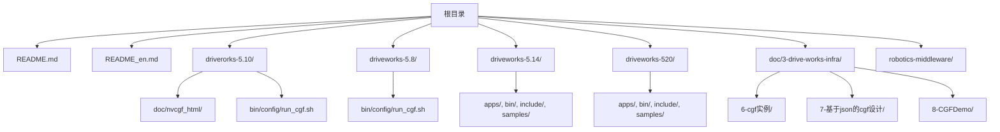
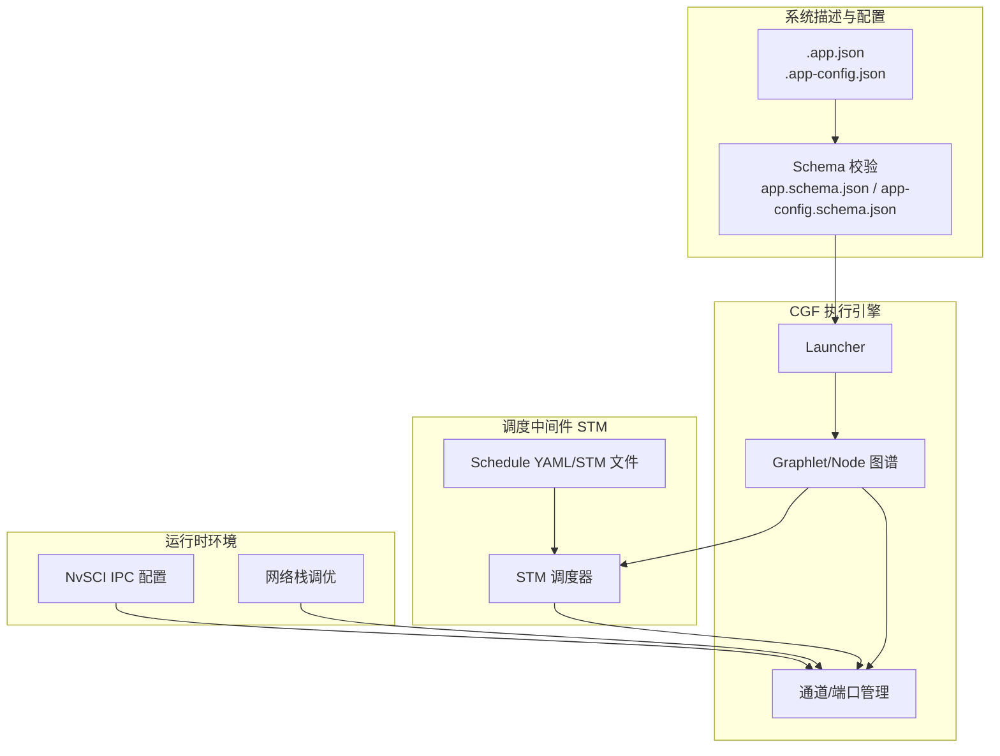
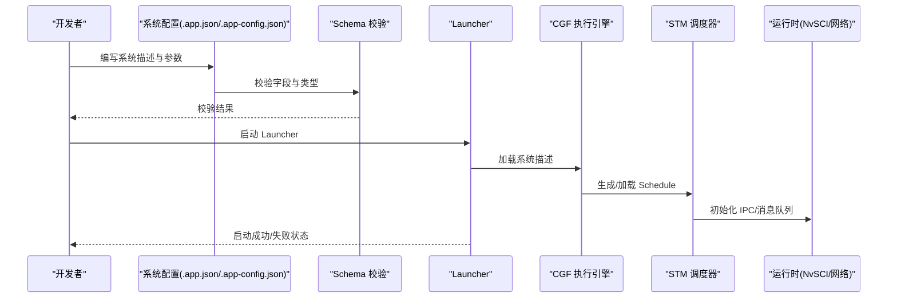
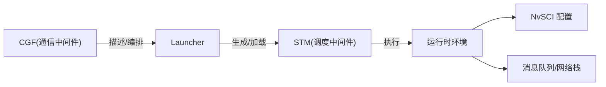
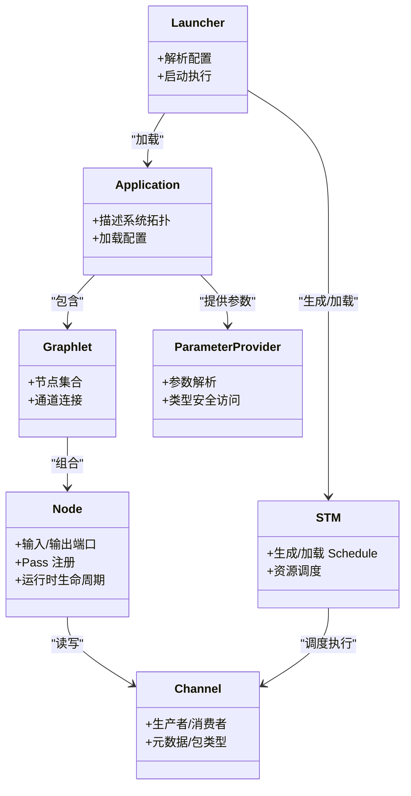

# 版本演进历程

<cite>
**本文引用的文件**
- [README.md](file://README.md)
- [README_en.md](file://README_en.md)
- [驱动器orks-5.10 文档：CGF 架构](file://driverorks-5.10/doc/nvcgf_html/cgf_architecture.html)
- [驱动器orks-5.10 文档：CGF 迁移指南（5.8→5.10）](file://driverorks-5.10/doc/nvcgf_html/cgf_porting_guide_5_10.html)
- [驱动器orks-5.10 文档：CGF 迁移指南（5.6→5.8）](file://driverorks-5.10/doc/nvcgf_html/cgf_porting_guide_5_8.html)
- [驱动器orks-5.10 文档：CGF 迁移指南（5.4→5.6）](file://driverorks-5.10/doc/nvcgf_html/cgf_porting_guide_5_6.html)
- [驱动器orks-5.10 文档：CGF 迁移指南（5.2→5.4）](file://driverorks-5.10/doc/nvcgf_html/cgf_porting_guide_5_4.html)
- [驱动器orks-5.10 启动脚本（运行 CGF 应用）](file://driverorks-5.10/bin/config/run_cgf.sh)
- [驱动器orks-5.8 启动脚本（运行 CGF 应用）](file://driveworks-5.8/bin/config/run_cgf.sh)
- [驱动器orks-5.14 示例与工具](file://driveworks-5.14/)
- [驱动器orks-520 示例与工具](file://driveworks-520/)
- [doc/3-drive-works-infra/6-cgf实例/cgf-helloworld-class.pu](file://doc/3-drive-works-infra/6-cgf实例/cgf-helloworld-class.pu)
- [doc/3-drive-works-infra/8-CGFDemo/cgf-dwframework-class.pu](file://doc/3-drive-works-infra/8-CGFDemo/cgf-dwframework-class.pu)
- [doc/3-drive-works-infra/7-基于json的cgf设计/5.8/app.schema.json](file://doc/3-drive-works-infra/7-基于json的cgf设计/5.8/app.schema.json)
- [doc/3-drive-works-infra/7-基于json的cgf设计/5.10/app-config.schema.json](file://doc/3-drive-works-infra/7-基于json的cgf设计/5.10/app-config.schema.json)
- [doc/3-drive-works-infra/7-基于json的cgf设计/5.14/app.schema.json](file://doc/3-drive-works-infra/7-基于json的cgf设计/5.14/app.schema.json)
- [doc/3-drive-works-infra/7-基于json的cgf设计/5.14/launcher.schema.json](file://doc/3-drive-works-infra/7-基于json的cgf设计/5.14/launcher.schema.json)
</cite>

## 目录
1. [引言](#引言)
2. [项目结构](#项目结构)
3. [核心组件](#核心组件)
4. [架构总览](#架构总览)
5. [详细组件分析](#详细组件分析)
6. [依赖分析](#依赖分析)
7. [性能考量](#性能考量)
8. [故障排查指南](#故障排查指南)
9. [结论](#结论)
10. [附录](#附录)

## 引言
本文件系统性梳理 NV Driveworks 从 4.x 到 5.x 的技术转型，重点覆盖：
- 5.x 引入的中间件架构：通信中间件 CGF（Compute Graph Framework）与调度中间件 STM（Scheduling Middleware）
- 5.x 主要版本（5.8 → 5.10 → 5.14）的功能增强、API 变更与性能改进
- DriveOS SDK 7.x 的重大架构调整：移除 CGF、保留 STM 的原因与影响
- 版本对比表与迁移指南要点

## 项目结构
仓库包含多个 Driveworks 版本与相关文档、示例、Schema 等资源，便于对照不同版本的 API、配置与工具链。

图表来源
- [README.md](file://README.md)
- [README_en.md](file://README_en.md)
- [驱动器orks-5.10 启动脚本（运行 CGF 应用）](file://driverorks-5.10/bin/config/run_cgf.sh)
- [驱动器orks-5.8 启动脚本（运行 CGF 应用）](file://driveworks-5.8/bin/config/run_cgf.sh)

章节来源
- [README.md](file://README.md)
- [README_en.md](file://README_en.md)

## 核心组件
- 中间件层（5.x）：CGF（通信中间件）+ STM（调度中间件），提供数据流编程范式与执行调度能力
- 驱动层与框架层：dwframework、dwcgf、dw 等子模块，支撑节点、通道、参数提供、日志与错误处理等
- 工具链与示例：Launcher、Schedule 生成、Schema 校验、样例应用（如 CGF Demo）

章节来源
- [README.md](file://README.md)
- [驱动器orks-5.10 文档：CGF 架构](file://driverorks-5.10/doc/nvcgf_html/cgf_architecture.html)

## 架构总览
下图展示 5.x 中间件层的高层交互：CGF 描述系统（.app.json、Schema）与节点图谱（Graphlet/Node）经 Launcher 解析后，由 STM 进行调度与执行；运行时依赖 NvSCI IPC 配置与网络栈调优。

图表来源
- [驱动器orks-5.10 文档：CGF 架构](file://driverorks-5.10/doc/nvcgf_html/cgf_architecture.html)
- [驱动器orks-5.10 启动脚本（运行 CGF 应用）](file://driverorks-5.10/bin/config/run_cgf.sh)
- [驱动器orks-5.8 启动脚本（运行 CGF 应用）](file://driveworks-5.8/bin/config/run_cgf.sh)
- [doc/3-drive-works-infra/7-基于json的cgf设计/5.10/app-config.schema.json](file://doc/3-drive-works-infra/7-基于json的cgf设计/5.10/app-config.schema.json)
- [doc/3-drive-works-infra/7-基于json的cgf设计/5.14/app.schema.json](file://doc/3-drive-works-infra/7-基于json的cgf设计/5.14/app.schema.json)

## 详细组件分析

### CGF 通信中间件（5.x）
- 数据流编程范式：以数据为中心的节点/通道模型，强调数据移动与处理步骤
- 关键实体：Application、Graphlet、Node、Channel、ParameterProvider、Pass 等
- 配置与 Schema：通过 .app.json/.app-config.json 描述系统拓扑、传感器映射、调度计划等；随版本演进，Schema 字段与语义逐步细化与拆分

章节来源
- [驱动器orks-5.10 文档：CGF 架构](file://driverorks-5.10/doc/nvcgf_html/cgf_architecture.html)
- [README.md](file://README.md)

### STM 调度中间件（5.x）
- 负责将 CGF 的节点/通道图映射为可执行的调度计划（YAML/STM），并进行时序控制与资源分配
- 运行时依赖 NvSCI IPC 与消息队列配置，启动脚本会检查并提示必要的系统参数

章节来源
- [驱动器orks-5.10 启动脚本（运行 CGF 应用）](file://driverorks-5.10/bin/config/run_cgf.sh)
- [驱动器orks-5.8 启动脚本（运行 CGF 应用）](file://driveworks-5.8/bin/config/run_cgf.sh)

### 版本演进与 API 变更（5.8 → 5.10 → 5.14）

#### 5.8 → 5.10：关键变更
- 应用 JSON 结构调整：passDependencies 移至 stmSchedules/stmExternalRunnables 下；外部可运行体需声明 processorTypes
- 端口校验 API 分离：isValidPort 拆分为按索引与按标识符两类
- 日志宏迁移：从 FRWK_LOG* 迁移到 DW_LOG*
- 异常类迁移：dw::framework::Exception 移除，改用 dw::core::ExceptionWithStatus
- NvSci 错误/事件 API 迁移：集中到 NvSciHelper
- 通道包类型 API 重构：移除 SyncedPacketPayload，引入 ChannelMetadata/MetadataFlags/MetadataPayload
- 节点 API 精简：移除 PASS_SETUP/PASS_TEARDOWN 常量，改用 passIndex 获取索引并以 runPass(index) 执行
- 参数提供器：移除易导致动态分配的 std::string 接口，改用 FixedString/StringView/const char*

章节来源
- [驱动器orks-5.10 文档：CGF 迁移指南（5.8→5.10）](file://driverorks-5.10/doc/nvcgf_html/cgf_porting_guide_5_10.html)

#### 5.6 → 5.8：关键变更
- 应用 JSON 结构调整：passDependencies 上移至 per-entry 字段；外部可运行体需声明 processorTypes
- 端口校验 API 分离：isValidPort 拆分为按索引与按标识符两类

章节来源
- [驱动器orks-5.10 文档：CGF 迁移指南（5.6→5.8）](file://driverorks-5.10/doc/nvcgf_html/cgf_porting_guide_5_8.html)

#### 5.4 → 5.6：关键变更
- 通道工厂与包构造：自定义 ChannelFactory 注册方式简化，改为静态注册并在基类统一访问
- 枚举描述 API：mapEnumNameToValue/mapEnumValueToName 返回值语义变化，异常替代返回状态
- 日志宏：FRWK_LOG* 标记弃用，迁移到 DW_LOG*
- 节点 API：大量“Old”接口移除，使用无后缀版本
- 参数提供器：统一采用 StringView 替代 const char* key

章节来源
- [驱动器orks-5.10 文档：CGF 迁移指南（5.4→5.6）](file://driverorks-5.10/doc/nvcgf_html/cgf_porting_guide_5_6.html)

#### 5.2 → 5.4：关键变更
- 通道工厂注册：从一次性注册向逐项静态注册迁移
- 枚举描述 API：返回值语义变化，异常替代返回状态
- 日志宏：FRWK_LOG* 标记弃用，迁移到 DW_LOG*
- 节点 API：大量“Old”接口移除，使用无后缀版本
- 参数提供器：统一采用 StringView 替代 const char* key

章节来源
- [驱动器orks-5.10 文档：CGF 迁移指南（5.2→5.4）](file://driverorks-5.10/doc/nvcgf_html/cgf_porting_guide_5_4.html)

#### 5.14：功能增强与工具链完善
- 新增 Schema：app.schema.json、launcher.schema.json 等，进一步规范系统描述与启动参数
- 示例与工具：提供更丰富的样例与工具链，支持多平台构建与部署
- 与 5.10 的差异：CGF 组件仍存在，但 API 与 Schema 已趋于稳定与规范化

章节来源
- [driveworks-5.14/](file://driveworks-5.14/)
- [doc/3-drive-works-infra/7-基于json的cgf设计/5.14/app.schema.json](file://doc/3-drive-works-infra/7-基于json的cgf设计/5.14/app.schema.json)
- [doc/3-drive-works-infra/7-基于json的cgf设计/5.14/launcher.schema.json](file://doc/3-drive-works-infra/7-基于json的cgf设计/5.14/launcher.schema.json)

### DriveOS SDK 7.x：CGF 移除与 STM 保留
- 重大调整：移除 Compute Graph Framework（CGF），仅保留调度中间件 STM
- 影响：开发者需直接使用 Driveworks API 实现节点与通道集成，不再依赖 CGF 的图形化描述与自动调度
- 原因：统一中间件架构，减少抽象层级，提升与底层驱动/业务组件的耦合度与可控性

章节来源
- [README.md](file://README.md)

### 开发流程与运行时序列（5.x）

图表来源
- [驱动器orks-5.10 启动脚本（运行 CGF 应用）](file://driverorks-5.10/bin/config/run_cgf.sh)
- [驱动器orks-5.8 启动脚本（运行 CGF 应用）](file://driveworks-5.8/bin/config/run_cgf.sh)
- [README.md](file://README.md)

## 依赖分析
- 组件内聚与耦合：CGF 与 STM 在 5.x 并行存在，CGF 负责系统描述与节点编排，STM 负责执行调度；二者通过 Launcher 协同
- 外部依赖：NvSCI IPC 配置文件、消息队列与网络栈参数对运行稳定性至关重要
- 版本演进：API 与 Schema 的持续规范化，降低运行时不确定性，提升可维护性

图表来源
- [驱动器orks-5.10 启动脚本（运行 CGF 应用）](file://driverorks-5.10/bin/config/run_cgf.sh)
- [驱动器orks-5.8 启动脚本（运行 CGF 应用）](file://driveworks-5.8/bin/config/run_cgf.sh)

章节来源
- [驱动器orks-5.10 启动脚本（运行 CGF 应用）](file://driverorks-5.10/bin/config/run_cgf.sh)
- [驱动器orks-5.8 启动脚本（运行 CGF 应用）](file://driveworks-5.8/bin/config/run_cgf.sh)

## 性能考量
- 网络栈与消息队列：启动脚本会检测并提示网络缓冲区与消息队列参数，确保高吞吐低延迟
- IPC 配置：NvSCI 配置文件必须正确设置，否则无法建立跨进程/跨节点通信
- 调度计划：合理的 Schedule YAML/STM 能够最大化利用 CPU/GPU/VPU 等异构资源

章节来源
- [驱动器orks-5.10 启动脚本（运行 CGF 应用）](file://driverorks-5.10/bin/config/run_cgf.sh)
- [驱动器orks-5.8 启动脚本（运行 CGF 应用）](file://driveworks-5.8/bin/config/run_cgf.sh)

## 故障排查指南
- 启动失败与退出码：通过查看 LogFolder 与 launcher 日志定位问题
- 网络栈问题：若 rmem/wmem 或 recvbuf/sendbuf 过小，会导致高延迟或丢包
- 消息队列不足：msg_max/queues_max 不足会阻塞多进程模式下的通信
- NvSCI 配置缺失：缺少 /etc/nvsciipc.cfg 或未包含 STM 相关条目会导致 IPC 初始化失败
- CGF Bug：历史问题（如 nvsci 相关、socket 大数据）已修复，建议升级到最新版本

章节来源
- [README_en.md](file://README_en.md)
- [驱动器orks-5.10 启动脚本（运行 CGF 应用）](file://driverorks-5.10/bin/config/run_cgf.sh)
- [驱动器orks-5.8 启动脚本（运行 CGF 应用）](file://driveworks-5.8/bin/config/run_cgf.sh)

## 结论
- 5.x 将 Driveworks 从算法库形态升级为中间件层，引入 CGF 与 STM，形成“图形化描述 + 调度执行”的完整闭环
- 5.8 → 5.10 → 5.14 的演进体现了 API 与 Schema 的持续规范化，提升了可维护性与可移植性
- DriveOS SDK 7.x 移除 CGF、保留 STM，要求开发者直接对接 Driveworks API，减少抽象层，提升可控性与性能空间
- 建议在迁移过程中严格遵循各版本迁移指南，优先完成 Schema 与 API 的对齐，并完善运行时环境配置

## 附录

### 版本对比表（5.8 → 5.10 → 5.14）
- 5.8 → 5.10
  - 应用 JSON：passDependencies 位置调整；外部可运行体新增 processorTypes
  - 端口校验：isValidPort 拆分为 isValidPortIndex/isValidPortIdentifier
  - 日志：FRWK_LOG* 迁移到 DW_LOG*
  - 异常：dw::framework::Exception 移除，改用 dw::core::ExceptionWithStatus
  - NvSci：错误/事件 API 迁移至 NvSciHelper
  - 通道包类型：移除 SyncedPacketPayload，引入 ChannelMetadata/MetadataFlags/MetadataPayload
  - 节点 API：移除 PASS_SETUP/PASS_TEARDOWN，改用 passIndex 与 runPass(index)
  - 参数提供器：移除易导致动态分配的 std::string 接口
- 5.10 → 5.14
  - Schema 完善：新增 app.schema.json、launcher.schema.json 等
  - 工具链：示例与工具链更丰富，支持多平台构建与部署
  - CGF 组件：仍存在，API 与 Schema 已趋于稳定

章节来源
- [驱动器orks-5.10 文档：CGF 迁移指南（5.8→5.10）](file://driverorks-5.10/doc/nvcgf_html/cgf_porting_guide_5_10.html)
- [驱动器orks-5.10 文档：CGF 迁移指南（5.6→5.8）](file://driverorks-5.10/doc/nvcgf_html/cgf_porting_guide_5_8.html)
- [驱动器orks-5.10 文档：CGF 迁移指南（5.4→5.6）](file://driverorks-5.10/doc/nvcgf_html/cgf_porting_guide_5_6.html)
- [驱动器orks-5.10 文档：CGF 迁移指南（5.2→5.4）](file://driverorks-5.10/doc/nvcgf_html/cgf_porting_guide_5_4.html)
- [driveworks-5.14/](file://driveworks-5.14/)
- [doc/3-drive-works-infra/7-基于json的cgf设计/5.14/app.schema.json](file://doc/3-drive-works-infra/7-基于json的cgf设计/5.14/app.schema.json)
- [doc/3-drive-works-infra/7-基于json的cgf设计/5.14/launcher.schema.json](file://doc/3-drive-works-infra/7-基于json的cgf设计/5.14/launcher.schema.json)

### 迁移指南要点
- 5.8 → 5.10
  - 更新 .app.json 与 .app-config.json 字段与语义
  - 替换日志宏与异常类
  - 使用新的 NvSci Helper API
  - 采用 ChannelMetadata/MetadataFlags/MetadataPayload 替代 SyncedPacketPayload
  - 使用 passIndex 与 runPass(index) 替代 PASS_* 常量
  - 使用 StringView/FixedString 接口替代 std::string
- 5.10 → 5.14
  - 对齐新增 Schema（app.schema.json、launcher.schema.json）
  - 使用新版工具链与示例
- DriveOS SDK 7.x
  - 移除 CGF，直接使用 Driveworks API
  - 自行实现节点与通道集成，避免对图形化描述的依赖

章节来源
- [驱动器orks-5.10 文档：CGF 迁移指南（5.8→5.10）](file://driverorks-5.10/doc/nvcgf_html/cgf_porting_guide_5_10.html)
- [README.md](file://README.md)

### 设计与类关系示意（概念性）

图表来源
- [驱动器orks-5.10 文档：CGF 架构](file://driverorks-5.10/doc/nvcgf_html/cgf_architecture.html)
- [README.md](file://README.md)