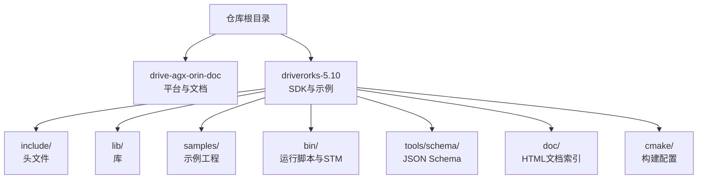
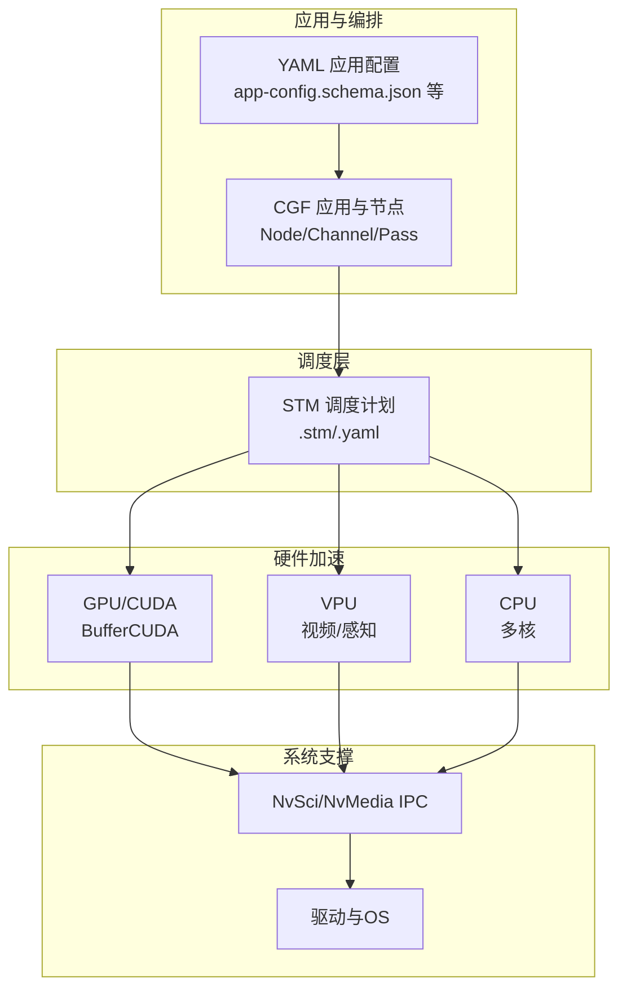
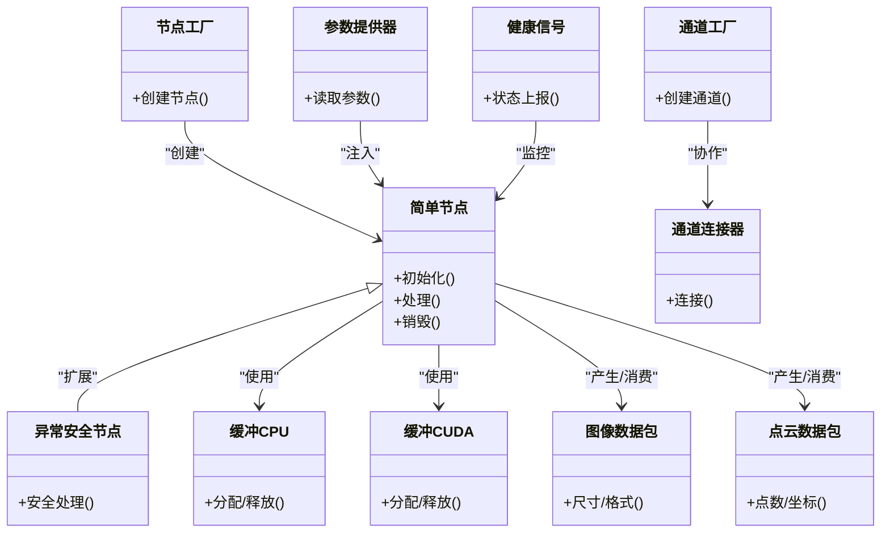
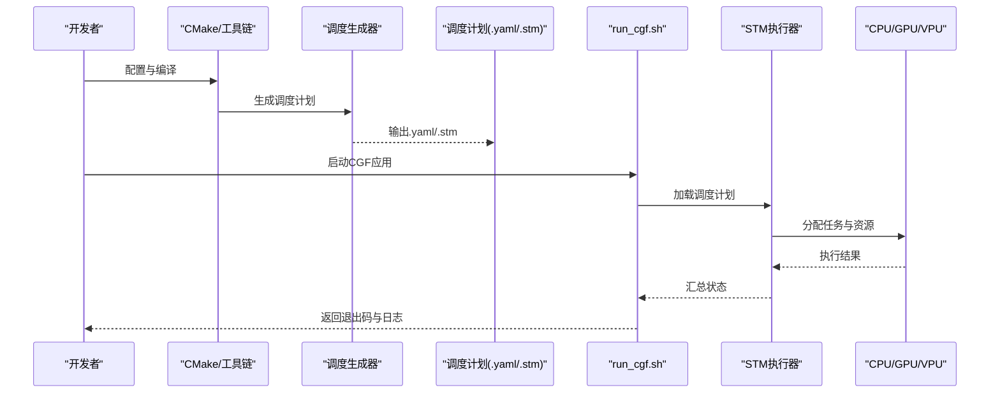
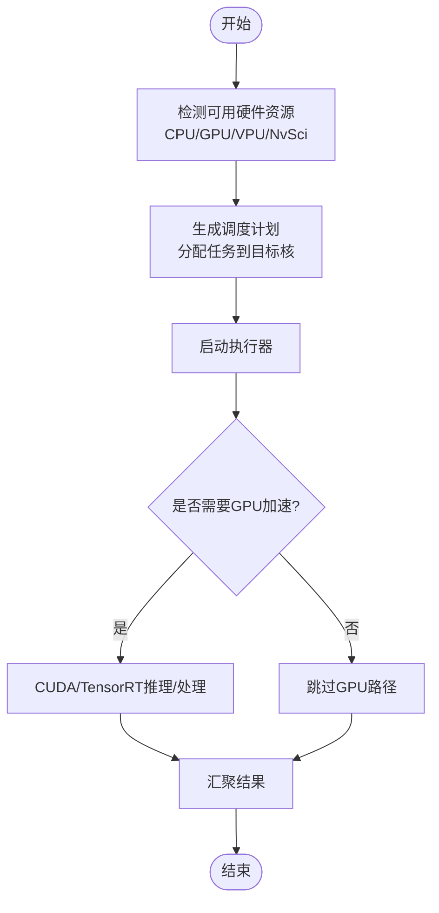
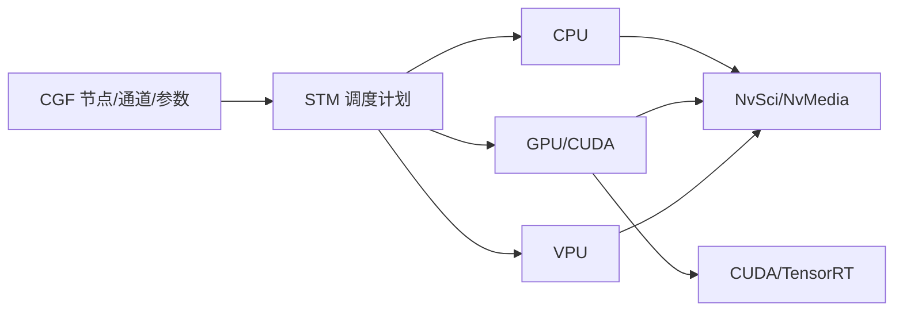

# 硬件平台支持

<cite>
**本文引用的文件**
- [README.md](file://README.md)
- [README_en.md](file://README_en.md)
- [NVIDIA DRIVE SDK_ The Foundation of AV Development-gtc-fall-2111.pdf](file://drive-agx-orin-doc/2-drive-os/CUDA-TensorRT-DriveWorks on DRIVE AGX-gtc-2003.pdf)
- [NVIDIA-STM-Userguide-do6050.pdf](file://drive-agx-orin-doc/3-drive-works/Nvidia-STM-Userguide-do6050.pdf)
- [driveworks-5.10/bin/run_cgf.sh](file://driverorks-5.10/bin/run_cgf.sh)
- [driveworks-5.10/bin/cpu_gpu1.stm](file://driverorks-5.10/bin/cpu_gpu1.stm)
- [driveworks-5.10/bin/gpu_multistream_multiprocess.stm](file://driverorks-5.10/bin/gpu_multistream_multiprocess.stm)
- [driveworks-5.10/bin/vpu_simple.stm](file://driverorks-5.10/bin/vpu_simple.stm)
- [driveworks-5.10/bin/cpu_simple.stm](file://driverorks-5.10/bin/cpu_simple.stm)
- [driveworks-5.10/config/nvsciipc.cfg](file://driverorks-5.10/config/nvsciipc.cfg)
- [driveworks-5.10/tools/schema/app-config.schema.json](file://driverorks-5.10/tools/schema/app-config.schema.json)
- [driveworks-5.10/tools/schema/app.schema.json](file://driverorks-5.10/tools/schema/app.schema.json)
- [driveworks-5.10/tools/schema/graphlet.schema.json](file://driveworks-5.10/tools/schema/graphlet.schema.json)
- [driveworks-5.10/tools/schema/node.schema.json](file://driveworks-5.10/tools/schema/node.schema.json)
- [driveworks-5.10/tools/schema/node-params.schema.json](file://driveworks-5.10/tools/schema/node-params.schema.json)
- [driveworks-5.10/tools/schema/node-wcets.schema.json](file://driveworks-5.10/tools/schema/node-wcets.schema.json)
- [driveworks-5.10/tools/schema/required-sensors.schema.json](file://driveworks-5.10/tools/schema/required-sensors.schema.json)
- [driveworks-5.10/tools/schema/sensor-mappings.schema.json](file://driveworks-5.10/tools/schema/sensor-mappings.schema.json)
- [driveworks-5.10/tools/schema/trans.schema.json](file://driveworks-5.10/tools/schema/trans.schema.json)
- [driveworks-5.10/doc/nvcgf_html/index_nvcgf.html](file://driverorks-5.10/doc/nvcgf_html/index_nvcgf.html)
- [driveworks-5.10/doc/nvsdk_dw_html/index_nvsdk_dw.html](file://driverorks-5.10/doc/nvsdk_dw_html/index_nvsdk_dw.html)
- [driveworks-5.10/samples/src/cgf_nodes/README.md](file://driverorks-5.10/samples/src/cgf_nodes/README.md)
- [driveworks-5.10/samples/src/hello_world/README.md](file://driverorks-5.10/samples/src/hello_world/README.md)
- [driveworks-5.10/samples/src/dnn/sample_dnn_plugin/README.md](file://driverorks-5.10/samples/src/dnn/sample_dnn_plugin/README.md)
- [driveworks-5.10/samples/src/dnn/sample_dnn_tensor/README.md](file://driverorks-5.10/samples/src/dnn/sample_dnn_tensor/README.md)
- [driveworks-5.10/samples/src/dnn/sample_object_detector_tracker/README.md](file://driverorks-5.10/samples/src/dnn/sample_object_detector_tracker/README.md)
- [driveworks-5.10/samples/src/image/image_capture/README.md](file://driverorks-5.10/samples/src/image/image_capture/README.md)
- [driveworks-5.10/samples/src/calibration/camera/README.md](file://driverorks-5.10/samples/src/calibration/camera/README.md)
- [driveworks-5.10/samples/src/calibration/lidar/README.md](file://driverorks-5.10/samples/src/calibration/lidar/README.md)
- [driveworks-5.10/samples/src/calibration/radar/README.md](file://driverorks-5.10/samples/src/calibration/radar/README.md)
- [driveworks-5.10/samples/src/calibration/stereo/README.md](file://driverorks-5.10/samples/src/calibration/stereo/README.md)
- [driveworks-5.10/samples/src/calibration/imu/README.md](file://driverorks-5.10/samples/src/calibration/imu/README.md)
- [driveworks-5.10/samples/src/calibration/vehicle/README.md](file://driverorks-5.10/samples/src/calibration/vehicle/README.md)
- [driveworks-5.10/samples/src/egomotion/README.md](file://driverorks-5.10/samples/src/egomotion/README.md)
- [driveworks-5.10/samples/src/icp/README.md](file://driverorks-5.10/samples/src/icp/README.md)
- [driveworks-5.10/samples/src/comms/sample_socket_ipc/README.md](file://driverorks-5.10/samples/src/comms/sample_socket_ipc/README.md)
- [driveworks-5.10/samples/src/dataspeedBridge/README.md](file://driverorks-5.10/samples/src/dataspeedBridge/README.md)
- [driveworks-5.10/samples/src/cgf_nodes/CMakeLists.txt](file://driverorks-5.10/samples/src/cgf_nodes/CMakeLists.txt)
- [driveworks-5.10/samples/CMakeLists.txt](file://driverorks-5.10/samples/CMakeLists.txt)
- [driveworks-5.10/cmake/dwcgf-config.cmake](file://driverorks-5.10/cmake/dwcgf-config.cmake)
- [driveworks-5.10/cmake/dwframework-config.cmake](file://driveworks-5.10/cmake/dwframework-config.cmake)
- [driveworks-5.10/cmake/driveworks-config.cmake](file://driveworks-5.10/cmake/driveworks-config.cmake)
- [driveworks-5.10/cmake/driveworks-shared-config.cmake](file://driveworks-5.10/cmake/driveworks-shared-config.cmake)
- [driveworks-5.10/cmake/driveworks-visualization-config.cmake](file://driveworks-5.10/cmake/driveworks-visualization-config.cmake)
- [driveworks-5.10/cmake/dwdynamicmemory-config.cmake](file://driveworks-5.10/cmake/dwdynamicmemory-config.cmake)
- [driveworks-5.10/include/dwframework/ContextParameterProvider_8hpp.html](file://driverorks-5.10/doc/nvcgf_html/ContextParameterProvider_8hpp.html)
- [driveworks-5.10/include/dwframework/Node_8hpp.html](file://driverorks-5.10/doc/nvcgf_html/Node_8hpp.html)
- [driveworks-5.10/include/dwframework/Channel_8hpp.html](file://driverorks-5.10/doc/nvcgf_html/Channel_8hpp.html)
- [driveworks-5.10/include/dwframework/ChannelFactory_8hpp.html](file://driverorks-5.10/doc/nvcgf_html/ChannelFactory_8hpp.html)
- [driveworks-5.10/include/dwframework/ChannelPacketTypes_8hpp.html](file://driverorks-5.10/doc/nvcgf_html/ChannelPacketTypes_8hpp.html)
- [driveworks-5.10/include/dwframework/Buffer_8hpp.html](file://driverorks-5.10/doc/nvcgf_html/Buffer_8hpp.html)
- [driveworks-5.10/include/dwframework/BufferCUDA_8hpp.html](file://driverorks-5.10/doc/nvcgf_html/BufferCUDA_8hpp.html)
- [driveworks-5.10/include/dwframework/BufferCPU_8hpp.html](file://driverorks-5.10/doc/nvcgf_html/BufferCPU_8hpp.html)
- [driveworks-5.10/include/dwframework/Types_8hpp.html](file://driverorks-5.10/doc/nvcgf_html/Types_8hpp.html)
- [driveworks-5.10/include/dwframework/Sensors_8hpp.html](file://driverorks-5.10/doc/nvcgf_html/Sensors_8hpp.html)
- [driveworks-5.10/include/dwframework/Image_8hpp.html](file://driverorks-5.10/doc/nvcgf_html/Image_8hpp.html)
- [driveworks-5.10/include/dwframework/PointCloud_8hpp.html](file://driverorks-5.10/doc/nvcgf_html/PointCloud_8hpp.html)
- [driveworks-5.10/include/dwframework/Lidar_8hpp.html](file://driverorks-5.10/doc/nvcgf_html/Lidar_8hpp.html)
- [driveworks-5.10/include/dwframework/Radar_8hpp.html](file://driverorks-5.10/doc/nvcgf_html/Radar_8hpp.html)
- [driveworks-5.10/include/dwframework/GPS_8hpp.html](file://driverorks-5.10/doc/nvcgf_html/GPS_8hpp.html)
- [driveworks-5.10/include/dwframework/IMU_8hpp.html](file://driverorks-5.10/doc/nvcgf_html/IMU_8hpp.html)
- [driveworks-5.10/include/dwframework/Ultrasonic_8hpp.html](file://driverorks-5.10/doc/nvcgf_html/Ultrasonic_8hpp.html)
- [driveworks-5.10/include/dwframework/Rig_8hpp.html](file://driverorks-5.10/doc/nvcgf_html/Rig_8hpp.html)
- [driveworks-5.10/include/dwframework/ManagedPort_8hpp.html](file://driverorks-5.10/doc/nvcgf_html/ManagedPort_8hpp.html)
- [driveworks-5.10/include/dwframework/Port_8hpp.html](file://driverorks-5.10/doc/nvcgf_html/Port_8hpp.html)
- [driveworks-5.10/include/dwframework/Pass_8hpp.html](file://driverorks-5.10/doc/nvcgf_html/Pass_8hpp.html)
- [driveworks-5.10/include/dwframework/GraphHealthSignal_8hpp.html](file://driverorks-5.10/doc/nvcgf_html/GraphHealthSignal_8hpp.html)
- [driveworks-5.10/include/dwframework/Exception_8hpp.html](file://driverorks-5.10/doc/nvcgf_html/Exception_8hpp.html)
- [driveworks-5.10/include/dwframework/ParameterProvider_8hpp.html](file://driverorks-5.10/doc/nvcgf_html/ParameterProvider_8hpp.html)
- [driveworks-5.10/include/dwframework/JsonParameterProvider_8hpp.html](file://driverorks-5.10/doc/nvcgf_html/JsonParameterProvider_8hpp.html)
- [driveworks-5.10/include/dwframework/TypeBasedParameterProvider_8hpp.html](file://driverorks-5.10/doc/nvcgf_html/TypeBasedParameterProvider_8hpp.html)
- [driveworks-5.10/include/dwframework/ParameterCollectionDescriptor_8hpp.html](file://driverorks-5.10/doc/nvcgf_html/ParameterCollectionDescriptor_8hpp.html)
- [driveworks-5.10/include/dwframework/ParameterDescriptor_8hpp.html](file://driverorks-5.10/doc/nvcgf_html/ParameterDescriptor_8hpp.html)
- [driveworks-5.10/include/dwframework/NodeConcept_8hpp.html](file://driverorks-5.10/doc/nvcgf_html/NodeConcept_8hpp.html)
- [driveworks-5.10/include/dwframework/NodeFactory_8hpp.html](file://driverorks-5.10/doc/nvcgf_html/NodeFactory_8hpp.html)
- [driveworks-5.10/include/dwframework/SimpleNode_8hpp.html](file://driverorks-5.10/doc/nvcgf_html/SimpleNode_8hpp.html)
- [driveworks-5.10/include/dwframework/SimpleNodeT_8hpp.html](file://driverorks-5.10/doc/nvcgf_html/SimpleNodeT_8hpp.html)
- [driveworks-5.10/include/dwframework/ExceptionSafeNode_8hpp.html](file://driverorks-5.10/doc/nvcgf_html/ExceptionSafeNode_8hpp.html)
- [driveworks-5.10/include/dwframework/Codec_8hpp.html](file://driverorks-5.10/doc/nvcgf_html/Codec_8hpp.html)
- [driveworks-5.10/include/dwframework/ChannelConnector_8hpp.html](file://driverorks-5.10/doc/nvcgf_html/ChannelConnector_8hpp.html)
- [driveworks-5.10/include/dwframework/ChannelDebug_8hpp.html](file://driverorks-5.10/doc/nvcgf_html/ChannelDebug_8hpp.html)
- [driveworks-5.10/include/dwframework/ChannelParameters_8hpp.html](file://driverorks-5.10/doc/nvcgf_html/ChannelParameters_8hpp.html)
- [driveworks-5.10/include/dwframework/ChannelObject_8hpp.html](file://driverorks-5.10/doc/nvcgf_html/ChannelObject_8hpp.html)
- [driveworks-5.10/include/dwframework/ChannelPacket_8hpp.html](file://driverorks-5.10/doc/nvcgf_html/ChannelPacket_8hpp.html)
- [driveworks-5.10/include/dwframework/ChannelPacketDefault_8hpp.html](file://driverorks-5.10/doc/nvcgf_html/ChannelPacketDefault_8hpp.html)
- [driveworks-5.10/include/dwframework/ChannelPacketRadarScan_8hpp.html](file://driverorks-5.10/doc/nvcgf_html/ChannelPacketRadarScan_8hpp.html)
- [driveworks-5.10/include/dwframework/ChannelPacketSensorServiceNodeRawData_8hpp.html](file://driverorks-5.10/doc/nvcgf_html/ChannelPacketSensorServiceNodeRawData_8hpp.html)
- [driveworks-5.10/include/dwframework/ChannelPacketDwCodecPacket_8hpp.html](file://driverorks-5.10/doc/nvcgf_html/ChannelPacketDwCodecPacket_8hpp.html)
- [driveworks-5.10/include/dwframework/ChannelPacketDwEgomotionStateHandle_t_8hpp.html](file://driverorks-5.10/doc/nvcgf_html/ChannelPacketDwEgomotionStateHandle_t_8hpp.html)
- [driveworks-5.10/include/dwframework/ChannelPacketDwFeatureArray_8hpp.html](file://driverorks-5.10/doc/nvcgf_html/ChannelPacketDwFeatureArray_8hpp.html)
- [driveworks-5.10/include/dwframework/ChannelPacketDwFeatureHistoryArray_8hpp.html](file://driverorks-5.10/doc/nvcgf_html/ChannelPacketDwFeatureHistoryArray_8hpp.html)
- [driveworks-5.10/include/dwframework/ChannelPacketDwFeatureNccScores_8hpp.html](file://driverorks-5.10/doc/nvcgf_html/ChannelPacketDwFeatureNccScores_8hpp.html)
- [driveworks-5.10/include/dwframework/ChannelPacketDwImageHandle_t_8hpp.html](file://driverorks-5.10/doc/nvcgf_html/ChannelPacketDwImageHandle_t_8hpp.html)
- [driveworks-5.10/include/dwframework/ChannelPacketDwRoadCastCommonTypes_8hpp.html](file://driverorks-5.10/doc/nvcgf_html/ChannelPacketDwRoadCastCommonTypes_8hpp.html)
- [driveworks-5.10/include/dwframework/ChannelPacketDwGlobalEgomotionCommonTypes_8hpp.html](file://driverorks-5.10/doc/nvcgf_html/ChannelPacketDwGlobalEgomotionCommonTypes_8hpp.html)
- [driveworks-5.10/include/dwframework/ChannelPacketDwPointCloudProcessingCommonTypes_8hpp.html](file://driverorks-5.10/doc/nvcgf_html/ChannelPacketDwPointCloudProcessingCommonTypes_8hpp.html)
- [driveworks-5.10/include/dwframework/ChannelPacketDwSensorCommonTypes_8hpp.html](file://driverorks-5.10/doc/nvcgf_html/ChannelPacketDwSensorCommonTypes_8hpp.html)
- [driveworks-5.10/include/dwframework/ChannelPacketDwSelfCalibrationTypes_8hpp.html](file://driverorks-5.10/doc/nvcgf_html/ChannelPacketDwSelfCalibrationTypes_8hpp.html)
- [driveworks-5.10/include/dwframework/ChannelPacketDwFrameworkTypes_8hpp.html](file://driverorks-5.10/doc/nvcgf_html/ChannelPacketDwFrameworkTypes_8hpp.html)
- [driveworks-5.10/include/dwframework/ChannelPacketDwavEnums_8hpp.html](file://driverorks-5.10/doc/nvcgf_html/ChannelPacketDwavEnums_8hpp.html)
- [driveworks-5.10/include/dwframework/ChannelPacketDwframeworkTypes_8hpp.html](file://driverorks-5.10/doc/nvcgf_html/ChannelPacketDwframeworkTypes_8hpp.html)
- [driveworks-5.10/include/dwframework/ChannelPacketDetectorTypes_8hpp.html](file://driverorks-5.10/doc/nvcgf_html/ChannelPacketDetectorTypes_8hpp.html)
- [driveworks-5.10/include/dwframework/ChannelPacketDopplerMotionEstimator_8hpp.html](file://driverorks-5.10/doc/nvcgf_html/ChannelPacketDopplerMotionEstimator_8hpp.html)
- [driveworks-5.10/include/dwframework/ChannelPacketEgomotionState_8hpp.html](file://driverorks-5.10/doc/nvcgf_html/ChannelPacketEgomotionState_8hpp.html)
- [driveworks-5.10/include/dwframework/ChannelPacketGPS_8hpp.html](file://driverorks-5.10/doc/nvcgf_html/ChannelPacketGPS_8hpp.html)
- [driveworks-5.10/include/dwframework/ChannelPacketIMU_8hpp.html](file://driverorks-5.10/doc/nvcgf_html/ChannelPacketIMU_8hpp.html)
- [driveworks-5.10/include/dwframework/ChannelPacketUltrasonic_8hpp.html](file://driverorks-5.10/doc/nvcgf_html/ChannelPacketUltrasonic_8hpp.html)
- [driveworks-5.10/include/dwframework/ChannelPacketRig_8hpp.html](file://driverorks-5.10/doc/nvcgf_html/ChannelPacketRig_8hpp.html)
- [driveworks-5.10/include/dwframework/ChannelPacketRegisteredPort_8hpp.html](file://driverorks-5.10/doc/nvcgf_html/ChannelPacketRegisteredPort_8hpp.html)
- [driveworks-5.10/include/dwframework/ChannelPacketMetadataHelper_8hpp.html](file://driverorks-5.10/doc/nvcgf_html/ChannelPacketMetadataHelper_8hpp.html)
- [driveworks-5.10/include/dwframework/ChannelPacketNvSciHelper_8hpp.html](file://driverorks-5.10/doc/nvcgf_html/ChannelPacketNvSciHelper_8hpp.html)
- [driveworks-5.10/include/dwframework/ChannelPacketVehicleIOValStructures_8hpp.html](file://driverorks-5.10/doc/nvcgf_html/ChannelPacketVehicleIOValStructures_8hpp.html)
- [driveworks-5.10/include/dwframework/ChannelPacketVehicleIOLegacyStructures_8hpp.html](file://driverorks-5.10/doc/nvcgf_html/ChannelPacketVehicleIOLegacyStructures_8hpp.html)
- [driveworks-5.10/include/dwframework/ChannelPacketPyramid_8hpp.html](file://driverorks-5.10/doc/nvcgf_html/ChannelPacketPyramid_8hpp.html)
- [driveworks-5.10/include/dwframework/ChannelPacketPoint3D_8hpp.html](file://driverorks-5.10/doc/nvcgf_html/ChannelPacketPoint3D_8hpp.html)
- [driveworks-5.10/include/dwframework/ChannelPacketPoint2D_8hpp.html](file://driverorks-5.10/doc/nvcgf_html/ChannelPacketPoint2D_8hpp.html)
- [driveworks-5.10/include/dwframework/ChannelPacketQuaternion_8hpp.html](file://driverorks-5.10/doc/nvcgf_html/ChannelPacketQuaternion_8hpp.html)
- [driveworks-5.10/include/dwframework/ChannelPacketVector3_8hpp.html](file://driverorks-5.10/doc/nvcgf_html/ChannelPacketVector3_8hpp.html)
- [driveworks-5.10/include/dwframework/ChannelPacketVector2_8hpp.html](file://driverorks-5.10/doc/nvcgf_html/ChannelPacketVector2_8hpp.html)
- [driveworks-5.10/include/dwframework/ChannelPacketScalar_8hpp.html](file://driverorks-5.10/doc/nvcgf_html/ChannelPacketScalar_8hpp.html)
- [driveworks-5.10/include/dwframework/ChannelPacketMatrix3x3_8hpp.html](file://driverorks-5.10/doc/nvcgf_html/ChannelPacketMatrix3x3_8hpp.html)
- [driveworks-5.10/include/dwframework/ChannelPacketMatrix4x4_8hpp.html](file://driverorks-5.10/doc/nvcgf_html/ChannelPacketMatrix4x4_8hpp.html)
- [driveworks-5.10/include/dwframework/ChannelPacketTimestamp_8hpp.html](file://driverorks-5.10/doc/nvcgf_html/ChannelPacketTimestamp_8hpp.html)
- [driveworks-5.10/include/dwframework/ChannelPacketStatus_8hpp.html](file://driverorks-5.10/doc/nvcgf_html/ChannelPacketStatus_8hpp.html)
- [driveworks-5.10/include/dwframework/ChannelPacketError_8hpp.html](file://driverorks-5.10/doc/nvcgf_html/ChannelPacketError_8hpp.html)
- [driveworks-5.10/include/dwframework/ChannelPacketGraphHealthSignal_8hpp.html](file://driverorks-5.10/doc/nvcgf_html/ChannelPacketGraphHealthSignal_8hpp.html)
- [driveworks-5.10/include/dwframework/ChannelPacketGraphHealthSignalArray_8hpp.html](file://driverorks-5.10/doc/nvcgf_html/ChannelPacketGraphHealthSignalArray_8hpp.html)
- [driveworks-5.10/include/dwframework/ChannelPacketGraphErrorSignal_8hpp.html](file://driverorks-5.10/doc/nvcgf_html/ChannelPacketGraphErrorSignal_8hpp.html)
- [driveworks-5.10/include/dwframework/ChannelPacketDwRoadCastCommonTypes_8hpp.html](file://driverorks-5.10/doc/nvcgf_html/ChannelPacketDwRoadCastCommonTypes_8hpp.html)
- [driveworks-5.10/include/dwframework/ChannelPacketDwGlobalEgomotionCommonTypes_8hpp.html](file://driverorks-5.10/doc/nvcgf_html/ChannelPacketDwGlobalEgomotionCommonTypes_8hpp.html)
- [driveworks-5.10/include/dwframework/ChannelPacketDwPointCloudProcessingCommonTypes_8hpp.html](file://driverorks-5.10/doc/nvcgf_html/ChannelPacketDwPointCloudProcessingCommonTypes_8hpp.html)
- [driveworks-5.10/include/dwframework/ChannelPacketDwSelfCalibrationTypes_8hpp.html](file://driverorks-5.10/doc/nvcgf_html/ChannelPacketDwSelfCalibrationTypes_8hpp.html)
- [driveworks-5.10/include/dwframework/ChannelPacketDwSensorCommonTypes_8hpp.html](file://driverorks-5.10/doc/nvcgf_html/ChannelPacketDwSensorCommonTypes_8hpp.html)
- [driveworks-5.10/include/dwframework/ChannelPacketDwFrameworkTypes_8hpp.html](file://driverorks-5.10/doc/nvcgf_html/ChannelPacketDwFrameworkTypes_8hpp.html)
- [driveworks-5.10/include/dwframework/ChannelPacketDwavEnums_8hpp.html](file://driverorks-5.10/doc/nvcgf_html/ChannelPacketDwavEnums_8hpp.html)
- [driveworks-5.10/include/dwframework/ChannelPacketDwframeworkTypes_8hpp.html](file://driverorks-5.10/doc/nvcgf_html/ChannelPacketDwframeworkTypes_8hpp.html)
- [driveworks-5.10/include/dwframework/ChannelPacketDetectorTypes_8hpp.html](file://driverorks-5.10/doc/nvcgf_html/ChannelPacketDetectorTypes_8hpp.html)
- [driveworks-5.10/include/dwframework/ChannelPacketDopplerMotionEstimator_8hpp.html](file://driverorks-5.10/doc/nvcgf_html/ChannelPacketDopplerMotionEstimator_8hpp.html)
- [driveworks-5.10/include/dwframework/ChannelPacketEgomotionState_8hpp.html](file://driverorks-5.10/doc/nvcgf_html/ChannelPacketEgomotionState_8hpp.html)
- [driveworks-5.10/include/dwframework/ChannelPacketGPS_8hpp.html](file://driverorks-5.10/doc/nvcgf_html/ChannelPacketGPS_8hpp.html)
- [driveworks-5.10/include/dwframework/ChannelPacketIMU_8hpp.html](file://driverorks-5.10/doc/nvcgf_html/ChannelPacketIMU_8hpp.html)
- [driveworks-5.10/include/dwframework/ChannelPacketUltrasonic_8hpp.html](file://driverorks-5.10/doc/nvcgf_html/ChannelPacketUltrasonic_8hpp.html)
- [driveworks-5.10/include/dwframework/ChannelPacketRig_8hpp.html](file://driverorks-5.10/doc/nvcgf_html/ChannelPacketRig_8hpp.html)
- [driveworks-5.10/include/dwframework/ChannelPacketRegisteredPort_8hpp.html](file://driverorks-5.10/doc/nvcgf_html/ChannelPacketRegisteredPort_8hpp.html)
- [driveworks-5.10/include/dwframework/ChannelPacketMetadataHelper_8hpp.html](file://driverorks-5.10/doc/nvcgf_html/ChannelPacketMetadataHelper_8hpp.html)
- [driveworks-5.10/include/dwframework/ChannelPacketNvSciHelper_8hpp.html](file://driverorks-5.10/doc/nvcgf_html/ChannelPacketNvSciHelper_8hpp.html)
- [driveworks-5.10/include/dwframework/ChannelPacketVehicleIOValStructures_8hpp.html](file://driverorks-5.10/doc/nvcgf_html/ChannelPacketVehicleIOValStructures_8hpp.html)
- [driveworks-5.10/include/dwframework/ChannelPacketVehicleIOLegacyStructures_8hpp.html](file://driverorks-5.10/doc/nvcgf_html/ChannelPacketVehicleIOLegacyStructures_8hpp.html)
- [driveworks-5.10/include/dwframework/ChannelPacketPyramid_8hpp.html](file://driverorks-5.10/doc/nvcgf_html/ChannelPacketPyramid_8hpp.html)
- [driveworks-5.10/include/dwframework/ChannelPacketPoint3D_8hpp.html](file://driverorks-5.10/doc/nvcgf_html/ChannelPacketPoint3D_8hpp.html)
- [driveworks-5.10/include/dwframework/ChannelPacketPoint2D_8hpp.html](file://driverorks-5.10/doc/nvcgf_html/ChannelPacketPoint2D_8hpp.html)
- [driveworks-5.10/include/dwframework/ChannelPacketQuaternion_8hpp.html](file://driverorks-5.10/doc/nvcgf_html/ChannelPacketQuaternion_8hpp.html)
- [driveworks-5.10/include/dwframework/ChannelPacketVector3_8hpp.html](file://driverorks-5.10/doc/nvcgf_html/ChannelPacketVector3_8hpp.html)
- [driveworks-5.10/include/dwframework/ChannelPacketVector2_8hpp.html](file://driverorks-5.10/doc/nvcgf_html/ChannelPacketVector2_8hpp.html)
- [driveworks-5.10/include/dwframework/ChannelPacketScalar_8hpp.html](file://driverorks-5.10/doc/nvcgf_html/ChannelPacketScalar_8hpp.html)
- [driveworks-5.10/include/dwframework/ChannelPacketMatrix3x3_8hpp.html](file://driverorks-5.10/doc/nvcgf_html/ChannelPacketMatrix3x3_8hpp.html)
- [driveworks-5.10/include/dwframework/ChannelPacketMatrix4x4_8hpp.html](file://driverorks-5.10/doc/nvcgf_html/ChannelPacketMatrix4x4_8hpp.html)
- [driveworks-5.10/include/dwframework/ChannelPacketTimestamp_8hpp.html](file://driverorks-5.10/doc/nvcgf_html/ChannelPacketTimestamp_8hpp.html)
- [driveworks-5.10/include/dwframework/ChannelPacketStatus_8hpp.html](file://driverorks-5.10/doc/nvcgf_html/ChannelPacketStatus_8hpp.html)
- [driveworks-5.10/include/dwframework/ChannelPacketError_8hpp.html](file://driverorks-5.10/doc/nvcgf_html/ChannelPacketError_8hpp.html)
- [driveworks-5.10/include/dwframework/ChannelPacketGraphHealthSignal_8hpp.html](file://driverorks-5.10/doc/nvcgf_html/ChannelPacketGraphHealthSignal_8hpp.html)
- [driveworks-5.10/include/dwframework/ChannelPacketGraphHealthSignalArray_8hpp.html](file://driverorks-5.10/doc/nvcgf_html/ChannelPacketGraphHealthSignalArray_8hpp.html)
- [driveworks-5.10/include/dwframework/ChannelPacketGraphErrorSignal_8hpp.html](file://driverorks-5.10/doc/nvcgf_html/ChannelPacketGraphErrorSignal_8hpp.html)
</cite>

## 目录
1. [简介](#简介)
2. [项目结构](#项目结构)
3. [核心组件](#核心组件)
4. [架构总览](#架构总览)
5. [详细组件分析](#详细组件分析)
6. [依赖分析](#依赖分析)
7. [性能考虑](#性能考虑)
8. [故障排查指南](#故障排查指南)
9. [结论](#结论)
10. [附录](#附录)

## 简介
本文件聚焦于NV Driveworks在NVIDIA DriveAGX系列边缘计算平台上的硬件支持与应用实践，围绕Driveworks 5.x中间件层（通信中间件CGF与调度中间件STM）展开，结合仓库内SDK文档、示例与配置，系统梳理平台适配、节点与调度、CUDA/TensorRT加速、多核与专用AI引擎协同、以及开发与部署流程。同时给出硬件选型建议、兼容性矩阵与部署要点，帮助读者在Orin/Thor平台上高效构建自动驾驶应用。

## 项目结构
仓库以Driveworks SDK版本为维度组织，重点包含：
- 驱动与中间件文档：位于drive-agx-orin-doc目录，涵盖平台概述、入门指南、CUDA/TensorRT与STM用户手册等
- SDK与示例：driverorks-5.10包含完整的头文件、库、示例、工具与配置
- 开发与运行脚本：bin目录下的STM调度脚本与run_cgf.sh
- JSON Schema：tools/schema目录下定义了应用配置、节点参数、传感器映射等规范
- 文档索引：doc/nvcgf_html与nvsdk_dw_html提供CGF与SDK API文档索引

**图表来源**
- [README.md:1-115](file://README.md#L1-L115)
- [README_en.md:1-92](file://README_en.md#L1-L92)

**章节来源**
- [README.md:1-115](file://README.md#L1-L115)
- [README_en.md:1-92](file://README_en.md#L1-L92)

## 核心组件
- 通信中间件CGF（Compute Graph Framework）
  - 提供节点化数据流图的编排、通道与端口管理、参数提供器、健康信号等能力
  - 文档索引与大量API头文件位于driverorks-5.10/doc/nvcgf_html与nvsdk_dw_html
- 调度中间件STM（Scheduling Middleware）
  - 提供基于YAML的调度计划生成与执行，支持CPU/GPU/VPU等资源的时序与并发调度
  - 仓库包含多种STM样例（cpu_gpu1.stm、gpu_multistream_multiprocess.stm、vpu_simple.stm、cpu_simple.stm）
- CUDA/TensorRT加速
  - CUDA与NvSci/NvMedia集成文档位于drive-agx-orin-doc/2-drive-os/CUDA-TensorRT-DriveWorks on DRIVE AGX-gtc-2003.pdf
  - SDK中包含BufferCUDA等类型，体现对GPU内存与计算的直接支持
- 多核与专用AI引擎协同
  - 通过STM在CPU/GPU/VPU之间进行任务分发与同步
  - 通道与缓冲区抽象支持跨核数据传输与处理

**章节来源**
- [README.md:22-50](file://README.md#L22-L50)
- [README_en.md:13-62](file://README_en.md#L13-L62)
- [driveworks-5.10/doc/nvcgf_html/index_nvcgf.html](file://driverorks-5.10/doc/nvcgf_html/index_nvcgf.html)
- [driveworks-5.10/doc/nvsdk_dw_html/index_nvsdk_dw.html](file://driverorks-5.10/doc/nvsdk_dw_html/index_nvsdk_dw.html)
- [driveworks-5.10/bin/cpu_gpu1.stm](file://driverorks-5.10/bin/cpu_gpu1.stm)
- [driveworks-5.10/bin/gpu_multistream_multiprocess.stm](file://driverorks-5.10/bin/gpu_multistream_multiprocess.stm)
- [driveworks-5.10/bin/vpu_simple.stm](file://driverorks-5.10/bin/vpu_simple.stm)
- [driveworks-5.10/bin/cpu_simple.stm](file://driverorks-5.10/bin/cpu_simple.stm)
- [driveworks-5.10/include/dwframework/BufferCUDA_8hpp.html](file://driverorks-5.10/doc/nvcgf_html/BufferCUDA_8hpp.html)

## 架构总览
下图展示Driveworks在DriveAGX平台上的典型运行架构：应用通过CGF定义节点与通道，利用STM生成并执行调度计划；CUDA/TensorRT在GPU侧提供AI推理与图像处理加速；NvSci/NvMedia负责高性能IPC与媒体处理；示例与工具提供从构建到部署的完整链路。

**图表来源**
- [driveworks-5.10/tools/schema/app-config.schema.json](file://driverorks-5.10/tools/schema/app-config.schema.json)
- [driveworks-5.10/tools/schema/node.schema.json](file://driverorks-5.10/tools/schema/node.schema.json)
- [driveworks-5.10/tools/schema/node-params.schema.json](file://driverorks-5.10/tools/schema/node-params.schema.json)
- [driveworks-5.10/tools/schema/sensor-mappings.schema.json](file://driverorks-5.10/tools/schema/sensor-mappings.schema.json)
- [driveworks-5.10/bin/cpu_gpu1.stm](file://driveworks-5.10/bin/cpu_gpu1.stm)
- [driveworks-5.10/bin/gpu_multistream_multiprocess.stm](file://driveworks-5.10/bin/gpu_multistream_multiprocess.stm)
- [driveworks-5.10/bin/vpu_simple.stm](file://driveworks-5.10/bin/vpu_simple.stm)
- [driveworks-5.10/include/dwframework/BufferCUDA_8hpp.html](file://driverorks-5.10/doc/nvcgf_html/BufferCUDA_8hpp.html)

## 详细组件分析

### CGF节点与通道体系
- 节点与通道
  - 节点工厂、简单节点、异常安全节点、节点概念与工厂模式在API中均有体现
  - 通道工厂、连接器、包类型、参数与调试接口完善
- 数据包与缓冲
  - 提供CPU/GPU缓冲、图像、点云、传感器数据包等类型，支撑多模态数据处理
- 参数与配置
  - 参数提供器、JSON参数提供器、类型化参数提供器、参数集合与描述符
- 健康与异常
  - 图形健康信号、异常类型与处理机制

**图表来源**
- [driveworks-5.10/include/dwframework/NodeFactory_8hpp.html](file://driverorks-5.10/doc/nvcgf_html/NodeFactory_8hpp.html)
- [driveworks-5.10/include/dwframework/SimpleNode_8hpp.html](file://driverorks-5.10/doc/nvcgf_html/SimpleNode_8hpp.html)
- [driveworks-5.10/include/dwframework/ExceptionSafeNode_8hpp.html](file://driverorks-5.10/doc/nvcgf_html/ExceptionSafeNode_8hpp.html)
- [driveworks-5.10/include/dwframework/ChannelFactory_8hpp.html](file://driverorks-5.10/doc/nvcgf_html/ChannelFactory_8hpp.html)
- [driveworks-5.10/include/dwframework/ChannelConnector_8hpp.html](file://driverorks-5.10/doc/nvcgf_html/ChannelConnector_8hpp.html)
- [driveworks-5.10/include/dwframework/BufferCPU_8hpp.html](file://driverorks-5.10/doc/nvcgf_html/BufferCPU_8hpp.html)
- [driveworks-5.10/include/dwframework/BufferCUDA_8hpp.html](file://driverorks-5.10/doc/nvcgf_html/BufferCUDA_8hpp.html)
- [driveworks-5.10/include/dwframework/Image_8hpp.html](file://driverorks-5.10/doc/nvcgf_html/Image_8hpp.html)
- [driveworks-5.10/include/dwframework/PointCloud_8hpp.html](file://driverorks-5.10/doc/nvcgf_html/PointCloud_8hpp.html)
- [driveworks-5.10/include/dwframework/ParameterProvider_8hpp.html](file://driverorks-5.10/doc/nvcgf_html/ParameterProvider_8hpp.html)
- [driveworks-5.10/include/dwframework/GraphHealthSignal_8hpp.html](file://driverorks-5.10/doc/nvcgf_html/GraphHealthSignal_8hpp.html)

**章节来源**
- [driveworks-5.10/doc/nvcgf_html/index_nvcgf.html](file://driverorks-5.10/doc/nvcgf_html/index_nvcgf.html)
- [driveworks-5.10/doc/nvsdk_dw_html/index_nvsdk_dw.html](file://driverorks-5.10/doc/nvsdk_dw_html/index_nvsdk_dw.html)

### STM调度执行流程
- 调度计划生成
  - 通过CMake与工具链生成标准调度计划（.yaml/.stm），定义节点执行顺序与时序约束
- 运行与启动
  - 使用run_cgf.sh启动CGF应用，按调度计划在CPU/GPU/VPU上执行
- 示例计划
  - 提供cpu_gpu1.stm、gpu_multistream_multiprocess.stm、vpu_simple.stm、cpu_simple.stm等样例

**图表来源**
- [README_en.md:13-62](file://README_en.md#L13-L62)
- [driveworks-5.10/samples/src/cgf_nodes/CMakeLists.txt](file://driverorks-5.10/samples/src/cgf_nodes/CMakeLists.txt)
- [driveworks-5.10/bin/run_cgf.sh](file://driverorks-5.10/bin/run_cgf.sh)
- [driveworks-5.10/bin/cpu_gpu1.stm](file://driveworks-5.10/bin/cpu_gpu1.stm)
- [driveworks-5.10/bin/gpu_multistream_multiprocess.stm](file://driveworks-5.10/bin/gpu_multistream_multiprocess.stm)
- [driveworks-5.10/bin/vpu_simple.stm](file://driveworks-5.10/bin/vpu_simple.stm)
- [driveworks-5.10/bin/cpu_simple.stm](file://driveworks-5.10/bin/cpu_simple.stm)

**章节来源**
- [README_en.md:13-62](file://README_en.md#L13-L62)
- [driveworks-5.10/bin/run_cgf.sh](file://driverorks-5.10/bin/run_cgf.sh)

### CUDA加速与多核/专用引擎协同
- CUDA加速
  - CUDA-TensorRT文档明确指出在DRIVE AGX上使用CUDA与TensorRT进行推理与图像处理
  - SDK中BufferCUDA类型表明GPU内存与计算的直接支持
- 多核与专用引擎
  - STM样例覆盖CPU/GPU/VPU组合，体现多核异构资源协同
  - NvSci/NvMedia IPC文档说明高性能跨核数据通路

**图表来源**
- [NVIDIA DRIVE SDK_ The Foundation of AV Development-gtc-fall-2111.pdf](file://drive-agx-orin-doc/2-drive-os/CUDA-TensorRT-DriveWorks on DRIVE AGX-gtc-2003.pdf)
- [driveworks-5.10/include/dwframework/BufferCUDA_8hpp.html](file://driverorks-5.10/doc/nvcgf_html/BufferCUDA_8hpp.html)
- [driveworks-5.10/bin/cpu_gpu1.stm](file://driveworks-5.10/bin/cpu_gpu1.stm)
- [driveworks-5.10/bin/gpu_multistream_multiprocess.stm](file://driveworks-5.10/bin/gpu_multistream_multiprocess.stm)
- [driveworks-5.10/bin/vpu_simple.stm](file://driveworks-5.10/bin/vpu_simple.stm)

**章节来源**
- [NVIDIA DRIVE SDK_ The Foundation of AV Development-gtc-fall-2111.pdf](file://drive-agx-orin-doc/2-drive-os/CUDA-TensorRT-DriveWorks on DRIVE AGX-gtc-2003.pdf)
- [driveworks-5.10/include/dwframework/BufferCUDA_8hpp.html](file://driverorks-5.10/doc/nvcgf_html/BufferCUDA_8hpp.html)

### 硬件选型指南（基于仓库信息）
- 选择依据
  - 计算密度与功耗：根据任务复杂度与实时性要求选择Orin/Thor不同配置
  - 资源类型：若存在高吞吐图像/雷达/激光雷达处理需求，优先考虑GPU/VPU资源充足的配置
  - 通信与IPC：NvSci/NvMedia在仓库文档中被强调，确保平台具备相应硬件与驱动支持
- 适配建议
  - 使用STM样例验证CPU/GPU/VPU组合的可行性
  - 利用BufferCUDA等类型确认GPU路径可用性
  - 通过run_cgf.sh与调度计划验证端到端执行链路

**章节来源**
- [README.md:22-50](file://README.md#L22-L50)
- [README_en.md:13-62](file://README_en.md#L13-L62)
- [driveworks-5.10/include/dwframework/BufferCUDA_8hpp.html](file://driverorks-5.10/doc/nvcgf_html/BufferCUDA_8hpp.html)

### 平台兼容性矩阵（基于仓库信息）
- 平台
  - DriveAGX Orin：Driveworks 5.x中间件层提供CGF与STM
  - DriveAGX Thor：Driveworks 7.x（合并至DriveOS SDK）移除CGF，保留STM
- 版本与组件
  - 5.x：CGF+STM
  - 7.x：仅STM，需自行集成其他业务组件
- 文档与工具
  - Orin：CGF与STM用户手册、CUDA/TensorRT文档
  - Thor：平台开发者文档

**章节来源**
- [README.md:51-62](file://README.md#L51-L62)
- [README.md:22-50](file://README.md#L22-L50)

### 性能基准与功耗分析（基于仓库信息）
- 基准测试
  - 仓库未提供具体数值基准；建议基于示例工程与调度样例进行端到端吞吐与延迟评估
- 功耗分析
  - 仓库未提供功耗数据；可在实际硬件上通过系统监控工具采集不同负载下的功耗曲线

**章节来源**
- [README_en.md:13-62](file://README_en.md#L13-L62)

### 部署建议
- 开发到目标机
  - 使用README_en.md中的rsync方式将安装产物部署到Orin机器
- 运行与验证
  - 使用run_cgf.sh启动CGF应用，检查日志与退出码
- IPC与网络
  - 若涉及跨进程/跨机通信，参考nvsciipc.cfg与相关IPC文档

**章节来源**
- [README_en.md:29-62](file://README_en.md#L29-L62)
- [driveworks-5.10/config/nvsciipc.cfg](file://driverorks-5.10/config/nvsciipc.cfg)

## 依赖分析
- 组件耦合
  - CGF与STM紧密配合：CGF定义节点与通道，STM生成并执行调度计划
  - 缓冲与数据包类型贯穿CGF：CPU/GPU缓冲与各类传感器数据包
- 外部依赖
  - CUDA/TensorRT、NvSci/NvMedia、驱动与OS
- 可能的循环依赖
  - 代码层面未发现明显循环依赖；CGF与STM通过接口与配置解耦

**图表来源**
- [driveworks-5.10/tools/schema/app-config.schema.json](file://driveworks-5.10/tools/schema/app-config.schema.json)
- [driveworks-5.10/tools/schema/node.schema.json](file://driveworks-5.10/tools/schema/node.schema.json)
- [driveworks-5.10/bin/cpu_gpu1.stm](file://driveworks-5.10/bin/cpu_gpu1.stm)
- [driveworks-5.10/bin/gpu_multistream_multiprocess.stm](file://driveworks-5.10/bin/gpu_multistream_multiprocess.stm)
- [driveworks-5.10/bin/vpu_simple.stm](file://driveworks-5.10/bin/vpu_simple.stm)

**章节来源**
- [driveworks-5.10/tools/schema/app-config.schema.json](file://driveworks-5.10/tools/schema/app-config.schema.json)
- [driveworks-5.10/tools/schema/node.schema.json](file://driveworks-5.10/tools/schema/node.schema.json)

## 性能考虑
- 资源分配
  - 通过STM样例探索CPU/GPU/VPU的组合与并行度，优化关键路径
- 内存与带宽
  - 利用BufferCUDA减少CPU-GPU拷贝开销，提升吞吐
- 实时性
  - 使用健康信号与异常处理保障系统稳定性，避免阻塞与抖动

[本节为通用指导，无需特定文件来源]

## 故障排查指南
- NVSCI相关问题
  - 参考README_en.md中关于NVSCI的已知问题与修复记录
- Socket大数据问题
  - 参考README_en.md中关于socket大数据问题的说明
- 日志与退出码
  - 通过run_cgf.sh输出的日志与launcher退出码判断执行状态

**章节来源**
- [README_en.md:64-92](file://README_en.md#L64-L92)
- [driveworks-5.10/bin/run_cgf.sh](file://driverorks-5.10/bin/run_cgf.sh)

## 结论
本仓库展示了Driveworks在DriveAGX平台上的中间件能力与开发实践：CGF提供节点化数据流编排，STM提供灵活的调度执行，CUDA/TensorRT与多核/专用引擎协同实现高效自动驾驶算法落地。结合仓库内的文档、示例与配置，可在Orin/Thor平台上完成从开发、构建、运行到部署的全链路实践。对于性能与功耗，建议基于示例工程开展端到端评估，并在实际硬件上采集数据以指导优化。

## 附录
- 关键文件索引
  - 平台与文档：drive-agx-orin-doc目录
  - SDK与示例：driverorks-5.10目录
  - JSON Schema：tools/schema/*.json
  - HTML文档索引：doc/nvcgf_html与nvsdk_dw_html