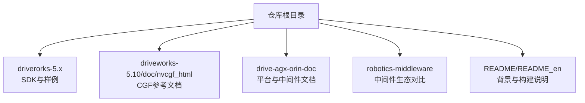
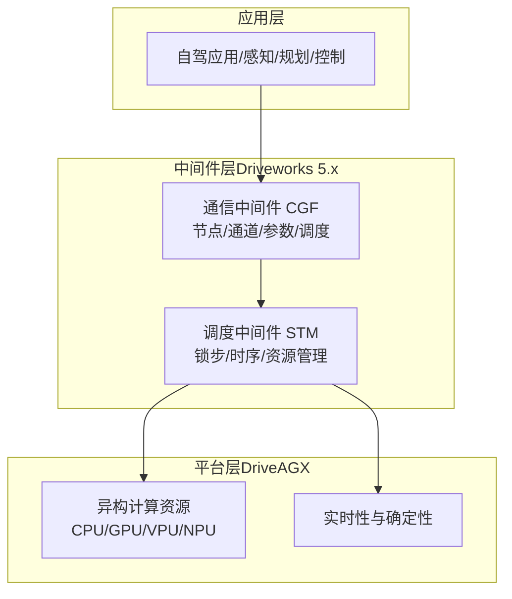
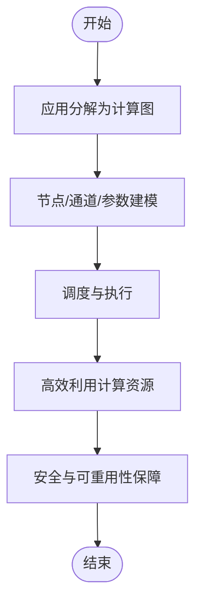
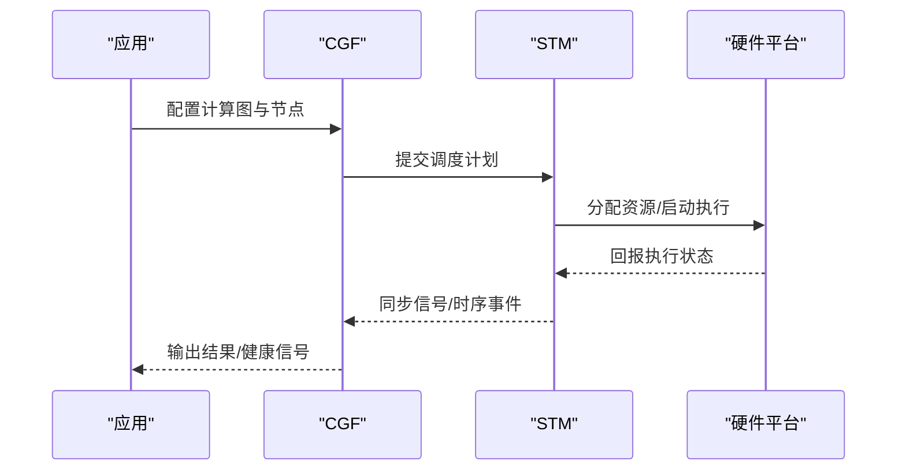
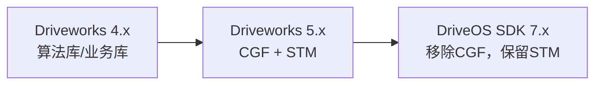
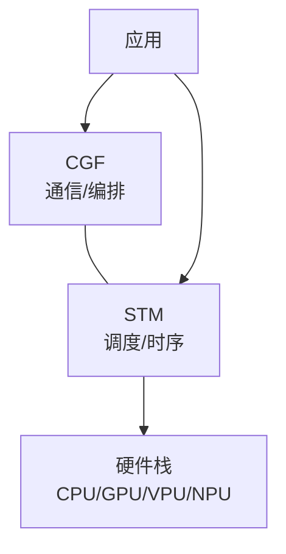

# 背景与定位

<cite>
**本文引用的文件**
- [README.md](file://README.md)
- [README_en.md](file://README_en.md)
- [cgf_introduction.html](file://driveworks-5.8/doc/nvcgf_html/cgf_introduction.html)
- [NVIDIA-STM-Userguide-do6050.pdf](file://drive-agx-orin-doc/3-drive-works/NVIDIA-STM-Userguide-do6050.pdf)
- [DRIVE-Platform-For-Developers-2302.pdf](file://drive-agx-orin-doc/0-overview/DRIVE-Platform-For-Developers-2302.pdf)
- [nvidia-drive-agx-thor-platform-for-developers-2509.pdf](file://drive-agx-orin-doc/0-overview/nvidia-drive-agx-thor-platform-for-developers-2509.pdf)
- [NvROS-Integration-nvmedia-and-eglstream-in-ROS-2021.pdf](file://robotics-middleware/driveworks-ROS-doc/NvROS-Integration-nvmedia-and-eglstream-in-ROS-2021.pdf)
- [Nvidia-OpenDDS-in-DriveOS-2021.pdf](file://robotics-middleware/driveworks-ROS-doc/Nvidia-OpenDDS-in-DriveOS-2021.pdf)
- [DriveWorks SDK migration](file://drive-agx-orin-doc/3-drive-works/DriveWorks SDK/migration/index.html)
</cite>

## 目录
1. [引言](#引言)
2. [项目结构](#项目结构)
3. [核心组件](#核心组件)
4. [架构总览](#架构总览)
5. [详细组件分析](#详细组件分析)
6. [依赖分析](#依赖分析)
7. [性能考虑](#性能考虑)
8. [故障排查指南](#故障排查指南)
9. [结论](#结论)
10. [附录](#附录)

## 引言
本文件聚焦于NVIDIA Driveworks在自动驾驶领域的定位与技术演进路径，重点阐述从4.x算法库到5.x中间件的技术升级动机，对比Driveworks与ROS2的核心差异与优势，说明中间件层在自动驾驶系统架构中的关键作用，并介绍NVIDIA DriveAGX边缘计算平台如何承载Driveworks，为OEM与Tier1提供端到端的自驾解决方案。

- NVIDIA以“平台+软件+生态”垂直整合策略，提供从边缘算力设备（如DriveAGX）到自驾中间件（Driveworks 5.x）的整体方案，覆盖开发、仿真、部署与调试全生命周期。
- Driveworks 4.x侧重算法与业务库；5.x引入通信中间件（CGF）与调度中间件（STM），并配套开发API与工具链，定位与ROS2类似，但强调在NVIDIA硬件栈上的深度优化与一致性。

章节来源
- [README.md:1-115](file://README.md#L1-L115)

## 项目结构
本仓库围绕Driveworks 5.x中间件展开，包含多版本SDK（5.8/5.10/5.14/520）、文档与示例，以及与DriveOS/DriveAGX平台相关的资料。核心目录与用途概览如下：
- driverorks-5.x：各版本SDK源码与样例，包含CGF/STM相关头文件、工具链与示例工程
- driveworks-5.10/doc/nvcgf_html：CGF参考文档（HTML）
- drive-agx-orin-doc：DriveAGX平台与Driveworks 5.x相关文档（含STM用户手册、平台介绍等）
- robotics-middleware：与ROS/ISAAC-ROS/eCAL等中间件生态的对比与关联文档
- README/README_en：项目背景、版本与构建流程说明

章节来源
- [README.md:71-115](file://README.md#L71-L115)
- [README_en.md:1-92](file://README_en.md#L1-L92)

## 核心组件
- 中间件层（5.x）：通信中间件（Compute Graph Framework，CGF）与调度中间件（Scheduling and Timing Middleware，STM）
- 边缘平台（DriveAGX）：提供高性能异构计算资源（CPU/GPU/VPU/NPU），支撑自驾应用的实时性与可靠性
- 开发工具链：CMake工具链、YAML调度生成、可视化与调试工具
- 生态集成：与DriveOS SDK融合，面向Thor平台提供统一的自驾软件栈

章节来源
- [README.md:22-62](file://README.md#L22-L62)
- [DRIVE-Platform-For-Developers-2302.pdf](file://drive-agx-orin-doc/0-overview/DRIVE-Platform-For-Developers-2302.pdf)

## 架构总览
下图展示Driveworks 5.x在自动驾驶系统中的位置与角色：作为中间件层，连接上层应用与底层硬件平台（DriveAGX），通过CGF进行节点间通信与数据流编排，通过STM进行确定性调度与时序控制。

图表来源
- [README.md:22-62](file://README.md#L22-L62)
- [NVIDIA-STM-Userguide-do6050.pdf](file://drive-agx-orin-doc/3-drive-works/NVIDIA-STM-Userguide-do6050.pdf)

## 详细组件分析

### CGF（通信中间件）
- 设计目标：将复杂应用分解为有向图形式的计算管线，高效利用计算资源，支持进程布局灵活性、实体间高效数据交换、安全与可重用性
- 关键能力：节点/通道/参数/调度的统一建模，支持跨进程/跨设备的数据通路
- 文档与定位：CGF参考文档明确其作为计算图框架的职责与价值

图表来源
- [cgf_introduction.html:104-116](file://driveworks-5.8/doc/nvcgf_html/cgf_introduction.html#L104-L116)

章节来源
- [cgf_introduction.html:104-116](file://driveworks-5.8/doc/nvcgf_html/cgf_introduction.html#L104-L116)

### STM（调度中间件）
- 能力概述：提供锁步同步、时序控制、资源调度与确定性执行，确保多核/多进程/多设备场景下的实时性
- 使用场景：在感知/定位/预测/控制等模块间建立严格的时序约束，保证系统稳定性与可验证性

图表来源
- [NVIDIA-STM-Userguide-do6050.pdf](file://drive-agx-orin-doc/3-drive-works/NVIDIA-STM-Userguide-do6050.pdf)

章节来源
- [README.md:22-62](file://README.md#L22-L62)

### 技术演进：从4.x到5.x
- 4.x：以算法与业务库为主，强调功能复用与快速集成
- 5.x：引入CGF/STM中间件层，强调系统级的通信与调度能力，定位与ROS2类似，但更贴合NVIDIA硬件栈
- 7.x：在DriveOS SDK中进一步整合，移除CGF，仅保留STM，强调开发者直接使用DW API

图表来源
- [README.md:9-21](file://README.md#L9-L21)
- [README.md:51-62](file://README.md#L51-L62)

章节来源
- [README.md:9-21](file://README.md#L9-L21)
- [README.md:51-62](file://README.md#L51-L62)

### 与ROS2的对比与优势
- 对比维度：中间件定位、通信模型、调度机制、与硬件栈的耦合度、工具链与生态
- Driveworks 5.x优势（据平台宣传材料）：在NVIDIA硬件栈上具备更优的一致性与性能，提供端到端的开发与部署体验
- 注意：仓库未包含官方对比文档原文，此处为基于平台资料的归纳总结

章节来源
- [README.md:26](file://README.md#L26)
- [DRIVE-Platform-For-Developers-2302.pdf](file://drive-agx-orin-doc/0-overview/DRIVE-Platform-For-Developers-2302.pdf)

### DriveAGX平台与OEM/Tier1支撑
- 平台特性：高性能异构计算、确定性执行、丰富的传感器接口与AI加速能力
- 解决方案：为OEM与Tier1提供从开发、仿真、部署到调试的完整工具链，降低集成复杂度与风险

章节来源
- [README.md:7](file://README.md#L7)
- [README.md:22-26](file://README.md#L22-L26)

## 依赖分析
- 组件耦合：CGF负责“如何连”，STM负责“何时做”，二者协同实现“可组合、可调度”的系统
- 外部依赖：与NVIDIA硬件栈（GPU/VPU/NPU）紧密耦合，同时提供跨进程/跨设备通信能力
- 迁移影响：7.x移除CGF后，开发者需直接使用DW API进行系统集成，对工程化能力提出更高要求

图表来源
- [README.md:51-62](file://README.md#L51-L62)

章节来源
- [README.md:51-62](file://README.md#L51-L62)

## 性能考虑
- 硬件栈优化：充分利用GPU/VPU/NPU的并行计算能力，结合STM的锁步与资源分配，提升端到端吞吐与延迟可控性
- 工具链效率：通过CMake工具链与自动调度生成，缩短构建与调试周期
- 实践建议：在节点设计中遵循数据局部性与流水线原则，合理划分通道与参数，避免热点瓶颈

章节来源
- [README_en.md:13-18](file://README_en.md#L13-L18)
- [README_en.md:20-27](file://README_en.md#L20-L27)

## 故障排查指南
- 常见问题线索：构建失败、运行时退出码、IPC/Socket异常、日志定位
- 排查步骤：确认工具链路径、检查调度YAML与STM生成产物、核对日志目录与IP栈配置、必要时清理日志后重试
- 社区支持：官方论坛标签“driveworks-cgf”可用于反馈与查询

章节来源
- [README_en.md:47-62](file://README_en.md#L47-L62)
- [README.md:45-49](file://README.md#L45-L49)

## 结论
Driveworks 5.x通过引入CGF与STM中间件层，实现了从算法库到系统级中间件的关键跃迁，与ROS2形成差异化竞争：在NVIDIA硬件栈上提供更强的一致性与端到端体验。结合DriveAGX平台，Driveworks为OEM与Tier1提供了从开发到部署的完整自驾解决方案。进入7.x后，随着CGF的移除，开发者需要更深入地掌握DW API与系统集成方法，这对工程化能力提出了更高要求。

## 附录
- 相关文档索引
  - CGF入门与参考：[cgf_introduction.html](file://driveworks-5.8/doc/nvcgf_html/cgf_introduction.html)
  - STM用户手册：[NVIDIA-STM-Userguide-do6050.pdf](file://drive-agx-orin-doc/3-drive-works/NVIDIA-STM-Userguide-do6050.pdf)
  - 平台介绍（含Driveworks定位）：[DRIVE-Platform-For-Developers-2302.pdf](file://drive-agx-orin-doc/0-overview/DRIVE-Platform-For-Developers-2302.pdf)
  - Thor平台文档（7.x架构）：[nvidia-drive-agx-thor-platform-for-developers-2509.pdf](file://drive-agx-orin-doc/0-overview/nvidia-drive-agx-thor-platform-for-developers-2509.pdf)
  - DriveWorks SDK迁移说明：[DriveWorks SDK migration](file://drive-agx-orin-doc/3-drive-works/DriveWorks SDK/migration/index.html)
  - ROS生态对比（NvROS/OpenDDS）：[NvROS-Integration-nvmedia-and-eglstream-in-ROS-2021.pdf](file://robotics-middleware/driveworks-ROS-doc/NvROS-Integration-nvmedia-and-eglstream-in-ROS-2021.pdf)，[Nvidia-OpenDDS-in-DriveOS-2021.pdf](file://robotics-middleware/driveworks-ROS-doc/Nvidia-OpenDDS-in-DriveOS-2021.pdf)