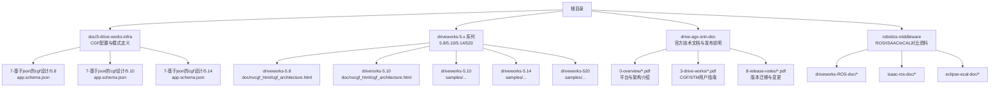
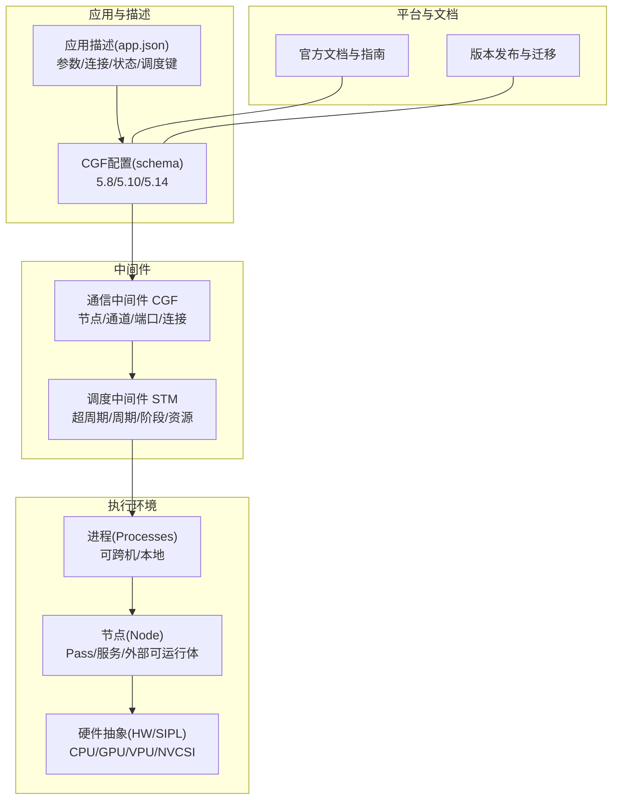
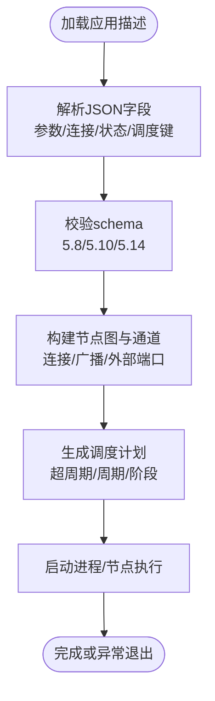
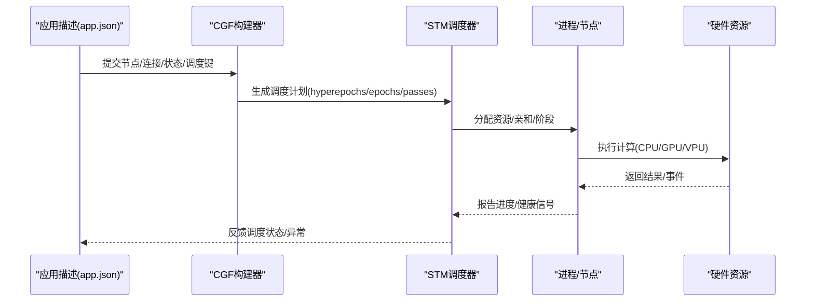
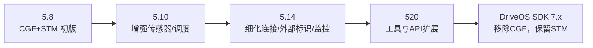
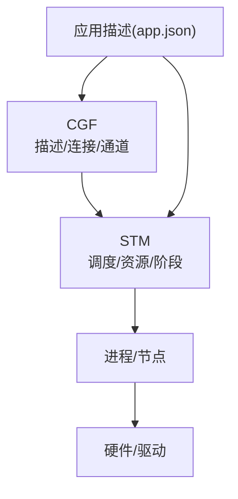

# 项目概述

<cite>
**本文引用的文件**
- [README.md](file://README.md)
- [README_en.md](file://README_en.md)
- [app.schema.json（5.8）](file://doc/3-drive-works-infra/7-基于json的cgf设计/5.8/app.schema.json)
- [app.schema.json（5.10）](file://doc/3-drive-works-infra/7-基于json的cgf设计/5.10/app.schema.json)
- [app.schema.json（5.14）](file://doc/3-drive-works-infra/7-基于json的cgf设计/5.14/app.schema.json)
- [cgf_architecture.html（5.8）](file://driveworks-5.8/doc/nvcgf_html/cgf_architecture.html)
- [cgf_architecture.html（5.10）](file://driverorks-5.10/doc/nvcgf_html/cgf_architecture.html)
- [NVIDIA DRIVE SDK_ The Foundation of AV Development-gtc-fall-2111.pdf](file://drive-agx-orin-doc/0-overview/NVIDIA DRIVE SDK_ The Foundation of AV Development-gtc-fall-2111.pdf)
- [nvidia-drive-agx-thor-platform-for-developers-2509.pdf](file://drive-agx-orin-doc/0-overview/nvidia-drive-agx-thor-platform-for-developers-2509.pdf)
- [NVIDIA-STM-Userguide-do6050.pdf](file://drive-agx-orin-doc/3-drive-works/NVIDIA-STM-Userguide-do6050.pdf)
- [DriveOS SDK 7.x 迁移指南](file://drive-agx-orin-doc/8-release-notes/NVIDIA_DRIVE_OS_6.0.5.0_Linux_Release_Notes.pdf)
</cite>

## 目录
1. [引言](#引言)
2. [项目结构](#项目结构)
3. [核心组件](#核心组件)
4. [架构总览](#架构总览)
5. [详细组件分析](#详细组件分析)
6. [依赖分析](#依赖分析)
7. [性能考虑](#性能考虑)
8. [故障排查指南](#故障排查指南)
9. [结论](#结论)
10. [附录](#附录)

## 引言
本文件面向NV Driveworks自动驾驶中间件项目，系统性梳理其从4.x算法库到5.x中间件架构的演进路径，明确其在自动驾驶生态中的定位与价值主张，并与ROS2等开源方案进行对比。同时，总结版本演进历史（5.8→5.10→5.14→520→DriveOS SDK 7.x），给出架构概览与核心组件关系说明，帮助读者快速理解Driveworks的整体设计与使用方式。

## 项目结构
仓库以版本与功能维度组织，包含多版本SDK、文档与示例，以及与中间件相关的核心子系统（CGF通信框架、STM调度中间件）。下图展示与本文目标最相关的目录与文件：

图表来源
- [README.md](file://README.md)
- [app.schema.json（5.8）](file://doc/3-drive-works-infra/7-基于json的cgf设计/5.8/app.schema.json)
- [app.schema.json（5.10）](file://doc/3-drive-works-infra/7-基于json的cgf设计/5.10/app.schema.json)
- [app.schema.json（5.14）](file://doc/3-drive-works-infra/7-基于json的cgf设计/5.14/app.schema.json)
- [cgf_architecture.html（5.8）](file://driveworks-5.8/doc/nvcgf_html/cgf_architecture.html)
- [cgf_architecture.html（5.10）](file://driverorks-5.10/doc/nvcgf_html/cgf_architecture.html)

章节来源
- [README.md](file://README.md)
- [README_en.md](file://README_en.md)

## 核心组件
- 中间件层（5.x）：Driveworks 5.x引入通信中间件CGF与调度中间件STM，形成“应用描述+节点图+调度”的一体化开发范式，定位与ROS2类似。
- 驱动与工具链：提供SDK、样例工程、构建脚本与运行时工具，覆盖从开发、编译、部署到调试的全流程。
- 版本演进：从5.8到5.14，CGF配置模型逐步完善；520进一步扩展；DriveOS SDK 7.x移除CGF，仅保留STM，强调直接API调用与自集成。

章节来源
- [README.md](file://README.md)
- [NVIDIA-STM-Userguide-do6050.pdf](file://drive-agx-orin-doc/3-drive-works/NVIDIA-STM-Userguide-do6050.pdf)

## 架构总览
下图展示Driveworks 5.x在DriveAGX平台上的典型架构：应用通过CGF描述节点与连接，经由STM生成调度计划，驱动多进程/多核执行；520及DriveOS SDK 7.x中，CGF被移除，STM继续保留，开发者需自行完成组件集成。

图表来源
- [app.schema.json（5.8）](file://doc/3-drive-works-infra/7-基于json的cgf设计/5.8/app.schema.json)
- [app.schema.json（5.10）](file://doc/3-drive-works-infra/7-基于json的cgf设计/5.10/app.schema.json)
- [app.schema.json（5.14）](file://doc/3-drive-works-infra/7-基于json的cgf设计/5.14/app.schema.json)
- [NVIDIA-STM-Userguide-do6050.pdf](file://drive-agx-orin-doc/3-drive-works/NVIDIA-STM-Userguide-do6050.pdf)

## 详细组件分析

### CGF（通信中间件）
- 职责：以JSON描述应用拓扑（子组件、连接、参数集、WCET集、状态机与调度键），统一管理节点间数据流与控制流。
- 版本演进：
  - 5.8：基础字段完备，支持日志、传感器布局、连接与调度键。
  - 5.10：新增“所需传感器”“传感器映射查找”“别名分组”等，提升多传感器布局适配能力。
  - 5.14：增强连接排序规则、外部标识符支持、服务pass引用、监控阈值等，调度表达更丰富。
- 关键字段（示意）：name、logSpec、parameters、requiredSensors、sensorMappingLookups、sensorMappings、subcomponents、connections、namedParameterSets、namedWCETSets、states、stmSchedules、stmExternalRunnables、processes。

图表来源
- [app.schema.json（5.8）](file://doc/3-drive-works-infra/7-基于json的cgf设计/5.8/app.schema.json)
- [app.schema.json（5.10）](file://doc/3-drive-works-infra/7-基于json的cgf设计/5.10/app.schema.json)
- [app.schema.json（5.14）](file://doc/3-drive-works-infra/7-基于json的cgf设计/5.14/app.schema.json)

章节来源
- [app.schema.json（5.8）](file://doc/3-drive-works-infra/7-基于json的cgf设计/5.8/app.schema.json)
- [app.schema.json（5.10）](file://doc/3-drive-works-infra/7-基于json的cgf设计/5.10/app.schema.json)
- [app.schema.json（5.14）](file://doc/3-drive-works-infra/7-基于json的cgf设计/5.14/app.schema.json)

### STM（调度中间件）
- 职责：基于超周期/周期/阶段的确定性调度，结合WCET与资源亲和，保障实时性与可预测性。
- 关键概念：hyperepochs → epochs → passes → aliasGroups → resources；支持外部可运行体（EXTERN）与依赖约束。
- 用户指南：参见官方STM用户手册，涵盖调度建模、生成与验证流程。

图表来源
- [NVIDIA-STM-Userguide-do6050.pdf](file://drive-agx-orin-doc/3-drive-works/NVIDIA-STM-Userguide-do6050.pdf)
- [app.schema.json（5.14）](file://doc/3-drive-works-infra/7-基于json的cgf设计/5.14/app.schema.json)

章节来源
- [NVIDIA-STM-Userguide-do6050.pdf](file://drive-agx-orin-doc/3-drive-works/NVIDIA-STM-Userguide-do6050.pdf)

### 版本演进与架构变迁
- 5.8：首次引入CGF与STM，奠定“应用描述+节点图+调度”的基础。
- 5.10：增强传感器与调度能力，完善schema与工具链。
- 5.14：进一步细化连接/外部标识/服务pass引用与监控阈值，提升复杂场景适配。
- 520：继续扩展工具与API，保持与5.14兼容的同时引入新特性。
- DriveOS SDK 7.x：移除CGF，仅保留STM，鼓励直接API调用与自集成，降低中间层抽象带来的耦合度。

图表来源
- [README.md](file://README.md)
- [DriveOS SDK 7.x 迁移指南](file://drive-agx-orin-doc/8-release-notes/NVIDIA_DRIVE_OS_6.0.5.0_Linux_Release_Notes.pdf)

章节来源
- [README.md](file://README.md)
- [DriveOS SDK 7.x 迁移指南](file://drive-agx-orin-doc/8-release-notes/NVIDIA_DRIVE_OS_6.0.5.0_Linux_Release_Notes.pdf)

### 与ROS2等开源方案的对比
- 对比维度：中间件定位、通信模型、确定性调度、工具链与生态。
- Driveworks 5.x：强调“应用描述+CGF+STM”的端到端中间件方案，具备更强的确定性与时序控制能力；520/7.x后更偏向直接API与自集成。
- ROS2：以DDS为核心，强调松耦合与分布式，适合多机器人/多域协作；在确定性方面不如STM。
- 其他方案：eCAL/ISAAC-ROS等各有侧重，可作为参考或替代选择。

章节来源
- [README.md](file://README.md)

## 依赖分析
- 组件内聚与耦合：CGF负责“描述与连接”，STM负责“调度与资源”，二者通过应用描述衔接；520/7.x后耦合度下降，开发者需自行集成。
- 外部依赖：平台SDK、NVCSI/SIPL、CUDA/TensorRT等；工具链依赖CMake与特定工具链文件。
- 潜在循环依赖：通过“描述→构建→调度→执行”的单向流程避免；注意在自集成场景中避免节点间循环依赖。

图表来源
- [app.schema.json（5.14）](file://doc/3-drive-works-infra/7-基于json的cgf设计/5.14/app.schema.json)
- [NVIDIA-STM-Userguide-do6050.pdf](file://drive-agx-orin-doc/3-drive-works/NVIDIA-STM-Userguide-do6050.pdf)

章节来源
- [app.schema.json（5.14）](file://doc/3-drive-works-infra/7-基于json的cgf设计/5.14/app.schema.json)

## 性能考虑
- 确定性调度：利用STM的超周期/周期/阶段模型，结合WCET与资源亲和，确保关键路径的时序约束。
- 数据通路优化：通过CGF的连接与广播机制减少冗余拷贝，合理划分节点粒度。
- 硬件亲和：将计算密集型任务绑定至GPU/CPU/VPU，避免跨域通信瓶颈。
- 工具链与验证：使用官方生成的调度与YAML，配合日志与监控阈值，持续评估性能与稳定性。

## 故障排查指南
- 常见问题线索：
  - CGF连接错误：检查源/目的端口命名、数组索引、外部标识符前缀。
  - 调度冲突：核对阶段/资源亲和/别名分组是否导致竞争。
  - 外部可运行体：确认WCET与依赖项设置正确。
- 定位手段：查看日志规范、使用生成的调度与YAML、启用监控阈值。
- 社区支持：官方论坛标签“driveworks-cgf”可用于反馈与查询。

章节来源
- [README_en.md](file://README_en.md)

## 结论
Driveworks从4.x算法库发展为5.x中间件，以CGF+STM为核心，提供从描述、调度到执行的一体化能力；在DriveOS SDK 7.x中，CGF被移除，STM继续保留，鼓励开发者直接API调用与自集成。相比ROS2，Driveworks在确定性与时序控制方面更具优势；与eCAL/ISAAC-ROS等方案相比，各有适用场景。建议根据项目对确定性、工具链与生态的需求，选择合适的版本与集成策略。

## 附录
- 平台与文档：参阅官方Overview与STM用户指南，获取最新平台与架构介绍。
- 示例与工具：参考samples目录与构建脚本，按README与README_en.md指引完成编译与运行。

章节来源
- [NVIDIA DRIVE SDK_ The Foundation of AV Development-gtc-fall-2111.pdf](file://drive-agx-orin-doc/0-overview/NVIDIA DRIVE SDK_ The Foundation of AV Development-gtc-fall-2111.pdf)
- [nvidia-drive-agx-thor-platform-for-developers-2509.pdf](file://drive-agx-orin-doc/0-overview/nvidia-drive-agx-thor-platform-for-developers-2509.pdf)
- [README_en.md](file://README_en.md)